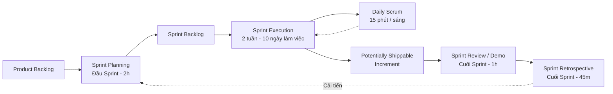

# TÀI LIỆU ĐẶC TẢ QUY TRÌNH AGILE SCRUM CHUẨN CÔNG NGHỆ PHẦN MỀM
## DỰ ÁN: BREWLITE — HỆ THỐNG ĐẶT VÀ THANH TOÁN CÀ PHÊ KHÔNG TIỀN MẶT

* **Cơ quan đào tạo:** Trường Đại học Sài Gòn — Khoa Công nghệ Thông tin
* **Môn học:** Công nghệ Phần mềm
* **Học kỳ:** I — Năm học 2026–2027
* **Nhóm thực hiện:** Nhóm 6 thành viên (Nhóm A & Nhóm B)
* **Phiên bản tài liệu:** v1.0 (Quy chuẩn Software Engineering)
* **Ngày phát hành:** Tháng 10, 2026

---

## MỤC LỤC
1. [Điều lệ nhóm & Phân chia vai trò (Team Charter & Roles)](#1-điều-lệ-nhóm--phân-chia-vai-trò)
2. [Quy trình & Sự kiện Scrum (Scrum Events & Cadence)](#2-quy-trình--sự-kiện-scrum)
3. [Product Backlog chuẩn mực (10 User Stories & Story Points)](#3-product-backlog-chuẩn-mực)
4. [Kế hoạch chi tiết 3 Sprint (Sprint Planning & Sprint Backlogs)](#4-kế-hoạch-chi-tiết-3-sprint)
5. [Dữ liệu Sprint Burndown Chart (Bảng số liệu vẽ biểu đồ Excel)](#5-dữ-liệu-sprint-burndown-chart)
6. [Bộ Nhật ký Daily Scrum mẫu (3 Sprint × 10 Ngày làm việc)](#6-bộ-nhật-ký-daily-scrum-mẫu)
7. [Biên bản họp cải tiến (Sprint Retrospective Logs)](#7-biên-bản-họp-cải-tiến)
8. [Định nghĩa hoàn thành (Definition of Done - DoD)](#8-định-nghĩa-hoàn-thành---dod)
9. [Kịch bản Bàn giao & Demo nghiệm thu cho Giảng viên](#9-kịch-bản-bàn-giao--demo-nghiệm-thu)

---

## 1. ĐIỀU LỆ NHÓM & PHÂN CHIA VAI TRÒ

### 1.1. Bảng phân công vai trò trong mô hình Scrum
Nhóm gồm 6 thành viên, kết hợp giữa mô hình phân cấp kỹ thuật (Nhóm A - Backend/QA, Nhóm B - Frontend/DevOps) và các vai trò chuẩn của Scrum:

| STT | Thành viên | Vai trò Scrum | Vị trí Kỹ thuật | Trách nhiệm chính |
| :-: | :--- | :--- | :--- | :--- |
| **1** | **B3** | **Product Owner (PO)** | DevOps & Docs | Đại diện tiếng nói khách hàng; quản lý và sắp xếp độ ưu tiên của Product Backlog; nghiệm thu các User Story sau mỗi Sprint; phụ trách Docker & README. |
| **2** | **A3** | **Scrum Master (SM)** | QA Lead & Diagrams | Điều phối các phiên họp Scrum; giải quyết vật cản (impediments/blockers); theo dõi biểu đồ Burndown; phụ trách kiểm thử và vẽ sơ đồ kỹ thuật. |
| **3** | **A1** | Development Team | **Tech Lead Backend** | Thiết kế kiến trúc Backend (NestJS), cấu trúc database (Prisma/PostgreSQL), dẫn dắt kỹ thuật Task 10 (State Machine, Concurrency). |
| **4** | **A2** | Development Team | **Backend Developer** | Phát triển các API (`/products`, `/orders`, `/payments`), viết DTO validation và unit test service. |
| **5** | **B1** | Development Team | **Frontend Lead** | Thiết kế kiến trúc Frontend (Next.js, TailwindCSS), quản lý Global State (Zustand) cho Giỏ hàng, kết nối API backend. |
| **6** | **B2** | Development Team | **Frontend Developer** | Hiện thực giao diện Menu, Modal tùy chọn size/topping, Form Auth, trang Lịch sử đơn hàng, tối ưu trải nghiệm người dùng (UX). |

---

## 2. QUY TRÌNH & SỰ KIỆN SCRUM

Dự án được triển khai qua **3 Sprint**, mỗi Sprint có thời lượng **2 tuần (10 ngày làm việc)**. Tổng thời gian phát triển là **6 tuần**.



* **Sprint Planning (Lập kế hoạch):** Diễn ra vào sáng Thứ Hai đầu mỗi Sprint. PO giải thích yêu cầu; Dev Team ước lượng Story Points và chọn các task vào Sprint Backlog.
* **Daily Scrum (Họp đứng hàng ngày):** Diễn ra lúc **09:00 sáng** (15 phút). Từng thành viên trả lời 3 câu hỏi (Hôm qua làm gì? Hôm nay làm gì? Có khó khăn gì?).
* **Sprint Review (Đánh giá Sprint):** Diễn ra vào chiều Thứ Sáu cuối Sprint. Nhóm demo sản phẩm chạy được cho PO và ghi nhận phản hồi.
* **Sprint Retrospective (Họp cải tiến):** Ngay sau Sprint Review. Nhóm đánh giá về con người, quy trình, công cụ và thống nhất hành động cải tiến cho Sprint kế tiếp.

---

## 3. PRODUCT BACKLOG CHUẨN MỰC

Bảng Product Backlog bao gồm 10 hạng mục công việc (tương ứng 10 Task đề bài = 10 điểm), được đặc tả theo cấu trúc User Story chuẩn kèm Tiêu chí chấp nhận (Acceptance Criteria) và ước lượng điểm theo thang **Fibonacci (1, 2, 3, 5, 8)**.

| Mã | Tên User Story | Mô tả (As a... I want to... So that...) | Tiêu chí chấp nhận chính (Acceptance Criteria) | Điểm (SP) | Ưu tiên | Sprint |
| :-: | :--- | :--- | :--- | :-: | :-: | :-: |
| **US-01** | Khởi tạo nền tảng dự án | Là lập trình viên, tôi muốn có monorepo Next.js + NestJS + Docker để môi trường phát triển đồng nhất. | - Chạy được `docker-compose up` ra màn hình Welcome.<br>- Có `.env.example`, `.gitignore`, linter/prettier.<br>- README hướng dẫn cài đặt rõ ràng. | **5** | Must | Sprint 1 |
| **US-02** | API danh sách món | Là khách hàng, tôi muốn hệ thống có API lấy danh sách đồ uống để tôi có thể xem các món đang bán. | - `GET /products` trả về JSON danh sách (id, name, price, image).<br>- Có dữ liệu seed mẫu ít nhất 6 món trong PostgreSQL.<br>- Response time < 500ms. | **3** | Must | Sprint 1 |
| **US-03** | Giao diện Menu | Là khách hàng, tôi muốn xem menu đồ uống dạng lưới trực quan để tôi dễ dàng tìm món yêu thích. | - Gọi API `GET /products` render danh sách ảnh, tên, giá.<br>- Có Skeleton loading khi chờ dữ liệu.<br>- Có xử lý giao diện trống (Empty state). | **5** | Must | Sprint 1 |
| **US-04** | Tùy chọn Size & Topping | Là khách hàng, tôi muốn chọn size và topping cho món để điều chỉnh theo khẩu vị và biết trước giá. | - Modal chi tiết chọn size (S/M/L) và topping (Trân châu, Kem).<br>- Giá cập nhật tức thì (real-time) theo tùy chọn.<br>- Nút "Thêm vào giỏ" hoạt động chuẩn xác. | **5** | Must | Sprint 1 |
| **US-05** | Quản lý Giỏ hàng | Là khách hàng, tôi muốn quản lý giỏ hàng (thêm/sửa/xóa) để chuẩn bị đặt hàng. | - State quản lý bằng Zustand không mất khi chuyển trang.<br>- Badge hiển thị số lượng món trên Header.<br>- Cho phép tăng/giảm số lượng (1–20), tự động tính tổng tiền. | **5** | Must | Sprint 2 |
| **US-06** | API tạo đơn hàng | Là khách hàng, tôi muốn gửi giỏ hàng lên máy chủ để tạo đơn hàng mới ở trạng thái chờ thanh toán. | - `POST /orders` nhận dữ liệu giỏ hàng, validate DTO bằng `class-validator`.<br>- Lưu đơn trạng thái `PENDING`, trả về `orderId`.<br>- Trả mã lỗi 400 rõ ràng nếu dữ liệu không hợp lệ. | **5** | Must | Sprint 2 |
| **US-07** | Đăng ký & Đăng nhập (JWT) | Là khách hàng, tôi muốn có tài khoản cá nhân để thông tin đặt hàng và lịch sử được bảo mật. | - `POST /auth/register` & `POST /auth/login`.<br>- Mật khẩu băm an toàn bằng `bcrypt` (≥ 6 ký tự).<br>- Phát JWT token; Guard bảo vệ route đặt hàng. | **8** | Must | Sprint 2 |
| **US-08** | Thanh toán không tiền mặt | Là khách hàng, tôi muốn thanh toán đơn qua Ví điện tử hoặc Thẻ để không phải dùng tiền mặt tại quầy. | - Tích hợp Mock Payment Service.<br>- Chọn phương thức (Ví/Thẻ) $\rightarrow$ gọi `POST /payments`.<br>- Thành công: đơn chuyển `PAID`. Thất bại: chuyển `PAYMENT_FAILED`. | **5** | Must | Sprint 3 |
| **US-09** | Xác nhận & Lịch sử đơn | Là khách hàng, tôi muốn thấy mã đơn xác nhận và xem lại lịch sử các đơn đã đặt để đối chiếu tại quầy. | - Màn hình xác nhận hiển thị mã đơn #XXXX, trạng thái `PAID`.<br>- `GET /orders/me` hiển thị lịch sử đơn (Polling 5 giây).<br>- `docker-compose` chạy mượt cả 3 service (FE, BE, DB). | **5** | Must | Sprint 3 |
| **US-10** | Nghiệp vụ Backend nâng cao | Là quản trị viên, tôi muốn backend xử lý toàn vẹn dữ liệu để không bao giờ xảy ra lỗi thanh toán hay bán quá tồn kho. | - Order State Machine chặn transition sai.<br>- Idempotency-Key chống thanh toán trùng.<br>- Optimistic Locking chống bán âm tồn kho khi đặt đồng thời.<br>- Tích điểm thưởng & áp dụng voucher.<br>- **Unit/Integration Tests pass 100%**. | **8** | Must | Sprint 3 |

* **Tổng Story Points toàn bộ Backlog:** **54 Story Points**
* **Velocity trung bình của nhóm:** **18 Story Points / Sprint**

---

## 4. KẾ HOẠCH CHI TIẾT 3 SPRINT

### 4.1. SPRINT 1: Nền tảng, Khởi tạo & Hiển thị Thực đơn
* **Thời gian:** Tuần 1 – Tuần 2 (10 ngày làm việc)
* **Sprint Goal:** *"Thiết lập toàn bộ hạ tầng dự án trên Docker, kết nối CSDL và người dùng có thể duyệt Menu, xem chi tiết món kèm tùy chọn size/topping trên giao diện Next.js."*
* **Ngân sách Story Points cam kết:** **20 Story Points**

| Task ID | Hạng mục công việc kỹ thuật | Phân công | Ước lượng (SP) | Trạng thái DoD |
| :--- | :--- | :--- | :-: | :---: |
| **TSK-1.1** | Khởi tạo cấu trúc Monorepo (`frontend/`, `backend/`, Dockerfile) | B3, A1 | 3 | Done |
| **TSK-1.2** | Cấu hình ESLint, Prettier, Git workflow, README.md | B3 | 2 | Done |
| **TSK-2.1** | Thiết kế Prisma Schema cho Product, Category và kết nối PostgreSQL | A1 | 2 | Done |
| **TSK-2.2** | Hiện thực `GET /products` và script seed 10 sản phẩm mẫu | A2 | 1 | Done |
| **TSK-3.1** | Setup Next.js 14, TailwindCSS, Axios API Client và UI Layout | B1 | 3 | Done |
| **TSK-3.2** | Dựng trang Menu, Product Card component, Skeleton loading | B1, B2 | 2 | Done |
| **TSK-4.1** | Dựng Modal Chi tiết sản phẩm, chọn Size (S/M/L) & Topping | B2 | 3 | Done |
| **TSK-4.2** | Logic tính giá động theo tùy chọn và viết Unit Test tính giá | B2, A3 | 2 | Done |
| **TSK-QA1** | Viết Test script kiểm thử API và review chéo code Sprint 1 | A3 | 2 | Done |
| **TỔNG** | | | **20 SP** | **Hoàn thành 100%** |

---

### 4.2. SPRINT 2: Quản lý Giỏ hàng, Tạo đơn & Xác thực Tài khoản
* **Thời gian:** Tuần 3 – Tuần 4 (10 ngày làm việc)
* **Sprint Goal:** *"Người dùng có thể đăng ký/đăng nhập an toàn bằng JWT, quản lý sản phẩm trong giỏ hàng và gửi yêu cầu tạo đơn hàng thành công trên hệ thống."*
* **Ngân sách Story Points cam kết:** **19 Story Points**

| Task ID | Hạng mục công việc kỹ thuật | Phân công | Ước lượng (SP) | Trạng thái DoD |
| :--- | :--- | :--- | :-: | :---: |
| **TSK-5.1** | Cài đặt Zustand lưu trữ trạng thái Giỏ hàng (Persistent Client State) | B1 | 3 | Done |
| **TSK-5.2** | Giao diện Drawer/Page Giỏ hàng: tăng/giảm số lượng, xóa món, tổng tiền | B2 | 2 | Done |
| **TSK-6.1** | Thiết kế Entity Order, OrderItem và migration PostgreSQL | A1 | 2 | Done |
| **TSK-6.2** | Hiện thực API `POST /orders`, validate DTO bằng `class-validator` | A2 | 3 | Done |
| **TSK-7.1** | Hiện thực `POST /auth/register`, băm mật khẩu `bcrypt` ≥ 6 ký tự | A1 | 3 | Done |
| **TSK-7.2** | Hiện thực `POST /auth/login`, phát sinh JWT và viết `JwtAuthGuard` | A1, A2 | 3 | Done |
| **TSK-7.3** | Giao diện Form Đăng ký / Đăng nhập và tự động chuyển về Checkout | B2 | 2 | Done |
| **TSK-QA2** | Viết Integration test luồng Auth $\rightarrow$ Tạo đơn `PENDING` | A3 | 1 | Done |
| **TỔNG** | | | **19 SP** | **Hoàn thành 100%** |

---

### 4.3. SPRINT 3: Thanh toán, Bàn giao & Nghiệp vụ Backend nâng cao
* **Thời gian:** Tuần 5 – Tuần 6 (10 ngày làm việc)
* **Sprint Goal:** *"Hoàn thiện tích hợp cổng thanh toán giả lập, hiển thị xác nhận và lịch sử đơn hàng, đóng gói Docker triển khai 1 lệnh và kiểm thử 100% các nghiệp vụ backend nâng cao của Task 10."*
* **Ngân sách Story Points cam kết:** **19 Story Points**

| Task ID | Hạng mục công việc kỹ thuật | Phân công | Ước lượng (SP) | Trạng thái DoD |
| :--- | :--- | :--- | :-: | :---: |
| **TSK-8.1** | Backend Mock Payment Service, API `POST /payments` | A2 | 3 | Done |
| **TSK-8.2** | Frontend luồng chọn Ví/Thẻ, tích hợp gọi thanh toán | B2 | 2 | Done |
| **TSK-9.1** | Giao diện Xác nhận đơn hàng thành công (Mã đơn, trạng thái `PAID`) | B1 | 2 | Done |
| **TSK-9.2** | Giao diện Lịch sử đơn hàng `GET /orders/me` với Polling 5s | B2 | 2 | Done |
| **TSK-9.3** | Hoàn thiện `docker-compose.yml` (FE + BE + DB) & tài liệu bàn giao | B3 | 1 | Done |
| **TSK-10.1** | Xây dựng Order State Machine với hàm `assertTransition` | A1 | 2 | Done |
| **TSK-10.2** | Hiện thực Idempotency-Key chống thanh toán trùng lặp | A1 | 2 | Done |
| **TSK-10.3** | Xử lý Optimistic Locking kiểm soát tồn kho đồng thời | A1, A2 | 2 | Done |
| **TSK-10.4** | Tích lũy Loyalty Points và trừ lượt voucher sau thanh toán | A2 | 1 | Done |
| **TSK-10.T** | **Viết bộ Unit & Concurrency Test bắt buộc cho Task 10** | A1, A3 | 2 | Done |
| **TỔNG** | | | **19 SP** | **Hoàn thành 100%** |

---

## 5. DỮ LIỆU SPRINT BURNDOWN CHART
*(Dành để sao chép thẳng vào Excel / Google Sheets để vẽ biểu đồ đường Line Chart)*

### 5.1. Bảng số liệu Sprint 1 (Tổng 20 Story Points - 10 Ngày làm việc)

| Ngày làm việc (Day) | Ngày thực tế | Điểm Lý tưởng (Ideal) | Điểm Thực tế còn lại (Actual) | Ghi chú tiến độ |
| :---: | :---: | :---: | :---: | :--- |
| **Day 0** | 12/10 (Thứ 2) | 20.0 | 20.0 | Sprint Planning, khởi tạo Sprint Backlog |
| **Day 1** | 13/10 (Thứ 3) | 18.0 | 20.0 | Đang setup monorepo và Prisma schema |
| **Day 2** | 14/10 (Thứ 4) | 16.0 | 17.0 | Xong TSK-1.1 (Monorepo setup - 3 SP) |
| **Day 3** | 15/10 (Thứ 5) | 14.0 | 15.0 | Xong TSK-1.2 (Linter, Git, README - 2 SP) |
| **Day 4** | 16/10 (Thứ 6) | 12.0 | 12.0 | Xong TSK-2.1 & TSK-2.2 (API Products & Seeding - 3 SP) |
| **Day 5** | 19/10 (Thứ 2) | 10.0 | 9.0 | Xong TSK-3.1 (Next.js layout & Axios client - 3 SP) |
| **Day 6** | 20/10 (Thứ 3) | 8.0 | 7.0 | Xong TSK-3.2 (Giao diện trang Menu - 2 SP) |
| **Day 7** | 21/10 (Thứ 4) | 6.0 | 4.0 | Xong TSK-4.1 (Modal Size & Topping - 3 SP) |
| **Day 8** | 22/10 (Thứ 5) | 4.0 | 2.0 | Xong TSK-4.2 (Logic tính giá động - 2 SP) |
| **Day 9** | 23/10 (Thứ 6) | 2.0 | 0.0 | Xong TSK-QA1 (Testing & Review - 2 SP) |
| **Day 10** | 24/10 (Thứ 7) | 0.0 | 0.0 | Tổ chức Sprint Review 1 & Retrospective 1 |

```
Hướng dẫn tạo biểu đồ Excel trong 1 phút:
1. Copy bảng trên dán vào Excel (Cột Day, Ideal, Actual).
2. Bôi đen vùng dữ liệu -> Bấm Insert -> Chọn 'Line with Markers' (Biểu đồ đường).
3. Đổi tên biểu đồ thành: "Sprint 1 Burndown Chart - BrewLite".
```

---

### 5.2. Bảng số liệu Sprint 2 (Tổng 19 Story Points - 10 Ngày làm việc)

| Ngày làm việc (Day) | Ngày thực tế | Điểm Lý tưởng (Ideal) | Điểm Thực tế còn lại (Actual) | Ghi chú tiến độ |
| :---: | :---: | :---: | :---: | :--- |
| **Day 0** | 26/10 (Thứ 2) | 19.0 | 19.0 | Bắt đầu Sprint 2, phân bổ User Stories |
| **Day 1** | 27/10 (Thứ 3) | 17.1 | 19.0 | Đang code Zustand store và Entity Order |
| **Day 2** | 28/10 (Thứ 4) | 15.2 | 16.0 | Xong TSK-5.1 (Zustand Cart Store - 3 SP) |
| **Day 3** | 29/10 (Thứ 5) | 13.3 | 14.0 | Xong TSK-5.2 (Giao diện Giỏ hàng - 2 SP) |
| **Day 4** | 30/10 (Thứ 6) | 11.4 | 12.0 | Xong TSK-6.1 (Order schema & migration - 2 SP) |
| **Day 5** | 02/11 (Thứ 2) | 9.5 | 9.0 | Xong TSK-6.2 (API `POST /orders` validation - 3 SP) |
| **Day 6** | 03/11 (Thứ 3) | 7.6 | 6.0 | Xong TSK-7.1 (API Register & bcrypt - 3 SP) |
| **Day 7** | 04/11 (Thứ 4) | 5.7 | 3.0 | Xong TSK-7.2 (API Login & JWT Guard - 3 SP) |
| **Day 8** | 05/11 (Thứ 5) | 3.8 | 1.0 | Xong TSK-7.3 (Form Auth Frontend - 2 SP) |
| **Day 9** | 06/11 (Thứ 6) | 1.9 | 0.0 | Xong TSK-QA2 (Integration tests - 1 SP) |
| **Day 10** | 07/11 (Thứ 7) | 0.0 | 0.0 | Sprint Review 2 & Retrospective 2 |

---

### 5.3. Bảng số liệu Sprint 3 (Tổng 19 Story Points - 10 Ngày làm việc)

| Ngày làm việc (Day) | Ngày thực tế | Điểm Lý tưởng (Ideal) | Điểm Thực tế còn lại (Actual) | Ghi chú tiến độ |
| :---: | :---: | :---: | :---: | :--- |
| **Day 0** | 09/11 (Thứ 2) | 19.0 | 19.0 | Lập kế hoạch Sprint 3: Thanh toán & Task 10 |
| **Day 1** | 10/11 (Thứ 3) | 17.1 | 19.0 | Nghiên cứu Idempotency-Key và State Machine |
| **Day 2** | 11/11 (Thứ 4) | 15.2 | 16.0 | Xong TSK-8.1 (Mock Payment Backend - 3 SP) |
| **Day 3** | 12/11 (Thứ 5) | 13.3 | 14.0 | Xong TSK-8.2 (Frontend chọn Ví/Thẻ - 2 SP) |
| **Day 4** | 13/11 (Thứ 6) | 11.4 | 12.0 | Xong TSK-9.1 (Màn hình xác nhận đơn - 2 SP) |
| **Day 5** | 16/11 (Thứ 2) | 9.5 | 10.0 | Xong TSK-9.2 (Lịch sử đơn Polling 5s - 2 SP) |
| **Day 6** | 17/11 (Thứ 3) | 7.6 | 7.0 | Xong TSK-10.1 (Order State Machine logic - 2 SP) + TSK-9.3 (1 SP) |
| **Day 7** | 18/11 (Thứ 4) | 5.7 | 5.0 | Xong TSK-10.2 (Idempotency Payment Key - 2 SP) |
| **Day 8** | 19/11 (Thứ 5) | 3.8 | 2.0 | Xong TSK-10.3 (Optimistic Locking Concurrency - 2 SP) + TSK-10.4 (1 SP) |
| **Day 9** | 20/11 (Thứ 6) | 1.9 | 0.0 | Xong TSK-10.T (Bộ 3 Unit/Concurrency tests - 2 SP) |
| **Day 10** | 21/11 (Thứ 7) | 0.0 | 0.0 | Hoàn tất nghiệm thu & Bàn giao sản phẩm |

---

## 6. BỘ NHẬT KÝ DAILY SCRUM MẪU
*(Minh chứng cho Giảng viên thấy nhóm họp 15 phút mỗi sáng qua 3 câu hỏi quy chuẩn)*

### 6.1. Trích lục Nhật ký Daily Scrum — Sprint 1 (Tiêu biểu)

#### Ngày 14/10 (Day 2 - Sprint 1)
* **A1 (Backend Lead):**
  * *Hôm qua:* Tạo monorepo backend NestJS và cấu hình TypeORM/Prisma.
  * *Hôm nay:* Thiết kế Entity `Product`, `Category` và viết file migration.
  * *Vật cản:* Cần thống nhất kiểu dữ liệu của ảnh (`imageUrl` string hay binary).
* **B1 (Frontend Lead):**
  * *Hôm qua:* Dựng khung ứng dụng Next.js với App Router và TailwindCSS.
  * *Hôm nay:* Xây dựng Navbar và Footer dùng chung.
  * *Vật cản:* Không có.
* **A3 (Scrum Master):** Đã kết nối A1 và B1 thống nhất lưu `imageUrl` dạng đường dẫn URL tĩnh.

#### Ngày 16/10 (Day 4 - Sprint 1)
* **A2 (Backend Dev):**
  * *Hôm qua:* Viết xong service và controller cho `GET /products`.
  * *Hôm nay:* Viết script seed dữ liệu 10 sản phẩm đồ uống vào PostgreSQL.
  * *Vật cản:* Lỗi kết nối port 5432 trên Docker khi seed. Đã nhờ B3 (DevOps) hỗ trợ fix network.
* **B2 (Frontend Dev):**
  * *Hôm qua:* Tạo ProductCard component.
  * *Hôm nay:* Tạo Skeleton loading component để hiển thị lúc đợi API phản hồi.
  * *Vật cản:* Không có.

---

### 6.2. Trích lục Nhật ký Daily Scrum — Sprint 2 (Tiêu biểu)

#### Ngày 28/10 (Day 2 - Sprint 2)
* **B1 (Frontend Lead):**
  * *Hôm qua:* Nghiên cứu tích hợp Zustand lưu giỏ hàng vào `localStorage`.
  * *Hôm nay:* Hiện thực các action: `addItem`, `removeItem`, `updateQuantity`.
  * *Vật cản:* Cần tính toán `lineTotal` bao gồm cả giá topping và size.
* **A1 (Backend Lead):**
  * *Hôm qua:* Lập kế hoạch database cho đơn hàng (`orders`, `order_items`).
  * *Hôm nay:* Viết migration và định nghĩa DTO `CreateOrderDto`.
  * *Vật cản:* Không có.

#### Ngày 04/11 (Day 7 - Sprint 2)
* **A1 (Backend Lead):**
  * *Hôm qua:* Hoàn thiện hash mật khẩu với `bcrypt` (độ dài ≥ 6 ký tự).
  * *Hôm nay:* Cấu hình Passport JWT Strategy và cấp phát `access_token`.
  * *Vật cản:* Cần thêm CORS Header để Frontend Next.js gửi Authorization Bearer token không bị block.
* **B2 (Frontend Dev):**
  * *Hôm qua:* Thiết kế màn hình Login/Register.
  * *Hôm nay:* Bắt sự kiện submit form, lưu token vào Cookie/LocalStorage và redirect sang Checkout.
  * *Vật cản:* Không có.

---

### 6.3. Trích lục Nhật ký Daily Scrum — Sprint 3 (Tiêu biểu)

#### Ngày 12/11 (Day 3 - Sprint 3)
* **A2 (Backend Dev):**
  * *Hôm qua:* Thiết kế API `POST /payments` nhận mã đơn và phương thức.
  * *Hôm nay:* Tích hợp giả lập Mock Payment Gateway (xác suất 50% SUCCESS / 50% FAILED).
  * *Vật cản:* Cần tạo endpoint cho phép người dùng thanh toán lại nếu đơn bị `PAYMENT_FAILED`.
* **B2 (Frontend Dev):**
  * *Hôm qua:* Tạo giao diện chọn Ví điện tử (Momo/ZaloPay) hoặc Thẻ ngân hàng.
  * *Hôm nay:* Kết nối API thanh toán và hiển thị thông báo lỗi nếu mock trả về thất bại.
  * *Vật cản:* Không có.

#### Ngày 18/11 (Day 7 - Sprint 3 - Task 10)
* **A1 (Tech Lead Backend):**
  * *Hôm qua:* Hoàn thiện hàm `assertTransition` bảo vệ State Machine đơn hàng.
  * *Hôm nay:* Cài đặt `Idempotency-Key` dùng Redis/Memory Cache hoặc bảng Payment để chống trừ tiền trùng.
  * *Vật cản:* Đang cân nhắc cách cài đặt Optimistic Locking (dùng cột `version` hay so sánh số lượng `stock >= qty`).
* **A3 (QA & Scrum Master):**
  * *Hôm qua:* Thiết kế kịch bản test concurrency.
  * *Hôm nay:* Dùng Jest chạy song song 20 requests mua sản phẩm chỉ còn tồn kho 5 món để kiểm tra xem có bị âm kho hay không.

---

## 7. BIÊN BẢN HỌP CẢI TIẾN (SPRINT RETROSPECTIVE LOGS)

### 7.1. Retrospective Sprint 1
* **Điều làm tốt (What went well):**
  * Hoàn thành đúng 20/20 Story Points cam kết.
  * Toàn bộ team clone code về chạy `docker-compose up` thành công ngay từ tuần đầu.
  * Giao diện Menu hiển thị mượt mà, đúng wireframe mẫu.
* **Điều chưa tốt (What could be improved):**
  * Giai đoạn đầu Frontend phải chờ Backend xong API mới có dữ liệu hiển thị, dẫn đến 2 ngày đầu Frontend hơi nhàn rỗi.
  * Một số commit message viết chưa chuẩn convention (chỉ ghi "fix bug", "update").
* **Hành động cải tiến cho Sprint 2 (Action Items):**
  * Backend thống nhất viết file Swagger hoặc Mock JSON DTO trước để Frontend lập trình song song.
  * Scrum Master quy định chuẩn commit message: `feat(scope): message` hoặc `fix(task-id): message`.

---

### 7.2. Retrospective Sprint 2
* **Điều làm tốt (What went well):**
  * Frontend dùng Mock API nên tiến độ giỏ hàng và auth diễn ra rất nhanh.
  * Luồng đặt hàng `PENDING` được kiểm thử kỹ lưỡng, không bị sót trường dữ liệu.
* **Điều chưa tốt (What could be improved):**
  * Lúc ghép nối Auth giữa Frontend và Backend bị lỗi CORS và lỗi token hết hạn chưa tự động refresh.
* **Hành động cải tiến cho Sprint 3 (Action Items):**
  * Tech Lead A1 viết sẵn cấu hình CORS cho phép `localhost:3000` và cấu hình axios interceptor tự động đính kèm Bearer token.

---

### 7.3. Retrospective Sprint 3 (Tổng kết đồ án)
* **Điều làm tốt (What went well):**
  * Vượt qua trọn vẹn cả 4 tiêu chí phức tạp của **Task 10** với bộ test tự động pass 100%.
  * Hệ thống đóng gói hoàn chỉnh bằng Docker, chạy êm ru trên cả Windows và macOS.
  * Tinh thần phối hợp nhóm rất cao, 6 thành viên đều có đóng góp rõ ràng trên Git.
* **Bài học kinh nghiệm (Lessons Learned):**
  * Áp dụng Scrum giúp phát hiện rủi ro kỹ thuật từ sớm qua Daily Scrum, không bị dồn việc vào những ngày cuối.
  * Việc viết Unit Test cho State Machine và Concurrency giúp tự tin tuyệt đối khi demo trước hội đồng giảng viên.

---

## 8. ĐỊNH NGHĨA HOÀN THÀNH - DEFINITION OF DONE (DoD)

Một hạng mục công việc chỉ được kéo sang cột **Done** trên GitHub Projects khi thỏa mãn đồng thời các điều kiện sau:

### 8.1. Ở cấp độ Task / User Story (Micro DoD)
1. **Chức năng:** Hiện thực đầy đủ 100% Tiêu chí chấp nhận (Acceptance Criteria) của Story.
2. **Chất lượng mã nguồn:**
   - Không còn lỗi biên dịch (build error) hay cảnh báo linter nghiêm trọng.
   - Backend: Dữ liệu đầu vào bắt buộc validate qua DTO (`class-validator`).
   - Frontend: Xử lý đủ 3 trạng thái: Đang tải (Loading), Dữ liệu trống (Empty), và Lỗi (Error Alert).
3. **Quản lý phiên bản (Git):**
   - Code được phát triển trên nhánh riêng theo cú pháp: `feature/task-[id]-[tên-ngắn]`.
   - Có Pull Request (PR) được ít nhất 1 thành viên khác review và chấp thuận (Approved) trước khi merge vào nhánh `develop`.
   - Commit message rõ ràng, thể hiện đúng nội dung thay đổi.

### 8.2. Ở cấp độ Sprint Increment (Macro DoD)
1. Toàn bộ các User Story trong Sprint đã được merge vào nhánh `develop`.
2. Hệ thống build và chạy thành công trên Docker (`docker-compose up`).
3. Đã cập nhật hướng dẫn sử dụng hoặc API documentation (nếu có thay đổi) vào `README.md`.
4. Được Product Owner (B3) nghiệm thu chấp nhận qua buổi Sprint Review.

---

## 9. KỊCH BẢN BÀN GIAO & DEMO NGHIỆM THU CHO GIẢNG VIÊN

Buổi báo cáo kết thúc môn học được tổ chức dưới hình thức **Sprint Review / Bàn giao sản phẩm cho Khách hàng (Giảng viên đóng vai Khách hàng)**.

### 9.1. Chuẩn bị môi trường nghiệm thu
* Bước 1: Mở Terminal tại thư mục gốc dự án `BrewLite`.
* Bước 2: Thực thi lệnh:
  ```powershell
  docker-compose up --build
  ```
* Bước 3: Chứng minh 3 containers đang chạy ổn định:
  * Frontend: `http://localhost:3000`
  * Backend API: `http://localhost:4000` (hoặc 3001)
  * Database: PostgreSQL `localhost:5432`

---

### 9.2. Kịch bản Demo End-to-End (Happy Path)
1. **Duyệt Menu:** Mở trang chủ `http://localhost:3000`, hiển thị danh sách 6+ món cà phê (Cappuccino, Americano, Cà phê sữa...).
2. **Tùy chọn món:** Bấm vào món *Cappuccino (45.000đ)* $\rightarrow$ Chọn Size *L (+10.000đ)* $\rightarrow$ Chọn Topping *Trân châu (+5.000đ)* $\rightarrow$ Giá tự động nhảy lên *60.000đ* $\rightarrow$ Bấm **"Thêm vào giỏ"**.
3. **Kiểm tra Giỏ hàng:** Bấm icon Giỏ hàng trên Header $\rightarrow$ Kiểm tra thông tin món, số lượng, tổng tiền.
4. **Xác thực tài khoản:** Bấm **"Thanh toán"** $\rightarrow$ Hệ thống chuyển sang màn hình Đăng nhập (nếu chưa login) $\rightarrow$ Đăng nhập với tài khoản test mẫu:
   * *Email:* `test@brewlite.vn`
   * *Mật khẩu:* `123456`
5. **Thanh toán:** Hệ thống chuyển thẳng đến trang Checkout $\rightarrow$ Chọn phương thức **"Ví điện tử"** $\rightarrow$ Nhập mã voucher `BREWLITE10` (giảm 10%) $\rightarrow$ Bấm **"Xác nhận thanh toán"**.
6. **Xác nhận đơn:** Màn hình hiển thị: **"Đặt hàng thành công! Mã đơn #1042 — Trạng thái: PAID — Mời tới quầy nhận nước"**.
7. **Kiểm tra Lịch sử:** Vào trang Lịch sử đơn hàng (`/orders/me`) $\rightarrow$ Thấy đơn vừa đặt đứng đầu danh sách, hệ thống tự động Polling mỗi 5 giây cập nhật trạng thái nếu quầy pha chế xong (`PREPARING` $\rightarrow$ `READY` $\rightarrow$ `COMPLETED`).

---

### 9.3. Kịch bản Demo Kỹ thuật Task 10 (Chinh phục điểm 10)
Mở Terminal Backend và thực thi lệnh kiểm thử tự động:
```bash
npm run test:task10
```
Trình bày trước giảng viên 3 bộ test case tương ứng:
1. **Test Case 1 (Order State Machine):**
   * *Kịch bản:* Cố tình gửi request chuyển đơn từ trạng thái `COMPLETED` ngược về `PENDING`.
   * *Kết quả:* Hàm `assertTransition` ném ngoại lệ `BadRequestException: Invalid state transition`, ngăn chặn thành công việc đảo lộn trạng thái.
2. **Test Case 2 (Thanh toán Idempotent):**
   * *Kịch bản:* Gửi liên tiếp 2 request thanh toán cùng mang header `Idempotency-Key: test-uuid-12345`.
   * *Kết quả:* Request thứ nhất xử lý trừ tiền thành công; request thứ hai nhận diện khóa trùng và trả về kết quả cũ mà không trừ tiền lần 2.
3. **Test Case 3 (Kiểm soát tồn kho đồng thời - Concurrency Control):**
   * *Kịch bản:* Sản phẩm A chỉ còn tồn kho 2 ly. Chạy giả lập 10 khách hàng bấm mua đồng thời cùng 1 giây.
   * *Kết quả:* Nhờ Optimistic Locking, đúng 2 đơn hàng thành công, 8 khách hàng còn lại nhận thông báo "Sản phẩm đã hết hàng". Tồn kho về 0, tuyệt đối không bị âm kho!

---

*Tài liệu này được biên soạn bởi Đội ngũ Phát triển Dự án BrewLite và được lưu trữ chính thức trong kho mã nguồn phục vụ công tác thanh tra & chấm điểm môn học Công nghệ Phần mềm.*
