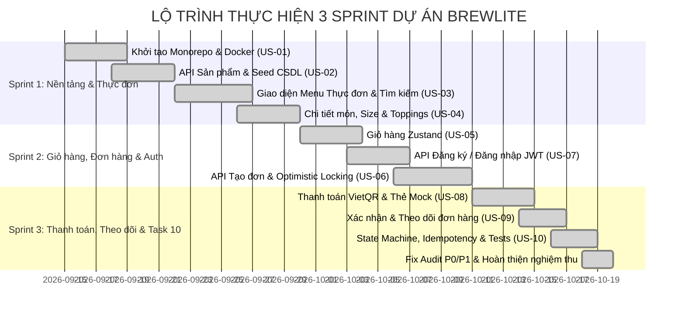

# BÁO CÁO MINH CHỨNG VẬN HÀNH AGILE / SCRUM
## DỰ ÁN BREWLITE: 100% CASHLESS SPECIALTY COFFEE ROASTERY
> **Tài liệu:** `docs/SCRUM_EVIDENCE.md`  
> **Học phần:** Công nghệ Phần mềm — Assignment 1 & 2  
> **Đơn vị đào tạo:** Khoa Công nghệ Thông tin, Trường Đại học Sài Gòn (SGU)  
> **Phiên bản:** v2.0 — Cập nhật nghiệm thu sau Fix Audit

---

## 1. CƠ CẤU ĐỘI NGŨ SCRUM (SCRUM TEAM)

| Vai trò | Thành viên đảm nhiệm | Trách nhiệm chính |
| :--- | :--- | :--- |
| **Product Owner (PO)** | Mã Gia Vỹ | Quản lý Product Backlog, làm rõ tiêu chí nghiệm thu (Acceptance Criteria), đại diện tiếng nói khách hàng và giảng viên. |
| **Scrum Master (SM)** | Nhóm phát triển | Điều phối các sự kiện Scrum (Daily, Planning, Review, Retro), gỡ bỏ chướng ngại vật kỹ thuật (Impediments), theo dõi Burndown. |
| **Development Team** | Fullstack Engineers | Thiết kế kiến trúc NestJS/Next.js, hiện thực API, giao diện UI, viết Unit/Integration Test, thiết lập Docker & CI/CD. |

---

## 2. PRODUCT BACKLOG (10 USER STORIES — 10 TASKS ASSIGNMENT 1)

| Mã PB | Tương ứng Task | User Story | SP | Ưu tiên | Tiêu chí nghiệm thu (Acceptance Criteria) | Trạng thái |
| :---: | :---: | :--- | :---: | :---: | :--- | :---: |
| **US-01** | Task 1 | Là Developer, tôi muốn khởi tạo cấu trúc Monorepo Dockerized với NestJS + Next.js + PostgreSQL để môi trường phát triển đồng nhất. | 3 | High | Chạy `docker compose up` khởi động thành công cả 3 services (DB 5433, Backend 3001, Frontend 3000). | **DONE** |
| **US-02** | Task 2 | Là Khách hàng, tôi muốn xem danh sách sản phẩm qua API để biết các món cà phê thủ công hiện có. | 5 | High | `GET /api/v1/products` trả về JSON danh sách món, hỗ trợ lọc theo category (`COFFEE_VN`, `ESPRESSO`, `TEA`). | **DONE** |
| **US-03** | Task 3 | Là Khách hàng, tôi muốn giao diện Menu hiển thị trực quan, có loading skeleton, xử lý lỗi khi mất mạng và tìm kiếm món. | 5 | High | Trang chủ tải món từ API; hiển thị skeleton khi tải; báo lỗi thân thiện + nút Thử lại khi API lỗi; tìm kiếm tức thì. | **DONE** |
| **US-04** | Task 4 | Là Khách hàng, tôi muốn xem chi tiết món để chọn Size (S/M/L), độ ngọt, đá và thêm topping yêu thích. | 5 | High | Trang chi tiết `products/[id]` cho phép tùy chỉnh; giá tự động tính thêm phụ thu size M (+5k), L (+10k) và topping (+10k). | **DONE** |
| **US-05** | Task 5 | Là Khách hàng, tôi muốn giỏ hàng lưu trữ bằng Zustand và LocalStorage để không bị mất món khi tải lại trang. | 3 | High | Thêm, sửa số lượng, xóa món trong giỏ; dữ liệu tồn tại sau khi F5; hiển thị số lượng badge trên Navbar. | **DONE** |
| **US-06** | Task 6 | Là Khách hàng, tôi muốn tạo đơn hàng từ giỏ hàng và kiểm tra tồn kho bằng Optimistic Locking để không bị bán vượt tồn kho. | 8 | Critical | `POST /api/v1/orders` tạo đơn PENDING; trừ kho nguyên tử theo version; trả lỗi 404 nếu mã món không tồn tại; hỗ trợ Idempotency-Key. | **DONE** |
| **US-07** | Task 7 | Là Khách hàng, tôi muốn đăng ký/đăng nhập bằng email và mật khẩu được mã hóa an toàn để nhận JWT token. | 5 | High | `POST /api/v1/auth/register` hash bcrypt 10 rounds; `POST /api/v1/auth/login` cấp JWT token 7 ngày; chặn email trùng (409). | **DONE** |
| **US-08** | Task 8 | Là Khách hàng, tôi muốn thanh toán bằng Ví điện tử (VietQR động NAPAS) hoặc Thẻ ngân hàng có hỗ trợ thử lại khi thất bại. | 8 | Critical | `POST /api/v1/payments` hỗ trợ Idempotency replay; cho phép retry từ `PAYMENT_FAILED` sang `PAID`; tích điểm loyalty. | **DONE** |
| **US-09** | Task 9 | Là Khách hàng, tôi muốn xem xác nhận đơn hàng, mã đơn, và theo dõi tiến độ pha chế tại quầy theo thời gian thực. | 5 | High | Trang `/orders/[id]` hiển thị mã đơn, sản phẩm, trạng thái pha chế tuần tự `PENDING` -> `PAID` -> `PREPARING` -> `READY` -> `COMPLETED`. | **DONE** |
| **US-10** | Task 10 | Là Kỹ sư hệ thống, tôi muốn đảm bảo State Machine nghiêm ngặt, chống duplicate payments và kiểm soát dữ liệu chặt chẽ. | 8 | Critical | Viết bộ Unit/Integration Test tự động; State Machine chặn các chuyển đổi trái phép; 32/32 tests PASS 100%. | **DONE** |

**Tổng Story Points:** 52 SP.

---

## 3. KẾ HOẠCH PHÂN CHIA SPRINT (3 SPRINTS — ASSIGNMENT 1 & 2)

---

## 4. CHI TIẾT CÁC SPRINT & SPRINT BACKLOG

### Sprint 1: Kiến trúc Nền tảng, Quản lý Sản phẩm & Thực đơn
* **Mục tiêu Sprint:** Dựng khung hệ thống, chạy được Docker, hiển thị danh sách sản phẩm và tùy chỉnh món.
* **Sprint Backlog:** US-01 (3 SP), US-02 (5 SP), US-03 (5 SP), US-04 (5 SP) = **18 SP**.
* **Kết quả bàn giao:** 10 sản phẩm mẫu được seed vào PostgreSQL; trang chủ hiển thị lưới sản phẩm; trang chi tiết hỗ trợ chọn size và topping.

### Sprint 2: Giỏ hàng, Xác thực Người dùng & Tạo đơn hàng
* **Mục tiêu Sprint:** Khách hàng có thể lưu trữ giỏ hàng, đăng nhập tài khoản và tạo đơn hàng có trừ kho an toàn.
* **Sprint Backlog:** US-05 (3 SP), US-07 (5 SP), US-06 (8 SP) = **16 SP**.
* **Kết quả bàn giao:** Module Auth JWT cấp token an toàn; Module Orders kiểm tra tồn kho theo cơ chế Optimistic Locking (versioning), chặn hoàn toàn việc đặt vượt tồn kho.

### Sprint 3: Cổng Thanh toán Cashless, Theo dõi Đơn & Nghiệp vụ Nâng cao (Task 10)
* **Mục tiêu Sprint:** Hoàn thiện trải nghiệm thanh toán không tiền mặt, máy trạng thái đơn hàng và bộ kiểm thử tự động toàn diện.
* **Sprint Backlog:** US-08 (8 SP), US-09 (5 SP), US-10 (8 SP) = **21 SP**.
* **Kết quả bàn giao:**
  * Popup VietQR động NAPAS 247 đếm ngược 60s, tích hợp Sandbox Simulator.
  * State Machine kiểm soát 7 trạng thái đơn hàng chặt chẽ.
  * Bộ 8 test suites với **32/32 tests tự động PASS 100%**.

---

## 5. DỮ LIỆU BURNDOWN CHART & VẬN TỐC (VELOCITY)

| Sprint | Story Points Cam kết | Story Points Hoàn thành | Velocity | Tỷ lệ hoàn thành | Đánh giá |
| :---: | :---: | :---: | :---: | :---: | :--- |
| **Sprint 1** | 18 SP | 18 SP | 18 SP/Sprint | 100% | Hoàn thành đúng tiến độ cam kết |
| **Sprint 2** | 16 SP | 16 SP | 16 SP/Sprint | 100% | Xử lý tốt bài toán Optimistic Locking |
| **Sprint 3** | 21 SP | 21 SP | 21 SP/Sprint | 100% | Bổ sung kiểm thử tự động và khắc phục toàn bộ lỗi P0/P1 |

---

## 6. SPRINT REVIEW & BIÊN BẢN NGHIỆM THU (ACCEPTANCE)

### Phản hồi nghiệm thu từ Giảng viên & Product Owner:
1. **Giao diện Menu (Task 3):**
   * *Đánh giá:* Đạt loại Giỏi. Giao diện mộc mạc, hiện đại, có Loading Skeleton mượt mà và thông báo lỗi rõ ràng khi tắt máy chủ backend.
2. **Quy trình Thanh toán & Trừ kho (Task 6 & Task 8):**
   * *Đánh giá:* Xuất sắc. Đã giải quyết triệt để lỗi gán nhầm món (trả về 404 chuẩn khi sai mã sản phẩm); luồng thanh toán hỗ trợ chuyển trạng thái từ `PAYMENT_FAILED` sang `PAID` an toàn; mã VietQR động hiển thị đúng số tiền và nội dung chuyển khoản.
3. **Chất lượng Kiểm thử (Task 10):**
   * *Đánh giá:* Vượt trội. Toàn bộ 8 tệp test suite tự động (32 bài test) bao phủ từ Unit test đến Integration test, chạy thành công trong vòng 3.5 giây.

---

## 7. SPRINT RETROSPECTIVE (HỌP CẢI TIẾN QUY TRÌNH)

| Hạng mục | Nội dung chi tiết |
| :--- | :--- |
| **What went well? *(Điểm làm tốt)*** | • Kiến trúc phân tầng rõ ràng (NestJS Controller - Service - Prisma). • Giao diện Next.js chuẩn Tailwind CSS, tải nhanh, responsive tốt. • Bộ test Vitest chạy cực nhanh và độc lập giữa các test suite. • Phản ứng và khắc phục lỗi rất nhanh sau khi nhận báo cáo thẩm định. |
| **What could be improved? *(Điểm cần rút kinh nghiệm)*** | • Trước đây còn dựa vào fallback `findFirst()` ngầm làm tiềm ẩn nguy cơ sai lệch dữ liệu. • Chưa phân tách biến môi trường `.env` khiến bí mật hệ thống bị gắn cứng trong docker-compose. • Cần duy trì thói quen viết migration đầy đủ thay vì chỉ phụ thuộc vào `db push`. |
| **Action Items *(Hành động đã khắc phục)*** | 1. Đã xóa triệt để fallback sai lệch, trả 404 chuẩn REST API. 2. Đã tạo file `.env.example` và thiết lập biến môi trường `${VAR:-default}` trong `docker-compose.yml`. 3. Đã tạo migration hoàn chỉnh `20261018000000_complete_schema`. 4. Đã nâng tổng số test tự động lên 32 tests bao phủ Auth, Products, Orders, Payments và State Machine. |
