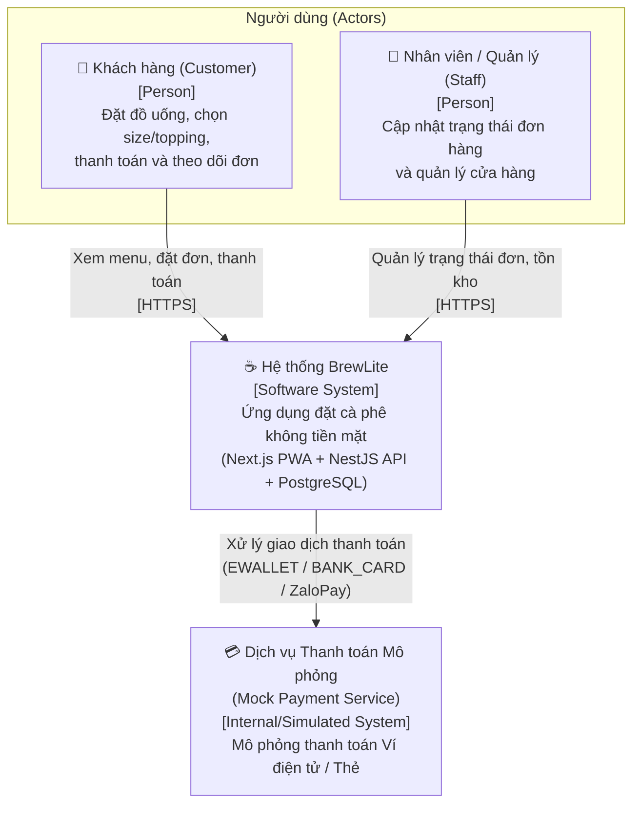
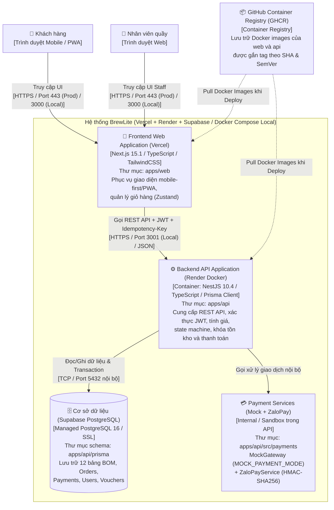

# Tài liệu Thiết kế Kiến trúc — BrewLite

> **Mã nhiệm vụ:** `TASK-03` (Trọng số: **2.0 / 10 điểm** — Đợt A: Bắt đầu ngay)  
> **Học phần:** Công nghệ Phần mềm — Giảng viên: **ThS. Từ Lãng Phiêu**  
> **Thành viên phụ trách:** Vũ Châu Minh Khôi | Phối hợp kiến trúc: Cả nhóm  
> **Kho mã nguồn:** Monorepo (`apps/web`, `apps/api`, `docs`, `tests`)  
> **Trạng thái:** `HOÀN THÀNH BẢN THIẾT KẾ KIẾN TRÚC & TRUY VẾT (T3.1)`

---

## 1. Bối cảnh Hệ thống (System Context)

**BrewLite** là ứng dụng web đặt và thanh toán đồ uống không dùng tiền mặt theo hướng mobile-first/PWA, giúp khách hàng chọn món, tùy chỉnh size/topping, áp dụng khuyến mãi và thanh toán nhanh chóng chỉ trong vài chạm, từ đó giảm thời gian xếp hàng chờ đợi tại quầy.

### 1.1 Các tác nhân và hệ thống bên ngoài
* **Khách hàng (Customer):** Duyệt thực đơn (menu), chọn tùy chọn (size, topping), quản lý giỏ hàng, đặt đơn, thanh toán không tiền mặt và theo dõi trạng thái đơn hàng theo thời gian thực.
* **Nhân viên quầy / Quản lý (Staff / Admin):** Tiếp nhận đơn hàng đã thanh toán (`PAID`) tại `/staff`, cập nhật tiến trình pha chế (`PREPARING` $\rightarrow$ `READY` $\rightarrow$ `COMPLETED`), và quản trị danh mục món, tồn kho nguyên vật liệu BOM, nhân sự tại `/admin`.
* **Hệ thống Thanh toán (Mock & ZaloPay Sandbox):** Hỗ trợ `MockGatewayService` mô phỏng Ví điện tử (`EWALLET`) và Thẻ ngân hàng (`BANK_CARD`) theo biến môi trường `MOCK_PAYMENT_MODE` (`success` | `failure`, kiểm soát bởi `ALLOW_MOCK_PAYMENT`), song hành với `ZaloPayService` Sandbox (`HMAC-SHA256`, webhook IPN).

### 1.2 Sơ đồ C4 — Mức Bối cảnh (Level 1: System Context Diagram)

---

## 2. Kiến trúc Mức Container (C4 Level 2: Container Diagram)

Hệ thống BrewLite được tổ chức theo mô hình **Monorepo** (xem [ADR-001](./adr/001-monorepo.md)), phân tách rõ ràng giữa giao diện người dùng (Frontend), dịch vụ nghiệp vụ (Backend API) và hệ quản trị cơ sở dữ liệu (Database). Trên Production, Frontend triển khai trên **Vercel**, Backend đóng gói bằng Docker triển khai trên **Render (Singapore)** kết hợp **Supabase PostgreSQL**, đồng thời duy trì tùy chọn đóng gói image qua GitHub Container Registry (GHCR) (xem [ADR-003](./adr/003-render-ghcr-deployment.md)).

---

## 3. Chi tiết các Thành phần Kiến trúc

### 3.1 Frontend (`apps/web`) — Next.js Mobile-First / PWA
* **Công nghệ cốt lõi:** Next.js (App Router, React 19, TypeScript) kết hợp TailwindCSS thiết kế theo định hướng ưu tiên thiết bị di động (mobile-first) và hỗ trợ Progressive Web App (PWA).
* **Quản lý trạng thái (State Management):**
  * `cart-store` (`apps/web/src/stores/cart-store.ts`): Sử dụng **Zustand** kết hợp middleware `persist` để lưu giỏ hàng vào `localStorage`. Hỗ trợ gộp dòng khi trùng `(productId, size, toppingIds)`, giới hạn số lượng $1\text{--}20$ mỗi dòng và tính tổng tạm tính (`selectTotal`).
  * `auth-store` (`apps/web/src/stores/auth-store.ts`): Lưu trữ trạng thái đăng nhập và `accessToken` JWT.
* **Giao tiếp API & Xử lý lỗi (`apps/web/src/lib/api-client.ts`):**
  * Tự động đính kèm header `Authorization: Bearer <token>` cho các endpoint yêu cầu xác thực.
  * Tự động sinh và giữ nguyên `Idempotency-Key` (bằng `crypto.randomUUID()`) khi người dùng bấm thanh toán hoặc thử lại (`Retry`) để tránh tạo đơn/trừ tiền kép.
  * Khi nhận mã lỗi `401 Unauthorized` (JWT hết hạn), tự động xóa token, giữ nguyên giỏ hàng hiện tại và điều hướng về `/auth/login?redirect=<trang_hiện_tại>`.
* **Theo dõi trạng thái đơn (`apps/web/src/hooks/use-order-polling.ts`):** Custom hook gọi định kỳ `GET /orders/:id` mỗi $5\text{ giây}$ kèm `AbortController`, tự động dừng khi đơn đạt trạng thái kết thúc (`COMPLETED` hoặc `CANCELLED`) hoặc khi component unmount.
* **Biến môi trường phía Client:** `NEXT_PUBLIC_API_URL` trỏ tới địa chỉ Backend API (Local: `http://localhost:3001`, Production: URL Render của backend).

### 3.2 Backend (`apps/api`) — Kiến trúc Phân lớp theo Module (Modular Layered Architecture)
Backend được xây dựng bằng **NestJS** (TypeScript), áp dụng kiến trúc phân lớp (`Controller` $\rightarrow$ `Service` $\rightarrow$ `Data Access / PrismaService`) và chia tách theo từng miền nghiệp vụ (Domain Modules) (xem [ADR-002](./adr/002-layered-modular-nestjs.md)):

1. **Auth Module (`apps/api/src/auth`):**
   * Xử lý đăng ký (`POST /auth/register`) và đăng nhập (`POST /auth/login`).
   * Băm mật khẩu bằng `bcrypt`, cấp phát token JWT có thời hạn $7\text{ ngày}$.
   * Cung cấp `JwtAuthGuard` và `RolesGuard` để bảo vệ các route đặt đơn, thanh toán và cập nhật trạng thái đơn.
   * **Mô hình Single Root Admin (`admin@brewlite.vn`):** Khóa cứng định danh Root Admin duy nhất, cấm tạo mới hoặc thăng cấp bất kỳ tài khoản nào khác lên role ADMIN (`403 Forbidden`).
   * **Đồng bộ Session Role Cookie:** Đồng bộ cookie phiên `brewlite_session_role` song song với JWT để Next.js Edge Middleware bảo vệ các route `/admin/*` và `/staff/*` ngay từ tầng Edge.
2. **Products Module (`apps/api/src/products`):**
   * Cung cấp danh sách thực đơn (`GET /products`) và chi tiết sản phẩm kèm danh sách topping (`GET /products/:id`), trả về `404 Not Found` nếu sản phẩm không tồn tại.
   * **Báo hết món tạm thời (`PATCH /products/:id/sold-out`):** Cho phép Barista (`STAFF`) và Quản trị viên (`ADMIN`) bật/tắt cờ `isSoldOutManual`.
   * **Role-Based Data Projection:** Áp dụng nguyên tắc đặc quyền tối thiểu: Khi người gọi là `STAFF`, API tự động lược bỏ hoàn toàn thông tin công thức (`recipes`) và các kích thước giá vốn (`cogsSizeS`, `cogsSizeM`, `cogsSizeL`) nhằm bảo vệ bí mật kinh doanh.
3. **Orders Module (`apps/api/src/orders`):**
   * **Tạo đơn hàng (`POST /orders`):** Thực thi trong một database transaction của Prisma. Hệ thống áp dụng **Khóa hàng User (`SELECT ... FOR UPDATE`)** để đảm bảo tính atomic khi kiểm tra đơn và trừ voucher.
   * **Giới hạn chống spam đơn (Anti-Spam Rate Limit):** Mỗi khách hàng chỉ được phép có tối đa **5 đơn hàng** ở trạng thái `PENDING` hoặc `PAYMENT_FAILED` cùng lúc; vượt quá sẽ bị từ chối với mã lỗi `400 Bad Request`.
   * **Tự động tính toán giá trị đơn:** Tự tính lại toàn bộ giá trị đơn hàng ở phía server theo công thức:
     $$\text{LineTotal} = (\text{Giá gốc} + \text{Phụ thu Size} + \sum \text{Giá Topping}) \times \text{Số lượng}$$
     (Phụ thu Size: $S = +0\text{đ}$, $M = +5.000\text{đ}$, $L = +10.000\text{đ}$; không tính VAT).
   * **Kiểm soát đồng thời (Optimistic Locking & BOM Stock Reservation):** Trừ và kiểm soát tồn kho `Ingredient` (BOM) lẫn `Order` bằng điều kiện `version = :version` đồng thời tăng `version + 1` (xem [ADR-006](./adr/006-optimistic-locking-idempotency.md) và [ADR-008](./adr/008-bom-schema-compatibility.md)). Ràng buộc `@@unique([userId, idempotencyKey])` chống trùng lặp đơn hàng từ client.
   * **Máy trạng thái đơn hàng (`apps/api/src/payments/state-machine.helper.ts`):** Hàm `assertTransition(from, to)` kiểm soát chặt chẽ các chuyển tiếp hợp lệ:
     * Luồng chính: `PENDING` $\rightarrow$ `PAID` $\rightarrow$ `PREPARING` $\rightarrow$ `READY` $\rightarrow$ `COMPLETED`.
     * Luồng thanh toán lỗi & thử lại: `PENDING` $\rightleftarrows$ `PAYMENT_FAILED`.
     * Luồng hủy đơn: `PENDING` / `PAID` / `PAYMENT_FAILED` $\rightarrow$ `CANCELLED`.
   * **Tác vụ tự động hủy đơn quá hạn (`apps/api/src/jobs/expire-orders.job.ts`):** Sử dụng `@nestjs/schedule` quét mỗi phút để tự động chuyển các đơn `PENDING` hoặc `PAYMENT_FAILED` quá $15\text{ phút}$ sang `CANCELLED`, đồng thời hoàn trả tồn kho và lượt sử dụng voucher.
4. **Payments Module (`apps/api/src/payments`):**
   * Xử lý thanh toán mô phỏng (`POST /payments`) cho phương thức `EWALLET` hoặc `BANK_CARD` (bị chặn `403` trên Production khi `ALLOW_MOCK_PAYMENT=false`) và luồng ZaloPay Sandbox (`/payments/zalopay/{create,callback,status/:orderId,confirm,cancel}`).
   * **Kiểm tra quyền sở hữu đơn hàng (Order Ownership Guard):** Chỉ chủ đơn (`order.userId === currentUser.id`) mới có quyền tạo giao dịch thanh toán hoặc thao tác hủy trên cổng thanh toán (`403 Forbidden`).
   * **Default-Deny cho Sandbox Confirm:** Các endpoint `/payments/zalopay/confirm` và `/cancel` bị từ chối `403 Forbidden` mặc định trên production trừ khi bật cờ `ALLOW_SANDBOX_CONFIRM=true`.
   * Đảm bảo tính **Idempotency** thông qua header `Idempotency-Key` (nếu giao dịch đã `SUCCESS` với cùng khóa, trả về ngay kết quả cũ mà không trừ tiền hay cộng điểm lần hai — xem [ADR-006](./adr/006-optimistic-locking-idempotency.md)).
   * Khi thanh toán thất bại (`PAYMENT_FAILED`), đơn hàng vẫn giữ tồn kho BOM đã đặt trong giới hạn 15 phút để khách hàng có thể bấm thử lại ngay.
5. **Inventory, Vouchers & Loyalty (`apps/api/src/inventory` & `apps/api/src/auth`, tích hợp trong `orders` & `payments`):**
   * Quản lý nguyên liệu (`Ingredient`), công thức BOM (`Recipe`, `ToppingRecipe`), cấu hình size (`GET /inventory/pricing-config`, `PATCH /inventory/size-pricing`), nhật ký kho (`InventoryLog`), mã giảm giá (`DiscountCode`) và đổi điểm lấy voucher (`POST /auth/redeem-points`, `GET /auth/vouchers`).
   * **Server-Enforced Loyalty Redemption:** Điểm đổi voucher được server khóa cứng: 10 điểm = voucher 10.000đ, 20 điểm = voucher 20.000đ, 50 điểm = voucher 50.000đ (`requiredPoints`). Server tự áp đặt và trừ chính xác số điểm quy định, không phụ thuộc client.
   * **Bảo vệ toàn vẹn lịch sử kho (Integrity Constraint):** Nghiêm cấm xóa nguyên liệu (`DELETE /inventory/ingredients/:id`) khi đã phát sinh `InventoryLog` hoặc công thức món liên quan, trả về mã lỗi `409 Conflict`.
   * Khi đơn hàng chuyển sang `PAID`, tự động cộng điểm tích lũy $\lfloor \text{totalAmount} / 1000 \rfloor$ vào `User.loyaltyPoints` trong cùng một transaction. Nếu đơn `PAID` bị hủy, hệ thống hoàn kho BOM và thu hồi lại số điểm đã cộng.
6. **Admin Users & Customers (`apps/api/src/users` & `apps/api/src/customers`):**
   * Quản trị tài khoản nhân viên (`GET/POST/PATCH/DELETE /staff`) và khách hàng (`GET/POST/PATCH/DELETE /admin/customers`), bật/tắt khóa tài khoản.
7. **Health Module (`apps/api/src/health`):**
   * Cung cấp endpoint `GET /health` để kiểm tra trạng thái sống của API và thực hiện truy vấn kiểm tra kết nối thực tế tới PostgreSQL (`SELECT 1`).

### 3.3 Cơ sở dữ liệu (`apps/api/prisma`) — PostgreSQL & Prisma ORM
* **Mô hình dữ liệu:** Quản lý tập trung qua tệp `apps/api/prisma/schema.prisma`, bao gồm **12 model** phục vụ đồng thời E-Commerce và BOM: `Product`, `Ingredient`, `InventoryLog`, `Recipe`, `ToppingRecipe`, `StoreSetting`, `DiscountCode`, `User`, `UserVoucher`, `Order`, `OrderItem`, `Payment` (xem [ADR-004](./adr/004-prisma-migrations.md) và [ADR-008](./adr/008-bom-schema-compatibility.md)).
* **Cơ chế kiểm soát phiên bản (Version Column):** Cột `version Int @default(0)` được đặt tại các thực thể liên quan đến tồn kho (`Ingredient`) và đơn hàng (`Order`) để đảm bảo cơ chế Khóa lạc quan (Optimistic Locking) hoạt động chuẩn xác.
* **Cơ chế Migration & Seed:**
  * Lịch sử thay đổi cấu trúc bảng được lưu vết đầy đủ trong `apps/api/prisma/migrations/`.
  * Dữ liệu mẫu (`apps/api/prisma/seed.ts`) được thiết kế có tính chất idempotent (`upsert`), khởi tạo $10\text{ sản phẩm}$ đồ uống/bánh ngọt, nguyên liệu (`Ingredient`), công thức BOM (`Recipe`, `ToppingRecipe`), cấu hình size và tài khoản mẫu 3 vai trò.
  * Quá trình chạy migration trên môi trường production được thực thi tự động khi container API khởi động thông qua `prisma migrate deploy` (xem [ADR-007](./adr/007-migration-on-startup.md)).

### 3.4 Dịch vụ Thanh toán (`MockGatewayService` & `ZaloPayService`)
* Đặt tại `apps/api/src/payments/mock-gateway.service.ts` và `apps/api/src/payments/zalopay.service.ts` (xem [ADR-005](./adr/005-mock-payment-service.md)).
* `MockGatewayService` hoạt động dựa trên biến môi trường `MOCK_PAYMENT_MODE` (chỉ nhận `success` hoặc `failure`, cùng `ALLOW_MOCK_PAYMENT` kiểm soát môi trường production):
  * `success`: Luôn trả về kết quả thanh toán thành công (dùng cho luồng happy-path và E2E).
  * `failure`: Luôn trả về trạng thái `PAYMENT_FAILED` với `{ success: false }` (dùng để kiểm thử giữ đơn và thử lại).
* `ZaloPayService` hỗ trợ giao dịch ZaloPay Sandbox v2 và xác thực callback IPN bằng chữ ký `HMAC-SHA256` (`ALLOW_SANDBOX_CONFIRM` kiểm soát xác nhận/hủy giả lập trên production).

### 3.5 Logging, Health Check và Quản lý Cấu hình
* **Logging:** Sử dụng hệ thống Logger tích hợp của NestJS, xuất log có cấu trúc (timestamp, context module, mức độ log `LOG`, `WARN`, `ERROR`) ra luồng `stdout`/`stderr` chuẩn của container, cho phép thu thập và tra cứu trực tiếp trên bảng điều khiển Render Logs hoặc `docker compose logs`. Tuyệt đối không ghi `passwordHash`, `JWT_SECRET` hay token vào log.
* **Health Check (`GET /health`) & OpenAPI (`docs/api/openapi.yaml`):**
  * Thực hiện kiểm tra kết nối cơ sở dữ liệu (`SELECT 1` qua Prisma).
  * Trả về `200 OK` kèm `{ "status": "ok", "db": "up" }` khi hệ thống khỏe mạnh, hoặc `503 Service Unavailable` khi mất kết nối DB. Đặc tả API đầy đủ tại [`docs/api/openapi.yaml`](../api/openapi.yaml).
* **Quản lý cấu hình (`apps/api/src/config/env.validation.ts`):**
  * Kiểm tra tính hợp lệ của toàn bộ biến môi trường bắt buộc (`DATABASE_URL`, `JWT_SECRET`, `MOCK_PAYMENT_MODE`) cùng các biến tùy chọn (`PORT`, `ALLOW_MOCK_PAYMENT`, `ALLOW_SANDBOX_CONFIRM`, `ZALOPAY_*`) ngay tại thời điểm ứng dụng khởi động (fail-fast). Nếu thiếu biến quan trọng như `DATABASE_URL` hoặc `JWT_SECRET`, ứng dụng sẽ từ chối khởi động và báo lỗi rõ ràng.

### 3.6 Kiến trúc Phân tầng Kiểm thử (Testing Architecture)
Hệ thống thiết lập 4 cấp độ kiểm thử rõ ràng theo kim tự tháp kiểm thử (Testing Pyramid):
1. **Unit & Component Tests (`apps/api/src/**/*.spec.ts`, `apps/web/src/**/*.test.ts*`):** Kiểm tra độc lập logic BOM, tính giá, state machine, cron job, giỏ hàng và render component React.
2. **API Tests (`API-T04` $\rightarrow$ `API-T09`, Controller & Service Specs):** Kiểm thử trực tiếp các controller và service của NestJS với mock dependencies.
3. **Integration Tests (`INT-T01` $\rightarrow$ `INT-T05` — `apps/api/src/integration/`):** *(Hoàn thiện ở Wave 3b)* Khởi chạy với PostgreSQL thật qua Docker Compose (`orders-payments.int.spec.ts`) để kiểm tra giao dịch tạo đơn, trừ kho BOM đồng thời và idempotency.
4. **End-to-End & Smoke Tests (`tests/e2e/checkout.spec.ts`, `scripts/smoke-test.{sh,ps1}`):** Playwright kiểm thử tự động toàn bộ luồng người dùng với Docker Compose (Wave 3b) và smoke scripts kiểm tra sau triển khai.

---

## 4. Lý do chọn Kiến trúc, Ưu điểm, Hạn chế và Đánh đổi (Trade-offs)

### 4.1 Lý do lựa chọn
Nhóm lựa chọn kiến trúc **Modular Monolith (Khối đơn nguyên phân tách theo module)** cho Backend NestJS kết hợp với **Frontend Next.js tách biệt** trong cùng một **Monorepo** vì:
1. Nghiệp vụ đặt hàng của BrewLite đòi hỏi tính toàn vẹn dữ liệu rất cao (kiểm tra tồn kho, áp voucher, tạo đơn, xử lý thanh toán và cộng điểm thưởng phải nằm trong các giao dịch ACID trên cùng một cơ sở dữ liệu PostgreSQL).
2. Quy mô nhóm 6 thành viên và thời gian thực hiện gói gọn trong 2 Sprint rất phù hợp với việc quản lý mã nguồn, tài liệu (`docs/`) và pipeline CI/CD trên một kho lưu trữ duy nhất.

### 4.2 Phân tích Ưu điểm, Hạn chế và Trade-offs

| Khía cạnh | Ưu điểm (Pros) | Hạn chế (Cons) | Sự đánh đổi (Trade-offs) |
| :--- | :--- | :--- | :--- |
| **Modular Monolith (`apps/api`)** | • Dễ dàng thực hiện ACID Transaction qua nhiều bảng (`Order`, `Product`, `Payment`, `User`) bằng Prisma. • Triển khai đơn giản (chỉ cần 1 container API), không tốn chi phí giao tiếp mạng nội bộ giữa các microservices. | • Khó mở rộng (scale) độc lập từng module (ví dụ: không thể chỉ scale riêng module `orders` mà không nhân bản toàn bộ `api`). • Nếu một module gây rò rỉ bộ nhớ, toàn bộ tiến trình API bị ảnh hưởng. | Chấp nhận giới hạn về khả năng scale độc lập từng module để đổi lấy **tính nhất quán dữ liệu tuyệt đối** và **tốc độ phát triển/vận hành nhanh** trong phạm vi MVP. |
| **Monorepo (`apps/web`, `apps/api`, `docs`, `tests`)** | • Đồng bộ hóa tài liệu đặc tả (SRS, ADR, sơ đồ), mã nguồn Frontend/Backend và kiểm thử E2E trong cùng một Pull Request. • Dễ dàng thiết lập CI/CD tập trung. | • Pipeline CI có thể chạy lâu hơn nếu không cấu hình tách luồng (matrix) và bộ nhớ đệm (cache). | Sử dụng GitHub Actions `matrix` (`api`, `web`) và `npm cache` để giảm thời gian build, đổi lại sự tiện lợi trong quản lý phiên bản và truy vết. |
| **Optimistic Locking so với Pessimistic Locking** | • Không giữ khóa dòng (row lock) lâu trong DB, giúp tăng thông lượng đọc/ghi khi nhiều khách xem và đặt món cùng lúc. | • Khi có xung đột cao trên cùng 1 sản phẩm, một số request phải retry hoặc nhận lỗi `409 Conflict`. | Kết hợp cơ chế **retry tối đa 3 lần** trong `OrdersService` để giảm tỷ lệ lỗi cho người dùng mà vẫn đảm bảo tuyệt đối không bán âm tồn kho ($\text{stock} \ge 0$). |
| **Chạy Migration lúc khởi động API** | • Không cần mở public cổng DB trực tiếp từ GitHub Actions runner để migrate từ bên ngoài. | • Làm tăng nhẹ thời gian khởi động container API; yêu cầu các bản migration phải tương thích ngược. | Ưu tiên **bảo mật kết nối cơ sở dữ liệu production** (chỉ container API trên Render giữ `DATABASE_URL` SSL tới Supabase) và cơ chế giữ bản cũ của Render nếu container mới lỗi khi migrate. |

---

## 5. Danh mục Quyết định Kiến trúc (Architecture Decision Records — ADRs)

Mọi quyết định kiến trúc trọng yếu của dự án đều được ghi nhận chi tiết trong thư mục `docs/architecture/adr/`:

1. **[ADR-001: Tổ chức mã nguồn theo cấu trúc Monorepo](./adr/001-monorepo.md)** — Thống nhất quản lý `apps/web`, `apps/api`, `docs` và `tests` trên một repository duy nhất.
2. **[ADR-002: Kiến trúc phân lớp theo Module trong NestJS](./adr/002-layered-modular-nestjs.md)** — Phân tách trách nhiệm `Controller` – `Service` – `PrismaService` theo từng miền nghiệp vụ (`auth`, `products`, `orders`, `payments`, `inventory`, `customers`, `users`, `health`).
3. **[ADR-003: Triển khai Production (Vercel + Render + Supabase) & GHCR](./adr/003-render-ghcr-deployment.md)** — Chuẩn hóa triển khai Frontend trên Vercel, Backend Docker trên Render, PostgreSQL trên Supabase (SSL) và giữ pipeline GHCR trong `cd.yml` cho đóng gói/rollback container.
4. **[ADR-004: Sử dụng Prisma ORM và quản lý Schema/Migration cho PostgreSQL](./adr/004-prisma-migrations.md)** — Đảm bảo an toàn kiểu dữ liệu (type-safety) và khả năng tái tạo cơ sở dữ liệu nhất quán giữa Local, CI và Production.
5. **[ADR-005: Xây dựng Dịch vụ Thanh toán Mô phỏng (`MockGatewayService`)](./adr/005-mock-payment-service.md)** — Chủ động điều khiển kịch bản thanh toán (`success`, `failure`) song hành với ZaloPay Sandbox qua biến môi trường để kiểm thử toàn diện các nhánh nghiệp vụ.
6. **[ADR-006: Kiểm soát đặt hàng đồng thời bằng Optimistic Locking và chống trùng lặp bằng Idempotency-Key](./adr/006-optimistic-locking-idempotency.md)** — Giải quyết bài toán bán vượt tồn kho (overselling) và thanh toán lặp hai lần.
7. **[ADR-007: Thực thi Database Migration khi khởi động Container API](./adr/007-migration-on-startup.md)** — Bảo vệ cơ sở dữ liệu production và đảm bảo an toàn khi triển khai phiên bản mới.
8. **[ADR-008: Tương thích Schema BOM 12 Bảng và Chuẩn Hóa Hợp Đồng API Monorepo](./adr/008-bom-schema-compatibility.md)** — Hợp nhất 12 model BOM, hợp đồng JSON `{ data }`, `0%` VAT và phân tách chu kỳ 15 phút TTL / 5 phút grace period.

---

## 6. Bảng Truy vết Thành phần Kiến trúc → Mã nguồn & Triển khai

Bảng dưới đây ánh xạ trực tiếp từng container/dịch vụ trong sơ đồ C4 và **Deployment Diagram (Task 3.2)** tới mục mô tả kiến trúc và đường dẫn mã nguồn thực tế trong repository (phục vụ **Task 5.2b** và **Task 5.3**):

| Thành phần / Container (trên Deployment Diagram) | Công nghệ / Nền tảng | Mục kiến trúc tương ứng | Thư mục / Tệp mã nguồn liên quan | Cổng & Giao thức |
| :--- | :--- | :--- | :--- | :--- |
| **`web` (Frontend Web App)** | Next.js 15.1.6 (App Router, React 19, TypeScript, TailwindCSS, Zustand) | Mục 2, Mục 3.1 (ADR-001, ADR-003) | • `apps/web/` • `apps/web/src/app/{menu,cart,checkout,orders,staff,admin,account,promotions}/` • `apps/web/src/stores/` • `apps/web/Dockerfile` | • Local: `3000` (HTTP) • Production (**Vercel**): `443` (HTTPS, `brew-lite-project.vercel.app`) |
| **`api` (Backend API Container)** | NestJS 10.4 (TypeScript, Passport JWT, class-validator, Prisma Client) | Mục 2, Mục 3.2, Mục 3.5 (ADR-002, ADR-006, ADR-007, ADR-008) | • `apps/api/` • `apps/api/src/{auth,products,orders,payments,inventory,customers,users,health,jobs,config}/` • `docs/api/openapi.yaml` • `apps/api/Dockerfile` | • Local: `3001` (HTTP) • Production (**Render Singapore**): `443` (HTTPS $\rightarrow$ `:3001`, `brewlite-api-9viv.onrender.com`); Health check: `GET /health` |
| **`MockGatewayService` & `ZaloPayService`** | NestJS Injectable Services (`MOCK_PAYMENT_MODE`, `HMAC-SHA256`) | Mục 2, Mục 3.4 (ADR-005) | • `apps/api/src/payments/mock-gateway.service.ts` • `apps/api/src/payments/zalopay.service.ts` • `apps/api/src/payments/payments.service.ts` | Gọi nội bộ / HTTPS tới ZaloPay Sandbox từ container `api` |
| **`db` (Database Container / Managed PostgreSQL)** | PostgreSQL 16 (`postgres:16-alpine` local / **Supabase PostgreSQL** production) | Mục 2, Mục 3.3 (ADR-004, ADR-007, ADR-008) | • `apps/api/prisma/schema.prisma` (12 models) • `apps/api/prisma/migrations/` • `apps/api/prisma/seed.ts` • `docker-compose.yml` | • Local: TCP `${DB_PORT:-5432}:5432` • Production (**Supabase**): TCP `5432`/`6543` qua TLS/SSL (`sslmode=require`) |
| **`tests` & `scripts` (Test Suites & Smoke)** | Playwright, Jest, Vitest & Shell/PowerShell Smoke Scripts | Mục 3.6 | • `apps/api/src/integration/` • `tests/e2e/checkout.spec.ts` • `scripts/smoke-test.{sh,ps1}` | Chạy trên local container, CI runner và kiểm thử hậu triển khai qua HTTPS |
| **`registry` (Container Registry — GHCR)** | GitHub Container Registry (`ghcr.io` — tùy chọn) | Mục 2, Mục 5 (ADR-003) | • `.github/workflows/cd.yml` • `apps/web/Dockerfile` • `apps/api/Dockerfile` | HTTPS (`443`) — CI push image, Render pull image khi dùng workflow GHCR |
| **`ci-cd` (GitHub Actions & Auto-Deploy)** | GitHub Actions (`ubuntu-latest`) + Vercel/Render Git Integration | Mục 4.2, Mục 5 (ADR-001, ADR-003) | • `.github/workflows/ci.yml` • `.github/workflows/cd.yml` • `docs/deployment.md` | HTTPS (`443`) — PR CI (`ci.yml`), Auto-Deploy khi merge `main`, GHCR CD (`cd.yml`) |
