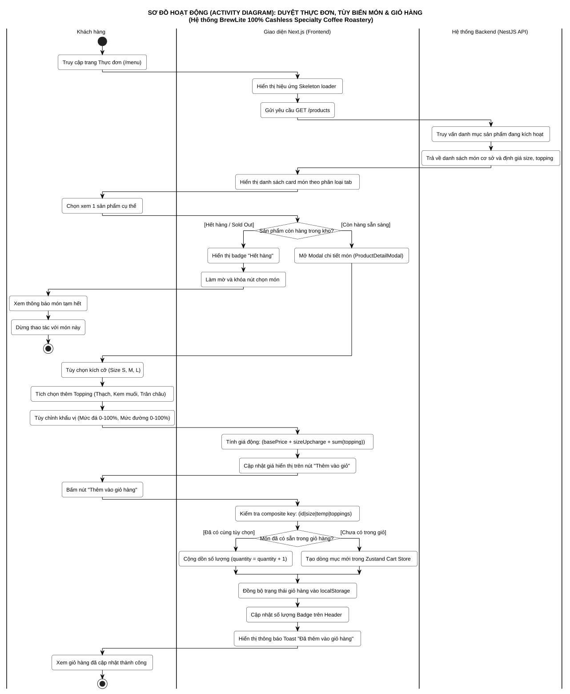
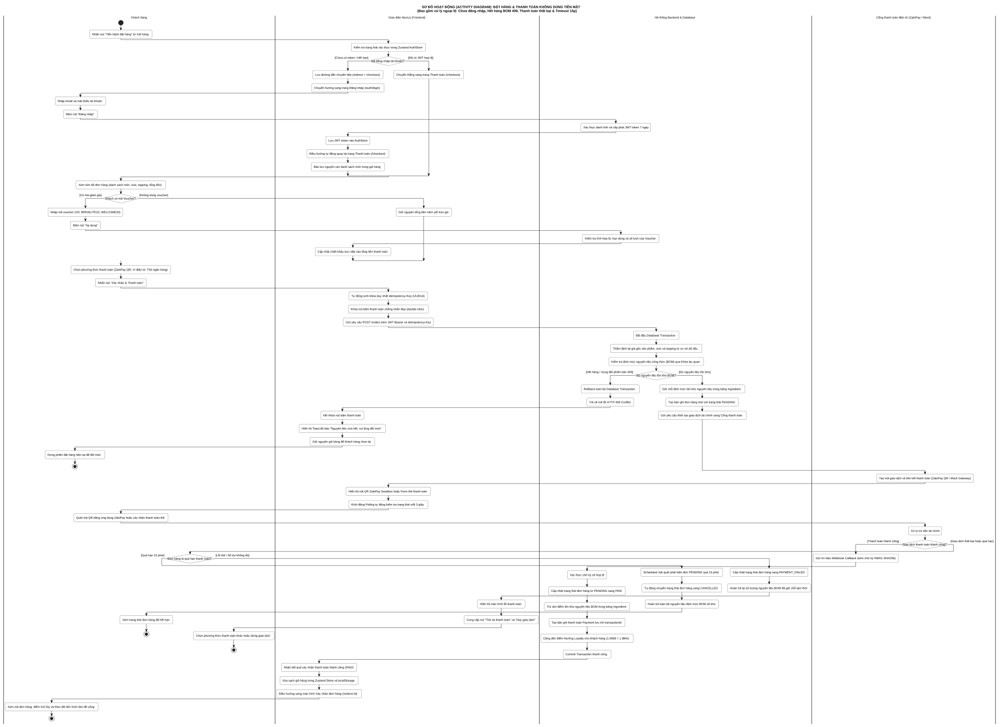
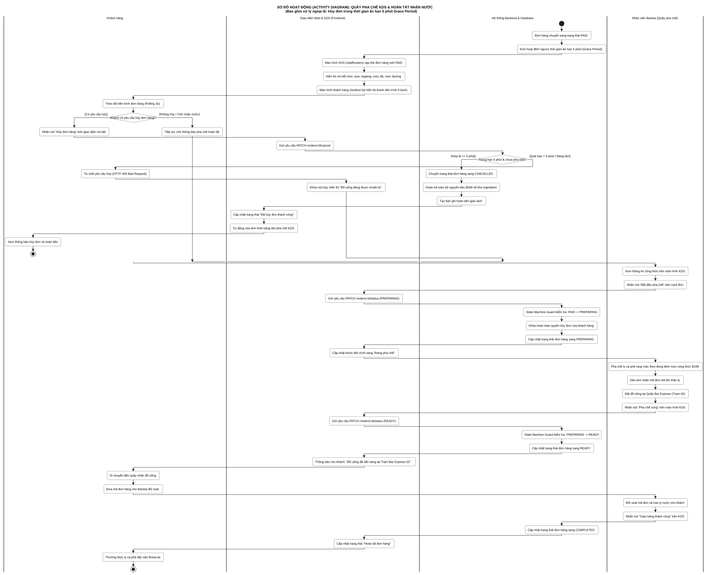

# ĐẶC TẢ CÁC SƠ ĐỒ HOẠT ĐỘNG (ACTIVITY DIAGRAMS)
## BREWLITE: 100% CASHLESS SPECIALTY COFFEE ROASTERY

> **Tài liệu:** `docs/diagrams/activity-diagrams.md`  
> **Học phần:** Công nghệ Phần mềm (Software Engineering) — Assignment 2 (Task 2.1)  
> **Đơn vị đào tạo:** Khoa Công nghệ Thông tin, Trường Đại học Sài Gòn (SGU)  
> **Giảng viên hướng dẫn:** ThS. Từ Lãng Phiêu  
> **Nhóm thực hiện:** Nhóm BrewLite (6 thành viên)  
> **Phong cách thiết kế:** Monochrome UML 2.5 (Chuẩn đen trắng tối giản, Swimlane phân làn, Decision hình thoi)  
> **Trạng thái:** Hoàn thành nghiệm thu Task 2.1 (Approved)

---

## 📌 1. TỔNG QUAN HỆ THỐNG SƠ ĐỒ HOẠT ĐỘNG (TASK 2.1)

Nhằm mô hình hóa hành vi động của hệ thống theo luồng **End-to-End** từ khi khách hàng tiếp cận menu đến khi ly cà phê được trao tận tay tại quầy Bar Express, hệ thống BrewLite được phân rã thành **3 sơ đồ Activity Diagram chuyên biệt**:

| STT | Tên Sơ Đồ Hoạt Động | Tệp Mã Nguồn & Kết Xuất | Số Làn (Swimlanes) | Điểm Nhấn Nghiệp Vụ & Ngoại Lệ |
| :---: | :--- | :--- | :---: | :--- |
| **1** | **Duyệt Menu, Tùy biến món & Giỏ hàng** | [`activity-menu-cart.puml`](activity-menu-cart.puml) [`activity-menu-cart.svg`](activity-menu-cart.svg) [`activity-menu-cart.png`](activity-menu-cart.png) | 3 Làn: • Khách hàng • Next.js Frontend • NestJS Backend | • Dynamic Pricing tự động. • Phân biệt món trùng lặp cấu hình để tăng số lượng. • **Xử lý món hết hàng (Sold out)**. |
| **2** | **Đặt hàng & Thanh toán không tiền mặt** *(Trọng tâm đề bài)* | [`activity-checkout.puml`](activity-checkout.puml) [`activity-checkout.svg`](activity-checkout.svg) [`activity-checkout.png`](activity-checkout.png) | 4 Làn: • Khách hàng • Next.js Frontend • NestJS & PostgreSQL • Cổng ZaloPay / Mock | • **Ngoại lệ 1: Chưa đăng nhập (Redirect Login & bảo lưu giỏ)**. • **Ngoại lệ 2: Hết hàng BOM (Optimistic Lock 409)**. • **Ngoại lệ 3: Thanh toán thất bại (Retry / Hủy)**. • **Ngoại lệ 4: Timeout đơn PENDING 15 phút**. |
| **3** | **Quầy pha chế KDS & Nhận nước tại quầy** | [`activity-kds.puml`](activity-kds.puml) [`activity-kds.svg`](activity-kds.svg) [`activity-kds.png`](activity-kds.png) | 4 Làn: • Khách hàng • Next.js KDS Frontend • NestJS & PostgreSQL • Nhân viên Barista | • Quy trình Barista KDS 1 chạm. • **Ngoại lệ: Hủy đơn trong 5 phút Grace Period**. • Máy trạng thái `PAID` $\rightarrow$ `PREPARING` $\rightarrow$ `READY` $\rightarrow$ `COMPLETED`. |

---

## ☕ 2. SƠ ĐỒ 1: DUYỆT THỰC ĐƠN, TÙY BIẾN MÓN & GIỎ HÀNG

### 2.1. Hình ảnh sơ đồ (Vector SVG)

### 2.2. Thuyết minh luồng hoạt động:
1. **Khách hàng** truy cập `/menu` $\rightarrow$ **Next.js** hiển thị Skeleton loader và gọi `GET /products` sang **NestJS Backend**.
2. **Backend** truy vấn PostgreSQL và trả về danh sách sản phẩm kích hoạt.
3. Khi khách bấm chọn 1 món:
   - **Hình thoi điều kiện `Còn hàng?`:**
     + *Nhánh Hết hàng:* Frontend hiển thị badge "Hết hàng" và khóa nút chọn món $\rightarrow$ Khách chọn món khác.
     + *Nhánh Còn hàng:* Mở modal tùy biến `ProductDetailModal`.
4. Khách hàng chọn Size (S/M/L), Topping và Đá/Đường $\rightarrow$ Frontend tính giá động (Dynamic Pricing) theo thời gian thực:
   $$\text{Giá} = (\text{basePrice} + \text{sizeUpcharge} + \sum \text{toppingPrice}) \times \text{quantity}$$
5. Khi khách bấm "Thêm vào giỏ hàng":
   - **Hình thoi điều kiện `Đã có trong giỏ?`:**
     + *Nhánh Đã có:* Tăng số lượng (`quantity + 1`).
     + *Nhánh Chưa có:* Thêm dòng mới vào Zustand Store.
6. Frontend lưu `localStorage` và cập nhật Cart Badge trên Header.

---

## 💳 3. SƠ ĐỒ 2: ĐẶT HÀNG & THANH TOÁN KHÔNG TIỀN MẶT (TRỌNG TÂM)

### 3.1. Hình ảnh sơ đồ (Vector SVG)

### 3.2. Thuyết minh luồng hoạt động & Xử lý 3 trường hợp ngoại lệ:
1. **Khách hàng** nhấn "Tiến hành đặt hàng" $\rightarrow$ **Next.js** kiểm tra token trong AuthStore:
   - **Hình thoi điều kiện `Đã đăng nhập?` (Ngoại lệ 1):**
     + *Nhánh Chưa đăng nhập:* Lưu redirect URL `/checkout`, chuyển sang `/auth/login`. Khách đăng nhập xong, Backend cấp JWT 7 ngày, Frontend điều hướng trở lại `/checkout` với giỏ hàng nguyên vẹn.
     + *Nhánh Đã đăng nhập:* Chuyển thẳng sang `/checkout`.
2. Khách áp dụng mã Voucher (nếu có) $\rightarrow$ Backend thẩm định và chiết khấu tổng tiền.
3. Khách chọn phương thức thanh toán và nhấn "Xác nhận & Thanh toán" $\rightarrow$ Frontend sinh `Idempotency-Key` (UUIDv4) chống gửi lặp và gửi `POST /orders`.
4. **Backend mở Database Transaction:**
   - **Hình thoi điều kiện `Đủ tồn kho BOM?` (Ngoại lệ 2 — Optimistic Locking):**
     + *Nhánh Hết hàng / Xung đột phiên bản 409:* Rollback transaction, trả lỗi `409 Conflict`. Frontend hiển thị Toast đỏ báo nguyên liệu vừa hết, giữ nguyên giỏ hàng để khách đổi món.
     + *Nhánh Đủ nguyên liệu:* Giữ chỗ tồn kho nguyên liệu, tạo đơn `PENDING` và gọi Cổng thanh toán ZaloPay/Mock.
5. **Cổng thanh toán** tạo mã QR/Form thanh toán $\rightarrow$ Frontend hiển thị và Polling mỗi 3 giây.
6. Khi khách thanh toán:
   - **Hình thoi điều kiện `Kết quả thanh toán?` (Ngoại lệ 3 & Timeout 15p):**
     + *Nhánh Thất bại:* Cập nhật đơn `PAYMENT_FAILED`, hoàn trả tồn kho tạm giữ. Frontend cho phép khách bấm **"Thử lại" (Retry)** hoặc **"Hủy giao dịch"**.
     + *Nhánh Timeout 15 phút:* Scheduled Job tự động quét và chuyển đơn sang `CANCELLED`, hoàn tồn kho BOM.
     + *Nhánh Thành công:* Webhook gửi chữ ký HMAC-SHA256, Backend xác thực $\rightarrow$ Cập nhật đơn `PAID`, trừ kho BOM vĩnh viễn, cộng điểm Loyalty (1.000đ = 1đ), dọn sạch giỏ hàng.

---

## 🍵 4. SƠ ĐỒ 3: QUẦY PHA CHẾ KDS & HOÀN TẤT NHẬN NƯỚC

### 4.1. Hình ảnh sơ đồ (Vector SVG)

### 4.2. Thuyết minh luồng hoạt động:
1. Đơn hàng chuyển sang `PAID` $\rightarrow$ Kích hoạt thời gian ân hạn 5 phút (Grace Period Countdown).
2. Màn hình KDS (`/staff/orders`) tự động nạp đơn hàng mới với chi tiết size/topping/đá/đường.
3. **Hình thoi điều kiện `Khách có yêu cầu hủy đơn hàng?` (Ngoại lệ Grace Period):**
   - *Nếu khách hủy trong $\le 5$ phút & chưa pha chế:* Backend kiểm tra hợp lệ $\rightarrow$ Chuyển đơn `CANCELLED`, hoàn nguyên liệu BOM về kho và ghi nhận hoàn tiền $\rightarrow$ Kết thúc (`stop`).
   - *Nếu quá hạn 5 phút hoặc đã bắt đầu làm:* Backend từ chối hủy (`HTTP 400 Bad Request`), Frontend khóa nút hủy và thông báo "Đồ uống đang được chuẩn bị".
   - *Nếu không hủy:* Khách tiếp tục chờ thông báo pha chế.
4. **Quầy pha chế Barista:**
   - Barista xem thông tin công thức và bấm "Bắt đầu pha chế" $\rightarrow$ Đơn chuyển sang `PREPARING`, khóa hoàn toàn quyền hủy đơn của khách.
   - Barista pha chế cà phê rang mộc theo định mức công thức BOM, dán tem nhãn `#id`, đặt ly tại Trạm Bar Express 02 và bấm "Pha chế xong" $\rightarrow$ Đơn chuyển `READY`.
5. **Giao nhận nước:**
   - Màn hình khách hiển thị thông báo mời đến nhận nước tại Trạm Bar Express 02.
   - Khách di chuyển đến quầy và đưa mã đơn đối soát $\rightarrow$ Barista đối soát và bấm "Giao hàng thành công" $\rightarrow$ Đơn chuyển `COMPLETED`. Kết thúc luồng End-to-End (`stop`).
