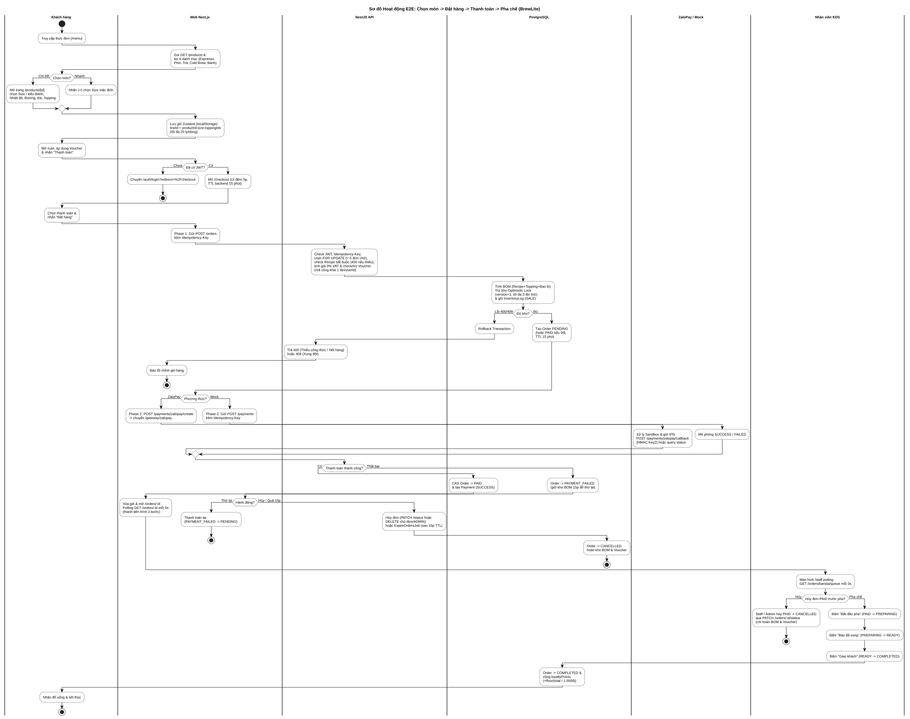

# Biểu đồ Hoạt động End-to-End (E2E Activity Diagram)

## 1. Giới thiệu & Liên kết Tệp tin

Biểu đồ hoạt động toàn trình (**End-to-End Activity Diagram**) mô tả đầy đủ vòng đời nghiệp vụ của một đơn hàng tại **BrewLite Coffee & Pastry**, trải dài qua các phân hệ từ Frontend (Next.js App Router), Backend (NestJS API), Cổng thanh toán (ZaloPay Sandbox / Mock Payment), Cơ sở dữ liệu (PostgreSQL / Prisma) cho đến quầy pha chế KDS (Barista Kitchen Display System).

* **Tệp nguồn PlantUML**: [activity_E2E.puml](file:///D:/SWE/BrewLite_project/docs/diagrams/activity_E2E.puml)
* **Ảnh vector SVG**: [activity_E2E.svg](file:///D:/SWE/BrewLite_project/docs/diagrams/activity_E2E.svg)
* **Ảnh PNG**: [activity_E2E.png](file:///D:/SWE/BrewLite_project/docs/diagrams/activity_E2E.png)

---

## 2. Cấu trúc Swimlanes (6 Làn hoạt động chính)

1. **Khách hàng (`Customer`)**: Tương tác UI chọn món, tùy chỉnh đồ uống/bánh, xác nhận giỏ hàng, thanh toán và nhận đồ uống.
2. **Web Next.js (`Frontend`)**: App Router pages (`/menu`, `/products/[id]`, `/cart`, `/auth/login`, `/checkout`, `/gateway/zalopay`, `/orders/[id]`) và Zustand store (`localStorage`).
3. **NestJS API (`Backend`)**: Xác thực JWT (`7d`, đổi mật khẩu qua `PATCH /auth/profile` cấp `accessToken` mới với `tokenVersion + 1`), kiểm tra `Idempotency-Key`, giới hạn `< 5` đơn chưa hoàn tất (`PENDING` + `PAYMENT_FAILED`), kiểm tra `Recipe` bắt buộc, tính tổng tiền (0% VAT) & áp dụng Voucher, tạo giao dịch thanh toán, xác thực chữ ký HMAC-SHA256 của ZaloPay, và Cron Job hết hạn đơn (`ExpireOrdersJob`).
4. **ZaloPay / Mock (`Gateway`)**: Mô phỏng cổng thanh toán ZaloPay Sandbox (`v2/create`, callback IPN Key2, `v2/query`) và Mock Payment (`POST /payments` cho Thẻ / VietQR / Apple Pay).
5. **PostgreSQL (`Database`)**: Thực thi transaction giữ kho BOM bằng Optimistic Locking (`Ingredient.version`), lưu `Order`, `Payment`, `InventoryLog`, và cập nhật điểm Hạt Vàng (`User.loyaltyPoints`) khi đơn chuyển sang `COMPLETED`.
6. **Nhân viên quầy KDS (`/staff`)**: Theo dõi hàng đợi pha chế và chuyển trạng thái `PAID -> PREPARING -> READY -> COMPLETED` (hoặc hủy đơn `PAID` trước khi pha qua `PATCH /orders/:id/status`).

---

## 3. Phân rã Quy trình Nghiệp vụ Theo Codebase Thực tế

### Giai đoạn 1: Duyệt Thực đơn & Quản lý Giỏ hàng (`/menu`, `/products/[id]`, `/cart`)
* **Danh mục thực đơn (`GET /products`)**: Web hiển thị 6 bộ lọc danh mục thực tế trong code (`Tất cả`, `Espresso Bar`, `Cà Phê Muối & Phin`, `Artisan Tea & Matcha`, `Cold Brew Craft`, `Bánh Nướng`).
* **Chọn món & Tùy chỉnh**: Khách hàng có thể nhấn nút `+` (Quick-Add) trên `ProductCard` để thêm nhanh size mặc định (`M` hoặc size đầu tiên), hoặc mở trang chi tiết **`/products/[id]`** để chọn:
  * Đồ uống: Size (`S`/`M`/`L`), Nhiệt độ (`Đá lạnh`/`Nóng ấm`), Độ ngọt (`0%`–`100%`), Mức đá (`Không đá`/`Đá riêng`/`Ít đá`/`Bình thường`), và Topping (VD: Kem muối biển, Thạch, Trân châu, Shot Espresso...).
  * Bánh nướng (`Bakery`): Cách thưởng thức (`Hâm nóng giòn`/`Dùng ngay`) và Món ăn kèm.
* **Khóa định danh giỏ hàng (`cart-store.ts`)**: Mỗi dòng giỏ hàng sử dụng composite key `lineId = ${productId}-${size}-${toppingIds.join(',')}` (tối đa **20 sản phẩm/dòng** ở UI).
* **Kiểm tra đăng nhập (`/cart` -> `/checkout`)**: Nếu chưa có JWT hợp lệ, chuyển hướng sang `/auth/login?redirect=%2Fcheckout`.

### Giai đoạn 2: Phase 1 — Tạo đơn & Giữ kho BOM (`POST /orders`)
* **Đếm ngược UI vs TTL Server**: Trang `/checkout` hiển thị đồng hồ đếm ngược 5 phút trên giao diện để thúc đẩy thanh toán, trong khi Backend áp dụng **TTL thực tế 15 phút** (`ORDER_PAYMENT_TTL_MS = 15 * 60 * 1000`).
* **Chống trùng lặp & Giới hạn đơn chờ**: `POST /orders` nhận header `Idempotency-Key`, khóa hàng `User` (`SELECT ... FOR UPDATE`) và kiểm tra số đơn đang chờ (`PENDING` + `PAYMENT_FAILED`) **< 5 đơn**.
* **Kiểm tra công thức BOM bắt buộc (`requireRecipeForEachItem: true`)**: Backend kiểm tra từng sản phẩm/size trong đơn phải có ít nhất một `Recipe` được cấu hình, từ chối `400 Bad Request` nếu thiếu. Tương ứng ở `/admin`, form **"Thêm món mới"** bắt buộc chọn `>= 1` nguyên liệu kèm size (`ALL`/`S`/`M`/`L`) và định lượng `> 0`, lưu tuần tự qua `POST /inventory/recipes`.
* **Tính giá & Kiểm soát Voucher ngay ở Phase 1**: Backend tính lại giá từ DB (0% VAT) và trừ lượt `UserVoucher` / tăng `DiscountCode.usageCount` (`voucherDeducted = true`). Mã giảm giá công khai (`DiscountCode`) bị giới hạn **tối đa 1 đơn không `CANCELLED` trên mỗi `userId`**; các `DiscountCode` ngưng hoạt động (`isActive = false`) cũng bị lọc khỏi danh sách `UserVoucher` trả về cho người dùng.
* **BOM & Optimistic Locking**: Tính tổng nguyên liệu (`Recipe` + `ToppingRecipe` + bao bì đóng gói). Các nguyên liệu bắt buộc (`isRequiredForSale = true`) được trừ kho bằng `updateMany` kèm điều kiện `version` và `stock >= requiredAmount` (tối đa **3 lần retry**). Nếu hết hàng trả `400 Bad Request`, nếu xung đột version trả `409 Conflict` và rollback toàn bộ transaction. Nếu thành công tạo đơn `PENDING` (hoặc `PAID` ngay nếu `totalAmount = 0`).

### Giai đoạn 3: Phase 2 — Thanh toán (`ZaloPay` / `Mock`) & Hết hạn
* **Nhánh ZaloPay**: Web gọi `POST /payments/zalopay/create` -> chuyển sang `/gateway/zalopay` (giao diện xác nhận sandbox `POST /payments/zalopay/confirm` hoặc chờ IPN `POST /payments/zalopay/callback` xác thực HMAC-SHA256 `key2` / fallback `GET /payments/zalopay/status/:orderId`).
* **Nhánh Mock (`POST /payments`)**: Gửi kèm `Idempotency-Key` cho phương thức Thẻ / VietQR / Apple Pay; Backend xử lý và trả HTTP `201` với trạng thái `PAID` hoặc `PAYMENT_FAILED`.
* **Khi `PAID`**: Cập nhật CAS `Order -> PAID`, tạo bản ghi `Payment(SUCCESS)`, xóa giỏ hàng và chuyển sang `/orders/:id`. Điểm Hạt Vàng **chưa cộng ở bước `PAID`** (UI hiển thị thông điệp *"Nhận +X Hạt Vàng khi đơn hoàn tất"*).
* **Khi `PAYMENT_FAILED` / Hủy / Hết hạn 15 phút**:
  * Đơn `PAYMENT_FAILED` **không hoàn kho ngay** mà giữ kho BOM trong phạm vi TTL 15 phút để khách thử lại (`PAYMENT_FAILED -> PENDING`).
  * Khách hàng **chỉ được tự hủy** đơn ở trạng thái `PENDING` hoặc `PAYMENT_FAILED` (không thể tự hủy đơn `PAID`). Với `DELETE /orders/:id`, chỉ **chủ đơn hoặc `ADMIN`** mới có quyền xóa (`STAFF` nhận `403 Forbidden`).
  * Quá 15 phút TTL, `ExpireOrdersJob` (`@Cron('*/1 * * * *')`) chuyển đơn sang `CANCELLED`, tự động hoàn kho BOM (`InventoryLog` loại `REFUND`) và hoàn lại lượt Voucher (`refundOrderResources`).

### Giai đoạn 4: Theo dõi Real-time & Pha chế KDS (`/orders/:id` & `/staff`)
* **Theo dõi phía Khách hàng (`/orders/:id`)**: Hook `useOrderPolling` polling `GET /orders/:id` mỗi **5 giây** (`5000ms`), hiển thị thanh tiến trình **3 bước** (`Đã thanh toán` -> `Đang pha chế` -> `Sẵn sàng lấy`; chuyển `COMPLETED` hiển thị hoàn thành).
* **Pha chế phía Quầy (`/staff`)**: Hook `useBaristaQueue` polling `GET /orders/barista/queue` mỗi **3 giây** (`3000ms`). Barista thao tác chuyển trạng thái lần lượt qua `PATCH /orders/:id/status`:
  1. `"Bắt đầu pha"`: `PAID -> PREPARING`
  2. `"Báo đã xong"`: `PREPARING -> READY`
  3. `"Giao khách"`: `READY -> COMPLETED` -> đồng thời cộng điểm Hạt Vàng (`Math.floor(totalAmount / 1000)` -> **1.000đ = 1 điểm**) cho chủ đơn.
* **Hủy đơn đã thanh toán (`PAID`)**: `STAFF` hoặc `ADMIN` được phép chuyển `PAID -> CANCELLED` qua `PATCH /orders/:id/status` (trước khi chuyển `PREPARING`), thực hiện hoàn kho BOM và hoàn lại Voucher (không cần thu hồi điểm thưởng vì điểm chỉ được cộng khi `COMPLETED`).
