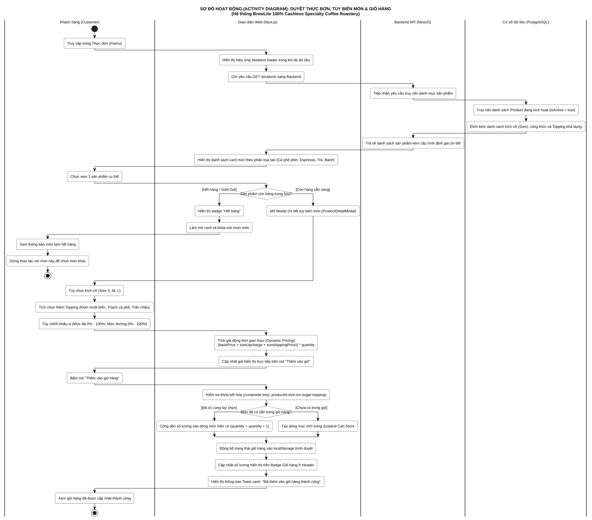
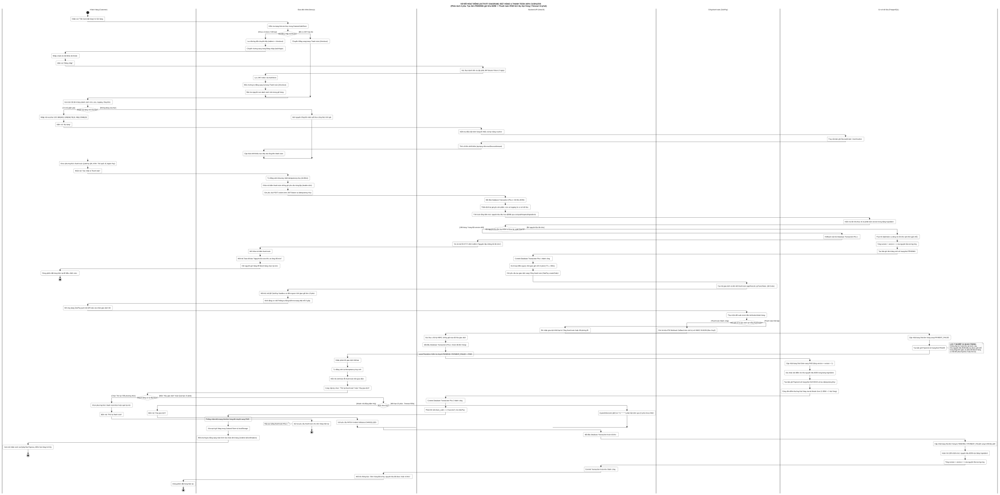
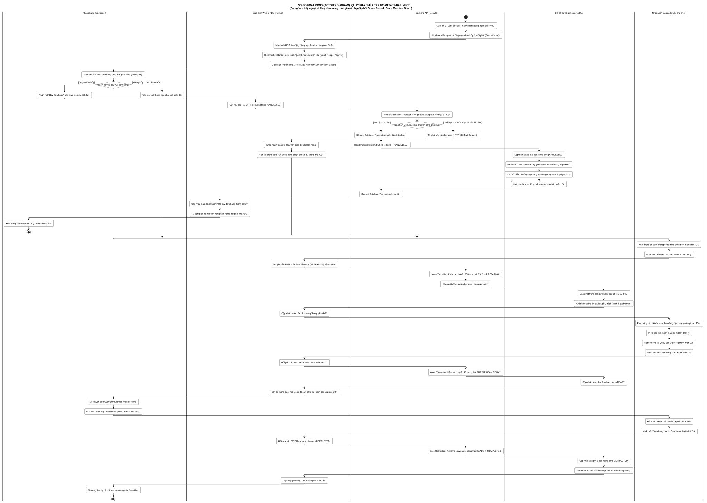

# ĐẶC TẢ CÁC SƠ ĐỒ HOẠT ĐỘNG (ACTIVITY DIAGRAMS)
## BREWLITE: 100% CASHLESS SPECIALTY COFFEE ROASTERY

> **Tài liệu:** `docs/diagrams/activity-diagrams.md`  
> **Học phần:** Công nghệ Phần mềm (Software Engineering) — Assignment 2 (Task 2.1)  
> **Đơn vị đào tạo:** Khoa Công nghệ Thông tin, Trường Đại học Sài Gòn (SGU)  
> **Nhóm thực hiện:** Nhóm BrewLite (6 thành viên)  
> **Phong cách thiết kế:** Monochrome UML 2.5 (Chuẩn đen trắng tối giản, Swimlane phân làn, Decision hình thoi)  
> **Trạng thái:** Chuẩn hóa toàn diện theo mã nguồn thực tế (Approved)

---

## 📌 1. TỔNG QUAN HỆ THỐNG SƠ ĐỒ HOẠT ĐỘNG (TASK 2.1)

Nhằm mô hình hóa hành vi động của hệ thống theo luồng **End-to-End** từ khi khách hàng tiếp cận menu đến khi ly cà phê được trao tận tay tại quầy Bar Express, hệ thống BrewLite được phân rã thành **3 sơ đồ Activity Diagram chuyên biệt** chuẩn hóa theo mã nguồn thực tế (`apps/api/src/orders/orders.service.ts` & `apps/api/src/payments/payments.service.ts`):

| STT | Tên Sơ Đồ Hoạt Động | Tệp Mã Nguồn & Kết Xuất | Số Làn (Swimlanes) | Điểm Nhấn Nghiệp Vụ & Ngoại Lệ |
| :---: | :--- | :--- | :---: | :--- |
| **1** | **Duyệt Menu, Tùy biến món & Giỏ hàng** | [`activity-menu-cart.puml`](activity-menu-cart.puml) [`activity-menu-cart.svg`](activity-menu-cart.svg) [`activity-menu-cart.png`](activity-menu-cart.png) | 4 Làn: • Khách hàng (Customer) • Giao diện Web (Next.js) • Backend API (NestJS) • Cơ sở dữ liệu (PostgreSQL) | • Dynamic Pricing tự động theo thời gian thực. • Composite key `(productId-size-ice-sugar-toppings)` tránh trùng lặp. • **Xử lý món hết hàng (Sold out)**. |
| **2** | **Đặt hàng & Thanh toán không tiền mặt** *(Trọng tâm đề bài)* | [`activity-checkout.puml`](activity-checkout.puml) [`activity-checkout.svg`](activity-checkout.svg) [`activity-checkout.png`](activity-checkout.png) | 5 Làn chuẩn: • Khách hàng (Customer) • Giao diện Web (Next.js) • Backend API (NestJS) • Cổng thanh toán (ZaloPay) • Cơ sở dữ liệu (PostgreSQL) | • **Phân tách 2 pha:** Tạo đơn PENDING (giữ kho BOM) $\rightarrow$ Thanh toán PAID (cộng Hạt Vàng). • **Ngoại lệ 1: Chưa đăng nhập** (Redirect `/auth/login` & bảo lưu giỏ hàng). • **Ngoại lệ 2: Hết hàng BOM 409** (Optimistic Lock rollback). • **Ngoại lệ 3: Thanh toán thất bại `PAYMENT_FAILED`** (Không lập tức hoàn kho, cho phép đổi phương thức/thử lại; chỉ hoàn kho khi khách hủy hoặc quá 15 phút). • **Ngoại lệ 4: Timeout đơn PENDING 15 phút (900s)** (`ExpireOrdersJob` `@Cron('*/1 * * * *')` tự động hủy và hoàn trả kho 100%). |
| **3** | **Quầy pha chế KDS & Nhận nước tại quầy** | [`activity-kds.puml`](activity-kds.puml) [`activity-kds.svg`](activity-kds.svg) [`activity-kds.png`](activity-kds.png) | 5 Làn: • Khách hàng (Customer) • Giao diện Web & KDS (Next.js) • Backend API (NestJS) • Cơ sở dữ liệu (PostgreSQL) • Nhân viên Barista (Quầy pha chế) | • Quick Recipe Popover hiển thị định lượng BOM. • **Ngoại lệ: Hủy đơn trong thời gian ân hạn 5 phút (Grace Period)**. • Máy trạng thái State Machine Guard: `PAID` $\rightarrow$ `PREPARING` $\rightarrow$ `READY` $\rightarrow$ `COMPLETED`. |

---

## ☕ 2. SƠ ĐỒ 1: DUYỆT THỰC ĐƠN, TÙY BIẾN MÓN & GIỎ HÀNG

### 2.1. Hình ảnh sơ đồ (Vector SVG)

### 2.2. Thuyết minh luồng hoạt động:
1. **Khách hàng** truy cập `/menu` $\rightarrow$ **Giao diện Web (Next.js)** hiển thị Skeleton loader và gọi `GET /products` sang **Backend API (NestJS)**.
2. **Backend API** truy vấn bảng `Product`, `Recipe`, `Ingredient` trong **PostgreSQL** và trả về danh sách sản phẩm kích hoạt kèm cấu hình định giá.
3. Khi khách bấm chọn 1 món:
   - **Hình thoi điều kiện `Sản phẩm còn hàng trong kho?`:**
     + *Nhánh Hết hàng / Sold Out:* Frontend hiển thị badge "Hết hàng", làm mờ card và khóa nút chọn món $\rightarrow$ Khách chọn món khác.
     + *Nhánh Còn hàng sẵn sàng:* Mở modal tùy biến `ProductDetailModal`.
4. Khách hàng chọn Size (S/M/L), Topping (Kem muối biển, Thạch cà phê...) và Mức đá (0-100%), Mức đường (0-100%) $\rightarrow$ Frontend tính giá động (Dynamic Pricing) theo thời gian thực:
   $$\text{Giá} = (\text{basePrice} + \text{sizeUpcharge} + \sum \text{toppingPrice}) \times \text{quantity}$$
5. Khi khách bấm "Thêm vào giỏ hàng":
   - **Hình thoi điều kiện `Món đã có sẵn trong giỏ hàng?` (kiểm tra composite key):**
     + *Nhánh Đã có cùng tùy chọn:* Cộng dồn số lượng (`quantity = quantity + 1`).
     + *Nhánh Chưa có:* Tạo dòng mục mới trong Zustand Cart Store.
6. Frontend lưu `localStorage`, cập nhật Cart Badge trên Header và hiển thị Toast xanh thông báo thành công.

---

## 💳 3. SƠ ĐỒ 2: ĐẶT HÀNG & THANH TOÁN KHÔNG TIỀN MẶT (TRỌNG TÂM)

### 3.1. Hình ảnh sơ đồ (Vector SVG)

### 3.2. Thuyết minh luồng hoạt động & Kiến trúc 2 Pha chuẩn hóa:

Quy trình Đặt hàng và Thanh toán tuân thủ kiến trúc phân tách 2 pha giao dịch độc lập và xử lý ngoại lệ theo đúng mã nguồn `orders.service.ts` và `payments.service.ts`:

#### 🔹 Pha 1: Tạo đơn PENDING & Giữ chỗ nguyên liệu BOM
1. **Khách hàng** nhấn "Tiến hành đặt hàng" $\rightarrow$ **Giao diện Web (Next.js)** kiểm tra token trong `authStore`:
   - **Hình thoi điều kiện `Đã đăng nhập tài khoản?` (Ngoại lệ 1):**
     + *Chưa đăng nhập:* Lưu redirect URL `/checkout`, chuyển sang `/auth/login`. Khách đăng nhập xong, Backend cấp JWT 7 ngày, Frontend điều hướng trở lại `/checkout` với giỏ hàng bảo lưu nguyên vẹn.
     + *Đã đăng nhập:* Chuyển thẳng sang trang `/checkout`.
2. Khách áp dụng mã Voucher (nếu có): Backend và PostgreSQL kiểm tra điều kiện đơn hàng tối thiểu, trần chiết khấu và tính toán số tiền giảm.
3. Khách chọn phương thức thanh toán và nhấn "Xác nhận & Thanh toán":
   - Frontend sinh `Idempotency-Key` (UUIDv4) chống gửi trùng lặp (double-click).
   - Gửi yêu cầu `POST /orders` kèm JWT Bearer.
4. **Backend API mở Database Transaction Pha 1 trong PostgreSQL:**
   - Thẩm định lại giá sản phẩm, size, topping từ DB.
   - Tính toán tổng định mức nguyên vật liệu tiêu hao BOM qua `computeRequiredIngredients`.
   - **Hình thoi điều kiện `Đủ nguyên liệu tồn kho BOM & Khóa lạc quan hợp lệ?` (Ngoại lệ 2):**
     + *Hết hàng / Xung đột version (HTTP 409 Conflict):* Rollback Transaction Pha 1. Frontend mở khóa nút bấm, hiển thị Toast đỏ thông báo nguyên liệu vừa hết, giữ nguyên giỏ hàng để khách đổi món.
     + *Đủ nguyên liệu tồn kho:* Thực thi Optimistic Locking trừ tồn kho tạm thời (giữ chỗ) trong bảng `Ingredient` (`version = version + 1`), tạo bản ghi `Order` với trạng thái ban đầu là `PENDING`. Commit Database Transaction Pha 1.
     - Kích hoạt đếm ngược thời gian giữ chỗ **15 phút (900 giây)**.
     - Gửi yêu cầu khởi tạo giao dịch sang **Cổng thanh toán (ZaloPay createOrder)**.

#### 🔹 Pha 2: Xử lý thanh toán & Chuyển sang PAID (Cộng Hạt Vàng)
5. **Cổng thanh toán (ZaloPay)** sinh mã giao dịch (`appTransId`, `zpTransToken`, QR Code).
6. **Frontend** hiển thị mã QR ZaloPay Sandbox, đếm ngược thời hạn đơn 15 phút và khởi động Polling mỗi 3 giây (`GET /payments/zalopay/status`).
7. Khách hàng quét mã QR ZaloPay hoặc xác nhận thẻ $\rightarrow$ ZaloPay xử lý trừ tiền tài chính.
8. **Hình thoi điều kiện `Kết quả xử lý giao dịch tại Cổng thanh toán?`:**
   - **Nhánh Thanh toán thành công:**
     + Cổng thanh toán gửi Webhook IPN Callback kèm chữ ký số HMAC-SHA256 (Mac Key2).
     + Backend API xác thực chữ ký HMAC chống giả mạo dữ liệu.
     + Backend API mở **Database Transaction Pha 2**:
       - `assertTransition`: Kiểm tra chuyển trạng thái hợp lệ `PENDING` / `PAYMENT_FAILED` $\rightarrow$ `PAID`.
       - Cập nhật Order sang `PAID` (tăng version = version + 1).
       - Xác nhận dứt điểm trừ kho nguyên liệu BOM trong bảng `Ingredient`.
       - Tạo bản ghi `Payment` với trạng thái `SUCCESS` và lưu `idempotencyKey`.
       - Cộng dồn điểm thưởng **Hạt Vàng** vào tài khoản User: tỷ lệ 1.000đ = 1 Hạt Vàng (`points = Math.floor(amount / 1000)`).
       - Commit Transaction Pha 2, phản hồi `return_code = 1` cho ZaloPay.
     + Frontend Polling nhận diện trạng thái `PAID` $\rightarrow$ Xóa sạch giỏ hàng trong Zustand Store & `localStorage` $\rightarrow$ Chuyển sang trang `/orders/:id/confirmation`.
     + Khách hàng nhận mã đơn, xem điểm Hạt Vàng tích lũy và theo dõi pha chế. (Kết thúc).
   - **Nhánh Thanh toán thất bại (`PAYMENT_FAILED` - Ngoại lệ 3):**
     + Cập nhật trạng thái đơn hàng sang `PAYMENT_FAILED`, tạo bản ghi Payment `FAILED`.
     + > [!IMPORTANT]
       > **Quy tắc Nghiệp vụ Chuẩn:** Hệ thống **KHÔNG lập tức hoàn kho** tại thời điểm giao dịch thất bại. Tồn kho BOM tiếp tục được giữ chỗ trong tổng thời gian 15 phút để tạo điều kiện thuận lợi cho khách hàng thử lại hoặc đổi phương thức thanh toán.
     + Frontend hiển thị cảnh báo lỗi thanh toán, tự động sinh Idempotency-Key mới và hiển thị 2 tùy chọn:
       - *Thử lại thanh toán:* Khách hàng chọn phương thức khác và bấm "Thử lại thanh toán" $\rightarrow$ Gửi lại yêu cầu thanh toán cho đơn hàng hiện tại (quay lại luồng thanh toán Pha 2).
       - *Hủy giao dịch / Quá hạn 15 phút (Timeout 900s):*
         - Nếu khách bấm "Hủy giao dịch": Frontend gửi `PATCH /orders/:id/status` (`CANCELLED`).
         - Nếu quá hạn 15 phút: `ExpireOrdersJob` (`@Cron('*/1 * * * *')` gọi `expirePendingOrders`) phát hiện đơn quá hạn $\rightarrow$ Tự động mở DB Transaction chuyển đơn sang `CANCELLED` và **hoàn trả 100% định mức nguyên liệu BOM** vào kho (`stock += requiredAmount`, `version += 1`).
         - Frontend thông báo đơn hàng đã bị hủy và nguyên liệu đã được hoàn về kho. Khách hàng kết thúc phiên.

---

## 🍵 4. SƠ ĐỒ 3: QUẦY PHA CHẾ KDS & HOÀN TẤT NHẬN NƯỚC

### 4.1. Hình ảnh sơ đồ (Vector SVG)

### 4.2. Thuyết minh luồng hoạt động:
1. Đơn hàng chuyển sang `PAID` $\rightarrow$ Kích hoạt thời gian ân hạn hủy đơn 5 phút (Grace Period Countdown).
2. Màn hình KDS (`/staff`) tự động nạp thẻ đơn hàng mới với chi tiết size, topping, định mức nguyên liệu (Quick Recipe Popover).
3. **Hình thoi điều kiện `Khách có yêu cầu hủy đơn hàng?` (Ngoại lệ Grace Period):**
   - *Nếu khách hủy trong $\le 5$ phút & chưa chuyển sang pha chế:* Backend kiểm tra hợp lệ $\rightarrow$ DB Transaction chuyển đơn sang `CANCELLED`, hoàn 100% nguyên liệu BOM về kho, thu hồi điểm Hạt Vàng đã cộng, hoàn lại voucher (nếu có) $\rightarrow$ KDS gỡ thẻ đơn $\rightarrow$ Kết thúc (`stop`).
   - *Nếu quá hạn 5 phút hoặc đã bắt đầu làm:* Backend từ chối hủy (`HTTP 400 Bad Request`), Frontend khóa nút hủy và thông báo "Đồ uống đang được chuẩn bị".
   - *Nếu không hủy:* Khách tiếp tục chờ thông báo pha chế.
4. **Quầy pha chế Barista:**
   - Barista xem thông tin định lượng công thức BOM trên màn hình KDS và bấm "Bắt đầu pha chế" $\rightarrow$ Backend cập nhật `PREPARING`, ghi nhận `staffId`, `staffName`, khóa hoàn toàn quyền hủy của khách.
   - Barista pha chế cà phê rang mộc theo định mức công thức BOM, in dán tem nhãn `#id`, đặt ly tại Quầy Bar Express (Trạm nhận 02) và bấm "Pha chế xong" $\rightarrow$ Đơn chuyển `READY`.
5. **Giao nhận nước:**
   - Màn hình khách hiển thị thông báo: "Đồ uống đã sẵn sàng tại Trạm Bar Express 02".
   - Khách di chuyển đến quầy và đưa mã đơn đối soát $\rightarrow$ Barista đối soát và bấm "Giao hàng thành công" $\rightarrow$ Backend chuyển `COMPLETED`, đánh dấu trừ dứt điểm voucher.
   - Khách hàng thưởng thức ly cà phê đặc sản BrewLite. Kết thúc luồng End-to-End (`stop`).
