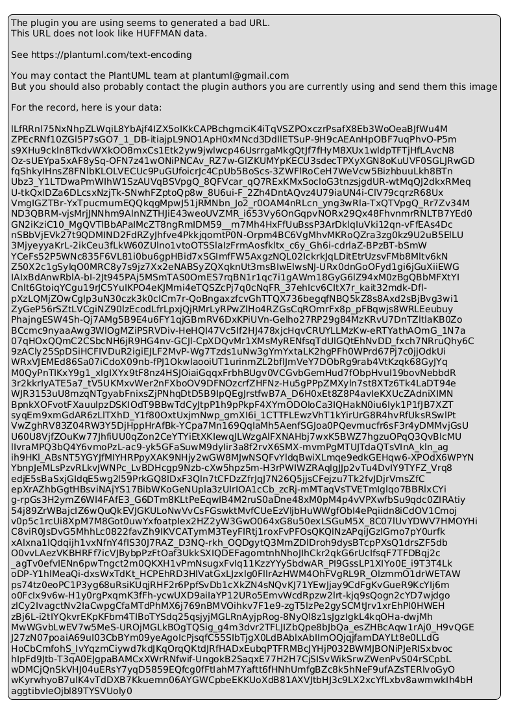

# ĐẶC TẢ SƠ ĐỒ TRIỂN KHAI HỆ THỐNG: UML DEPLOYMENT DIAGRAM
## HỆ THỐNG BREWLITE SPECIALTY COFFEE PLATFORM — ASSIGNMENT 2

> **Học phần:** Công nghệ Phần mềm — Giảng viên: **ThS. Từ Lãng Phiêu**  
> **Sinh viên thực hiện:** Mã Gia Vỹ — MSSV: **3124410414**  
> **Mã nhiệm vụ:** `TASK-03` / Phân nhiệm: **`Task 3.2 — UML Deployment Diagram (Đợt A)`**  
> **Tạo phẩm liên kết:** [`deployment.puml`](deployment.puml) | [`deployment.svg`](deployment.svg) | [`deployment.png`](deployment.png)  
> **Đồng bộ Kiến trúc:** Bám sát 100% tài liệu kiến trúc Task 3.1 ([`architecture.md`](../architecture/architecture.md)), [`ADR-001`](../architecture/adr/001-monorepo.md) (Monorepo), [`ADR-003`](../architecture/adr/003-render-ghcr-deployment.md) (Render & GHCR) và [`ADR-005`](../architecture/adr/005-mock-payment-service.md) (Thanh toán).

---

## 📌 1. MỤC TIÊU VÀ NGUYÊN TẮC THIẾT KẾ (UML 2.5)

1. **Tuân thủ Chuẩn Thẩm mỹ Học thuật UML 2.5:**
   * Sử dụng nét vẽ **đen - trắng tối giản**, không bóng đổ (`shadowing false`), đường nét rõ ràng sắc sảo, tối ưu hiển thị cho in ấn đồ án và báo cáo kỹ thuật.
2. **Quy ước Cấu trúc Thư mục Monorepo (theo bạn Kiệt - ADR-001):**
   * Frontend: `apps/web` (Next.js 16 App Router, React 19, Zustand Store, TailwindCSS).
   * Backend: `apps/api` (NestJS 11 REST API, Prisma ORM, Payments Module).
   * Database Schema: `apps/api/prisma`.
3. **Phân định 3 Môi trường Rõ ràng (Local — CI — Production):**
   * **Local Environment:** Máy trạm nhà phát triển chạy Docker Desktop ảo hóa 3 container qua bridge network.
   * **CI/CD Infrastructure:** GitHub Cloud điều phối pipeline tự động và lưu trữ image trên GitHub Container Registry (`ghcr.io`).
   * **Production Environment:** Nền tảng PaaS Render (Singapore Region) với mạng nội bộ Private VPC bảo vệ cơ sở dữ liệu.

---

## 🗺️ 2. HÌNH ẢNH SƠ ĐỒ TRIỂN KHAI

---

## 🔄 3. BẢNG ĐẶC TẢ CHI TIẾT TỪNG THÀNH PHẦN KIẾN TRÚC

| STT | Thành phần / Node | Phân loại UML | Môi trường | Cổng & Giao thức | Mô tả chi tiết kỹ thuật |
| :---: | :--- | :--- | :--- | :--- | :--- |
| **1** | **Client Devices** | `<<device>>` | Người dùng | N/A | Thiết bị di động (Smartphone), Laptop hoặc PC chạy trình duyệt web hiện đại (Chromium, Safari, Firefox). |
| **2** | **BrewLite Web App** | `<<component>>` | Client SPA | N/A | Ứng dụng PWA / SPA viết bằng React 19, Next.js Client, Zustand Store quản lý giỏ hàng và đồng bộ giao diện. Mã nguồn: `apps/web`. |
| **3** | **Docker Desktop** | `<<virtualizationEngine>>` | Local Dev | Bridge Network | Máy ảo Docker trên máy lập trình viên điều phối 3 container: `web:latest` (3000), `api:latest` (3001) và `db:postgres` (5433:5432). |
| **4** | **Local Volume (`postgres_data`)** | `<<volume>>` | Local Dev | File System | Lưu trữ dữ liệu PostgreSQL trên ổ cứng máy trạm, đảm bảo không mất dữ liệu mẫu khi restart container. |
| **5** | **GitHub Repository** | `<<vcs>>` | CI Cloud | HTTPS :443 | Kho mã nguồn Monorepo quản lý source code, kiểm soát PR và kích hoạt tự động các workflows. |
| **6** | **GitHub Actions Runner** | `<<executionEnvironment>>` | CI Cloud | Ubuntu Linux | Máy ảo chạy pipeline CI (`ci.yml`: lint, test, build) và pipeline CD (`cd.yml`: multi-stage build, tag SHA, push GHCR). |
| **7** | **GitHub Container Registry (GHCR)** | `<<registry>>` | CI Cloud | `ghcr.io` | Lưu trữ Docker Image đóng gói sẵn (`ghcr.io/brewlite-web:sha`, `ghcr.io/brewlite-api:sha`) phục vụ pull tự động sang Render. |
| **8** | **Render Edge Gateway & CDN** | `<<loadBalancer>>` | Production | HTTPS :443 | Điểm tiếp nhận request đầu vào từ Internet, xử lý kết thúc mã hóa TLS 1.3, chống DDoS và phân phối tài nguyên tĩnh. |
| **9** | **Web Service: Frontend Web** | `<<service>>` | Production | Container :3000 | Render Web Service chạy container Next.js 16 standalone output. Biến môi trường: `NEXT_PUBLIC_API_URL=https://api.brewlite.vn`. |
| **10** | **Web Service: Backend API** | `<<service>>` | Production | Container :3001 | Render Web Service chạy container NestJS 11. Định kỳ probe `GET /health` (10s) đảm bảo Zero-Downtime Deployment. Log xuất ra `stdout/stderr`. |
| **11** | **Payments Module** | `<<component>>` | Production API | In-process | Mô-đun thanh toán tích hợp cả **ZaloPay Sandbox API** (chữ ký số HMAC-SHA256) và **MockGatewayService** (theo ADR-005). |
| **12** | **Managed PostgreSQL 16** | `<<database>>` | Production | TCP :5432 (Private) | Cơ sở dữ liệu nằm hoàn toàn trong Render Private VPC (10.0.0.0/8), không cấp IP công khai. Dữ liệu lưu trên Persistent SSD 10GB. |
| **13** | **ZaloPay Sandbox Gateway** | `<<gateway>>` | Bên thứ ba | HTTPS :443 | Máy chủ cổng thanh toán ZaloPay (`sb-openapi.zalopay.vn`) xử lý tạo đơn QR, truy vấn trạng thái và gửi webhook IPN callback. |

---

## 🔒 4. QUẢN TRỊ BẢO MẬT & TRUY VẾT MÃ NGUỒN (TRACEABILITY)

1. **Phân Tầng Quản lý Bí mật (Secrets Management):**
   * **Local:** Khai báo qua tệp `.env` cục bộ và `docker-compose.yml`, tuyệt đối không commit tệp chứa thông tin nhạy cảm.
   * **CI:** Bảo vệ bằng GitHub Repository Secrets (`GHCR_TOKEN`, `RENDER_DEPLOY_HOOK_WEB`, `RENDER_DEPLOY_HOOK_API`).
   * **Production:** Khai báo trực tiếp trên Render Environment Secret Groups (`DATABASE_URL`, `JWT_SECRET`, `ZALOPAY_APP_ID`, `ZALOPAY_KEY1`, `ZALOPAY_KEY2`).
2. **Khớp nối 1:1 với Bảng Truy vết Kiến trúc (Mục 6 - `architecture.md`):**
   * Mỗi container trong sơ đồ đều tương ứng trực tiếp với một mục trong kiến trúc của bạn Kiệt và thư mục mã nguồn tương ứng (`apps/web`, `apps/api`, `apps/api/prisma`), thỏa mãn 100% tiêu chí nghiệm thu đề bài của ThS. Từ Lãng Phiêu.
