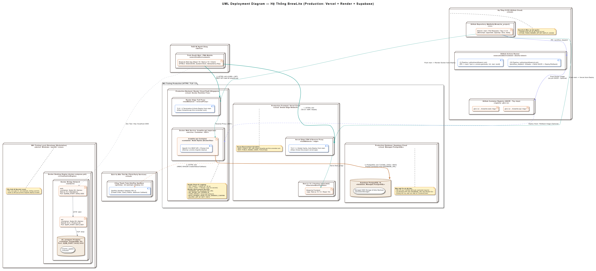

# ĐẶC TẢ SƠ ĐỒ TRIỂN KHAI HỆ THỐNG: UML DEPLOYMENT DIAGRAM
## HỆ THỐNG BREWLITE SPECIALTY COFFEE PLATFORM — ASSIGNMENT 2

> **Học phần:** Công nghệ Phần mềm — Giảng viên: **ThS. Từ Lãng Phiêu**  
> **Sinh viên thực hiện:** Quách Kỳ Minh (Task 3.2 — UML Deployment Diagram)  
> **Cập nhật đồng bộ Production thực tế:** 2026-11-14 (Vercel Frontend + Render Docker API + Supabase PostgreSQL)  
> **Tạo phẩm liên kết:** [`deployment.puml`](deployment.puml) | [`deployment.svg`](deployment.svg) | [`deployment.png`](deployment.png)  
> **Đồng bộ Kiến trúc:** Bám sát 100% tài liệu kiến trúc ([`architecture.md`](../architecture/architecture.md)), [`ADR-001`](../architecture/adr/001-monorepo.md) (Monorepo), [`ADR-003`](../architecture/adr/003-render-ghcr-deployment.md) (Vercel + Render + Supabase & GHCR) và [`ADR-005`](../architecture/adr/005-mock-payment-service.md) (Thanh toán).

---

## 📌 1. MỤC TIÊU VÀ NGUYÊN TẮC THIẾT KẾ

1. **Phản ánh đúng hạ tầng thực tế (Assignment 2 §5.2):** Sơ đồ phân tách rõ các nền tảng thật đang phục vụ Production gồm **Vercel** (Frontend Web), **Render Singapore** (Backend API Docker), **Supabase** (Managed PostgreSQL) và **ZaloPay Sandbox**.
2. **Quy ước Cấu trúc Thư mục Monorepo (`ADR-001`):**
   * Frontend: `apps/web` (Next.js 15.1.6 App Router, React 19, Zustand Store, TailwindCSS).
   * Backend: `apps/api` (NestJS 10.4 REST API, Prisma ORM 5.22, Payments Module).
   * Database Schema: `apps/api/prisma`.
3. **Phân định 3 Môi trường Rõ ràng (Local — CI/CD — Production):**
   * **Local Environment:** Máy trạm chạy Docker Compose (`docker-compose.yml`) với 3 container `web`, `api`, `db`.
   * **CI/CD Infrastructure:** GitHub Cloud chạy `ci.yml` trên PR, tích hợp Auto-Deploy trực tiếp tới Vercel & Render khi merge `main`, và giữ `cd.yml` cho luồng đóng gói container GHCR / rollback thủ công.
   * **Production Environment:** Vercel Edge (`https://brew-lite-project.vercel.app`) gọi qua HTTPS tới Render Docker API (`https://brewlite-api-9viv.onrender.com`), kết nối bảo mật TLS/SSL (`sslmode=require`) tới Supabase PostgreSQL.

---

## 🗺️ 2. HÌNH ẢNH SƠ ĐỒ TRIỂN KHAI

---

## 🔄 3. BẢNG ĐẶC TẢ CHI TIẾT TỪNG THÀNH PHẦN KIẾN TRÚC

| STT | Thành phần / Node | Phân loại UML | Môi trường | Cổng & Giao thức | Mô tả chi tiết kỹ thuật |
| :---: | :--- | :--- | :--- | :--- | :--- |
| **1** | **Client Devices & Browser** | `<<device>>` / `<<executionEnvironment>>` | Người dùng | HTTPS :443 | Smartphone/Laptop chạy trình duyệt web hiện đại tải ứng dụng React 19 / Next.js 15.1, quản lý giỏ hàng Zustand và sinh `Idempotency-Key`. |
| **2** | **Docker Desktop (`docker-compose.yml`)** | `<<virtualizationEngine>>` | Local Dev | Bridge Network | Điều phối 3 container local: `web` (`${WEB_PORT:-3000}:3000`), `api` (`${API_PORT:-3001}:3001`) và `db` (`postgres:16-alpine`, `${DB_PORT:-5432}:5432`). |
| **3** | **Local Volume (`brewlite_pgdata`)** | `<<volume>>` | Local Dev | File System | Lưu trữ dữ liệu PostgreSQL trên máy trạm, tránh mất dữ liệu mẫu khi restart container. |
| **4** | **GitHub Repository (`MaGiaVy/BrewLite_project`)** | `<<vcs>>` | CI/CD Cloud | HTTPS :443 | Kho mã nguồn Monorepo quản lý PR vào `main`, tag phát hành `v1.0.0`, trigger CI và Auto-Deploy tới Vercel/Render. |
| **5** | **GitHub Actions Runner** | `<<executionEnvironment>>` | CI/CD Cloud | Ubuntu Linux | Chạy `ci.yml` (`npm ci`, `prisma generate`, `lint`, `test`, `build`) và `cd.yml` (quét Gitleaks, build & push GHCR, gọi Render deploy/rollback hook). |
| **6** | **GitHub Container Registry (GHCR)** | `<<registry>>` | CI/CD Cloud | `ghcr.io` | Kho Docker Image tùy chọn (`ghcr.io/.../brewlite-{web,api}:<tag>`) cho kịch bản triển khai hoặc rollback bằng container image. |
| **7** | **Vercel Edge & Next.js Hosting** | `<<cloud>>` / `<<executionEnvironment>>` | Production | HTTPS :443 | Phục vụ Frontend `apps/web` tại `https://brew-lite-project.vercel.app` với TLS 1.3, CDN toàn cầu, Auto-Deploy từ `main` và `NEXT_PUBLIC_API_URL`. |
| **8** | **Render Edge & `brewlite-api` Docker** | `<<cloud>>` / `<<service>>` | Production | HTTPS :443 → :3001 | Render Web Service tại Singapore (`https://brewlite-api-9viv.onrender.com`) build từ `apps/api/Dockerfile`, chạy `prisma migrate deploy` khi khởi động và phục vụ `GET /health`. |
| **9** | **Payments Module (`apps/api/src/payments`)** | `<<component>>` | Production API | In-process | Xử lý `ZaloPayService` (HMAC-SHA256, webhook callback) và `MockGatewayService` (bị chặn trên Production trừ khi cấu hình cho phép test). |
| **10** | **Supabase Managed PostgreSQL 16** | `<<database>>` | Production | TCP :5432 / :6543 (TLS/SSL) | Cơ sở dữ liệu Production lưu 12 bảng BOM/Orders/Payments, bật SSL (`sslmode=require`), chỉ Backend Render giữ `DATABASE_URL`. |
| **11** | **ZaloPay Sandbox Gateway** | `<<gateway>>` | Bên thứ ba | HTTPS :443 | Máy chủ ZaloPay Sandbox (`sb-openapi.zalopay.vn`) xử lý tạo đơn QR, truy vấn trạng thái và gửi webhook IPN callback. |

---

## 🔒 4. QUẢN TRỊ BẢO MẬT & TRUY VẾT MÃ NGUỒN (TRACEABILITY)

1. **Phân tầng Quản lý Bí mật (Secrets Management):**
   * **Local:** Khai báo trong `.env` (tạo từ `.env.example`), đã bị `.gitignore` chặn commit.
   * **CI/CD:** Bảo vệ bằng GitHub Repository Secrets (`GITHUB_TOKEN`, `RENDER_API_KEY`, `RENDER_API_DEPLOY_HOOK`, `RENDER_WEB_DEPLOY_HOOK`) và job `gitleaks` trong `cd.yml`.
   * **Production:** Frontend trên Vercel chỉ chứa biến công khai `NEXT_PUBLIC_API_URL`; toàn bộ bí mật (`DATABASE_URL`, `JWT_SECRET`, `ZALOPAY_APP_ID`, `ZALOPAY_KEY1`, `ZALOPAY_KEY2`, `CORS_ORIGIN`, `ALLOW_SANDBOX_CONFIRM`) nằm trong **Render Environment Variables** của `brewlite-api`.
2. **Bảo mật Cơ sở dữ liệu:**
   * Database Supabase PostgreSQL kết nối qua TLS/SSL (`sslmode=require`), không cấp connection string cho client trình duyệt và không ghi mật khẩu vào log/repo.
