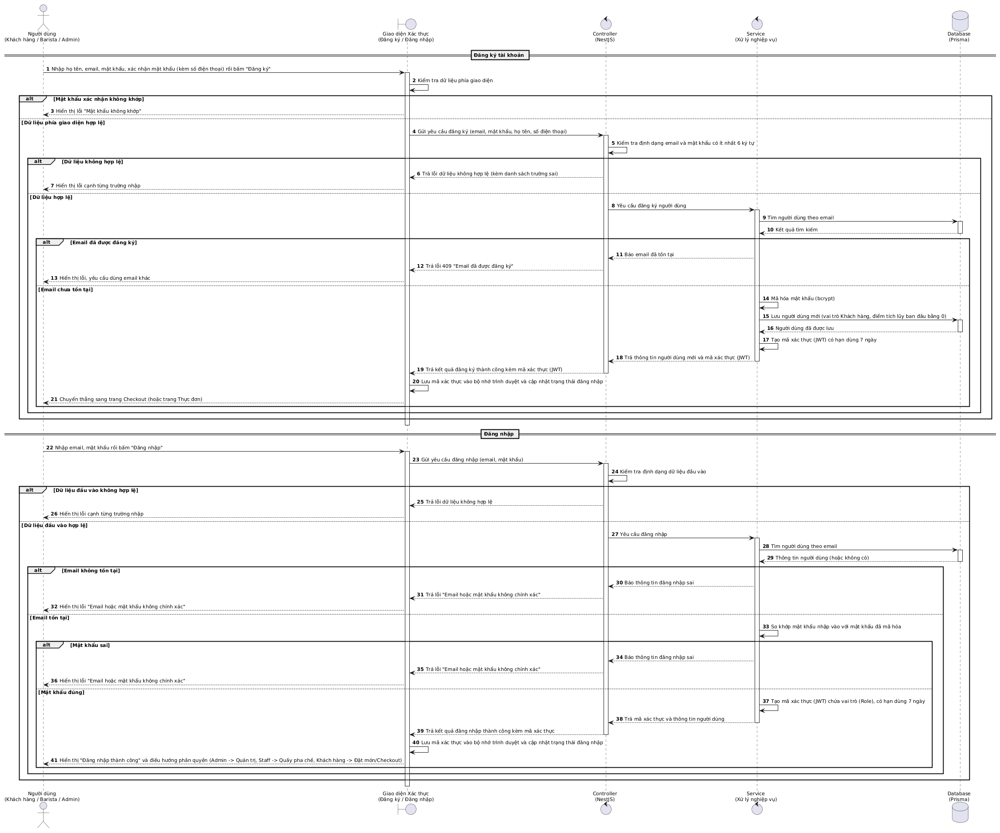

# ĐẶC TẢ SƠ ĐỒ TUẦN TỰ: ĐĂNG KÝ VÀ ĐĂNG NHẬP PHÂN QUYỀN (RBAC)
## HỆ THỐNG BREWLITE SPECIALTY COFFEE PLATFORM

> **Học phần:** Công nghệ Phần mềm — Giảng viên: **ThS. Từ Lãng Phiêu**  
> **Sinh viên thực hiện:** Mã Gia Vỹ — MSSV: **3124410414**  
> **Tạo phẩm:** [`sequence-auth.puml`](sequence-auth.puml) | [`sequence-auth.svg`](sequence-auth.svg) | [`sequence-auth.png`](sequence-auth.png)  
> **Mã ca sử dụng liên kết:** `UC10` (Đăng ký tài khoản), `UC11` (Đăng nhập hệ thống), `UC11a` (Điều hướng phân quyền RBAC)  
> **Đồng bộ SRS:** Bám sát 100% mục `FR-04` và `NFR-02` (Stateless JWT token có thời hạn hiệu lực **7 ngày**).

---

## 📌 1. CẤU TRÚC 5 ĐỐI TƯỢNG (LIFELINES) CHUẨN FORM UML

1. **`Người dùng (Khách hàng / Barista / Admin)` (`User`):** Tác nhân tương tác trực tiếp với hệ thống qua thiết bị di động / PWA.
2. **`Giao diện Xác thực (Đăng ký / Đăng nhập)` (`UI`):** Lớp biên (Boundary) tiếp nhận form nhập liệu, kiểm tra dữ liệu phía Client, lưu trữ mã xác thực (JWT) và điều hướng.
3. **`Controller (NestJS)` (`Controller`):** Lớp điều khiển (Control) tiếp nhận HTTP request, kích hoạt `ValidationPipe` kiểm tra định dạng DTO.
4. **`Service (Xử lý nghiệp vụ)` (`Service`):** Lớp xử lý logic (Control) thực hiện mã hóa bcrypt, đối soát mật khẩu và ký tạo mã xác thực JWT có thời hạn 7 ngày.
5. **`Database (Prisma)` (`DB`):** Cơ sở dữ liệu lưu trữ thông tin thực thể `User`.

---

## 🔄 2. BẢNG TRUY VẾT 41 BƯỚC ĐẶC TẢ CHI TIẾT

### PHẦN 1: ĐĂNG KÝ TÀI KHOẢN (BƯỚC 1 – 21)

| STT | Bước thực hiện | Thành phần gửi $\rightarrow$ nhận | Mô tả chi tiết kỹ thuật |
| :---: | :--- | :--- | :--- |
| **1** | Nhập thông tin đăng ký | `Người dùng` $\rightarrow$ `UI` | Nhập họ tên, email, mật khẩu, xác nhận mật khẩu (kèm số điện thoại tùy chọn) rồi bấm "Đăng ký". |
| **2** | Kiểm tra dữ liệu phía giao diện | `UI` $\rightarrow$ `UI` | Kiểm tra form rỗng và so khớp mật khẩu xác nhận ngay tại Client. |
| **3** | *[Nhánh lỗi]* Hiển thị lỗi mật khẩu không khớp | `UI` $\rightarrow$ `Người dùng` | Cảnh báo lỗi ngay trên giao diện mà không gọi API. |
| **4** | Gửi yêu cầu đăng ký | `UI` $\rightarrow$ `Controller` | Gọi `POST /auth/register` kèm payload `RegisterDto`. |
| **5** | Kiểm tra định dạng dữ liệu | `Controller` $\rightarrow$ `Controller` | `ValidationPipe` kiểm tra email chuẩn RFC, mật khẩu tối thiểu 6 ký tự. |
| **6 – 7** | *[Nhánh lỗi]* Dữ liệu DTO không hợp lệ | `Controller` $\rightarrow$ `UI` $\rightarrow$ `Người dùng` | Trả mã 400 Bad Request và hiển thị thông báo lỗi cạnh từng trường nhập. |
| **8** | Yêu cầu đăng ký người dùng | `Controller` $\rightarrow$ `Service` | Kích hoạt phương thức `AuthService.register(dto)`. |
| **9 – 10** | Tìm người dùng theo email | `Service` $\leftrightarrow$ `DB` | Truy vấn `prisma.user.findUnique({ where: { email } })`. |
| **11 – 13** | *[Nhánh lỗi]* Email đã được đăng ký | `Service` $\rightarrow$ `Controller` $\rightarrow$ `UI` | Ném lỗi 409 Conflict "Email đã được đăng ký" và yêu cầu dùng email khác. |
| **14** | Mã hóa mật khẩu | `Service` $\rightarrow$ `Service` | Sử dụng thư viện `bcrypt` với muối `SALT_ROUNDS = 10`. |
| **15 – 16** | Lưu người dùng mới | `Service` $\leftrightarrow$ `DB` | Lưu user vào Database với vai trò mặc định `CUSTOMER`, điểm tích lũy ban đầu `0`. |
| **17** | Tạo mã xác thực (JWT) | `Service` $\rightarrow$ `Service` | `jwtService.sign({ sub: user.id, email, role: 'CUSTOMER' })` **hạn dùng 7 ngày** (chuẩn `FR-04` & `NFR-02`). |
| **18 – 19** | Trả kết quả đăng ký thành công | `Service` $\rightarrow$ `Controller` $\rightarrow$ `UI` | Phản hồi HTTP 201 Created kèm mã xác thực (JWT) và thông tin safeUser. |
| **20** | Lưu mã xác thực | `UI` $\rightarrow$ `UI` | Lưu JWT token vào bộ nhớ trình duyệt (LocalStorage) và cập nhật `authStore`. |
| **21** | Chuyển hướng người dùng | `UI` $\rightarrow$ `Người dùng` | Chuyển thẳng sang trang Checkout (nếu đang dở giỏ hàng) hoặc trang Thực đơn (`/menu`). |

---

### PHẦN 2: ĐĂNG NHẬP & PHÂN QUYỀN (BƯỚC 22 – 41)

| STT | Bước thực hiện | Thành phần gửi $\rightarrow$ nhận | Mô tả chi tiết kỹ thuật |
| :---: | :--- | :--- | :--- |
| **22** | Nhập email, mật khẩu | `Người dùng` $\rightarrow$ `UI` | Người dùng nhập tài khoản và bấm "Đăng nhập". |
| **23** | Gửi yêu cầu đăng nhập | `UI` $\rightarrow$ `Controller` | Gọi `POST /auth/login` kèm `LoginDto`. |
| **24** | Kiểm tra định dạng đầu vào | `Controller` $\rightarrow$ `Controller` | `ValidationPipe` kiểm tra dữ liệu bắt buộc không được rỗng. |
| **25 – 26** | *[Nhánh lỗi]* Dữ liệu đầu vào không hợp lệ | `Controller` $\rightarrow$ `UI` $\rightarrow$ `Người dùng` | Trả lỗi HTTP 400 Bad Request và hiển thị cảnh báo lỗi. |
| **27** | Yêu cầu đăng nhập | `Controller` $\rightarrow$ `Service` | Kích hoạt `AuthService.login(dto)`. |
| **28 – 29** | Tìm người dùng theo email | `Service` $\leftrightarrow$ `DB` | Truy vấn Database theo email đăng nhập. |
| **30 – 32** | *[Nhánh lỗi]* Email không tồn tại | `Service` $\rightarrow$ `Controller` $\rightarrow$ `UI` | Chuẩn OWASP: Trả mã 401 Unauthorized "Email hoặc mật khẩu không chính xác" (chống rà quét tài khoản). |
| **33** | So khớp mật khẩu | `Service` $\rightarrow$ `Service` | Thực hiện `bcrypt.compare(password, user.passwordHash)`. |
| **34 – 36** | *[Nhánh lỗi]* Mật khẩu sai | `Service` $\rightarrow$ `Controller` $\rightarrow$ `UI` | Trả lỗi 401 "Email hoặc mật khẩu không chính xác". |
| **37** | Tạo mã xác thực (JWT) chứa vai trò | `Service` $\rightarrow$ `Service` | Tạo JWT mang claim `{ sub, email, role: user.role }` **có hạn 7 ngày** (chuẩn `FR-04` & `NFR-02`). |
| **38 – 39** | Trả kết quả đăng nhập thành công | `Service` $\rightarrow$ `Controller` $\rightarrow$ `UI` | Trả về mã xác thực JWT và profile thông tin người dùng. |
| **40** | Cập nhật phiên đăng nhập | `UI` $\rightarrow$ `UI` | Lưu token vào LocalStorage và cập nhật Zustand store. |
| **41** | Điều hướng phân quyền (RBAC) | `UI` $\rightarrow$ `Người dùng` | **Điều hướng tự động theo Role:** • `ADMIN` $\rightarrow$ Cổng Quản trị (`/admin`) • `STAFF` $\rightarrow$ Quầy pha chế KDS (`/staff`) • `CUSTOMER` $\rightarrow$ Trang Đặt món / Checkout. |

---

## 🖼️ 3. HÌNH ẢNH SƠ ĐỒ KẾT XUẤT

