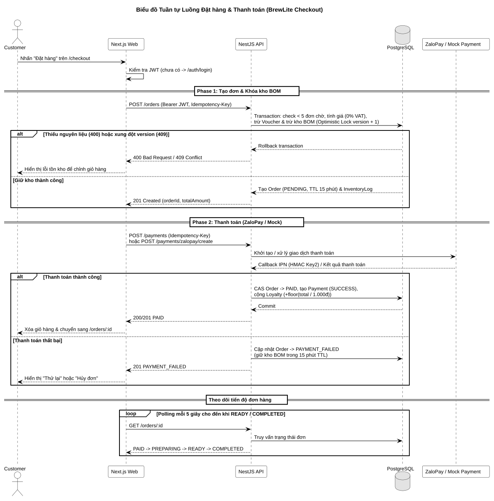

# Biểu đồ Tuần tự Luồng Đặt hàng & Thanh toán (Checkout Sequence Diagram)

## 1. Tổng quan Kiến trúc 2 Pha

Quy trình Checkout của hệ thống **BrewLite** tách biệt thành **2 Pha độc lập (Two-Phase Checkout)** thông qua 5 thành phần cốt lõi (`Customer`, `Next.js Web`, `NestJS API`, `PostgreSQL`, `ZaloPay / Mock Payment`) để đảm bảo tính nhất quán tồn kho BOM và ngăn chặn thanh toán trùng lặp:

1. **Pha 1 (`POST /orders`)**: Xác thực JWT, kiểm tra `Idempotency-Key`, khóa dòng `User` kiểm tra `< 5` đơn chưa hoàn tất, tính lại tổng tiền (0% VAT), trừ lượt Voucher (`voucherDeducted = true`) và trừ kho nguyên liệu BOM bằng **Optimistic Locking (`version + 1`)** để tạo đơn hàng `PENDING` (TTL **15 phút**; hoặc `PAID` ngay nếu `totalAmount = 0`).
2. **Pha 2 (`POST /payments` hoặc `POST /payments/zalopay/create`)**: Gọi cổng thanh toán ZaloPay / Mock Gateway (kèm `Idempotency-Key` hoặc IPN HMAC-SHA256 `key2`) để hoàn tất chuyển trạng thái `Order -> PAID`, ghi nhận `Payment(SUCCESS)` và cộng điểm Hạt Vàng (**1.000đ = 1 điểm**), hoặc chuyển `PAYMENT_FAILED` nếu thanh toán thất bại.
3. **Theo dõi tiến độ (`/orders/:id`)**: Web polling `GET /orders/:id` mỗi **5 giây** (`useOrderPolling`) để đồng bộ trạng thái từ KDS quầy pha chế (`PAID -> PREPARING -> READY -> COMPLETED`).

* **Tệp nguồn PlantUML**: [sequence-checkout.puml](file:///D:/SWE/BrewLite_project/docs/diagrams/sequence-checkout.puml)
* **Ảnh vector SVG**: [sequence-checkout.svg](file:///D:/SWE/BrewLite_project/docs/diagrams/sequence-checkout.svg)
* **Ảnh PNG**: [sequence-checkout.png](file:///D:/SWE/BrewLite_project/docs/diagrams/sequence-checkout.png)

---

## 2. Chi tiết Các Bước & Cơ chế Bảo vệ Dữ liệu

### 2.1. Kiểm tra Xác thực & Chống trùng lặp (`Idempotency-Key`)
* Trước khi vào `/checkout`, `Next.js Web` kiểm tra JWT token (`7d`). Nếu chưa đăng nhập, chuyển hướng về `/auth/login?redirect=%2Fcheckout`.
* Cả `POST /orders` và `POST /payments` đều hỗ trợ `Idempotency-Key` (UUIDv4) để chống double-click hoặc retry mạng. Nếu payload không khớp key cũ, API trả về `409 Conflict`.

### 2.2. Phase 1: Tạo đơn `PENDING`, Trừ Voucher & Khóa kho BOM (`POST /orders`)
* **Khóa hàng User & Giới hạn đơn chờ**: Thực thi `SELECT id FROM "User" WHERE id = :userId FOR UPDATE`, từ chối (`400 Bad Request`) nếu khách đang có `>= 5` đơn ở trạng thái `PENDING` / `PAYMENT_FAILED`.
* **Tính giá & Trừ lượt Voucher**: Server tự tính tổng tiền từ giá sản phẩm/topping/voucher trong DB (0% VAT), **trừ ngay lượt `UserVoucher` / tăng `DiscountCode.usageCount` (`voucherDeducted = true`)** trong transaction để tránh dùng 1 mã cho nhiều đơn song song.
* **BOM Optimistic Locking**: Tính tổng nguyên liệu (`Recipe` + `ToppingRecipe` + bao bì). Với nguyên liệu bắt buộc (`isRequiredForSale = true`), cập nhật `stock = stock - required, version = version + 1` với điều kiện `WHERE id = ... AND version = ... AND stock >= required` (tối đa **3 lần retry**).
  * Thiếu nguyên liệu ở lần thử đầu -> trả `400 Bad Request` và rollback transaction.
  * Cạnh tranh đồng thời vượt quá số lần retry -> trả `409 Conflict` và rollback transaction.
* **TTL Thanh toán**: Giao diện `/checkout` và `/gateway/zalopay` hiển thị đếm ngược 5 phút cho người dùng, trong khi Backend áp dụng **TTL thực tế 15 phút** (`ORDER_PAYMENT_TTL_MS = 15 * 60 * 1000`).

### 2.3. Phase 2: Xử lý Thanh toán (`ZaloPay / Mock`) & Thử lại
* **ZaloPay Sandbox**: `POST /payments/zalopay/create` tạo giao dịch trên ZaloPay `v2/create` (HMAC-SHA256 `key1`) và điều hướng sang `/gateway/zalopay`. Kết quả được xác nhận qua webhook IPN `POST /payments/zalopay/callback` (xác thực HMAC-SHA256 `key2`), nút xác nhận sandbox (`/payments/zalopay/confirm`) hoặc fallback `GET /payments/zalopay/status/:orderId`.
* **Mock Payment**: `POST /payments` (kèm `Idempotency-Key`) mô phỏng kết quả `PAID` hoặc `PAYMENT_FAILED` (trả HTTP `201`).
* **Thanh toán thành công (`PAID`)**: Dùng CAS (`where: { id, status: activeStatus, version }`) chuyển `Order -> PAID`, tạo `Payment(SUCCESS)` và cộng `User.loyaltyPoints` theo công thức `Math.floor(paymentAmount / 1000)`.
* **Thanh toán thất bại (`PAYMENT_FAILED`)**: Cập nhật `Order -> PAYMENT_FAILED` và **giữ nguyên kho BOM trong phạm vi 15 phút TTL** để khách hàng có thể bấm **"Thử lại"** (`PAYMENT_FAILED -> PENDING`).

### 2.4. Quy tắc Hủy đơn & Hết hạn Tự động (15 phút)
* **Khách hàng tự hủy**: Chỉ áp dụng với đơn ở trạng thái `PENDING` hoặc `PAYMENT_FAILED` qua `PATCH /orders/:id/status`. **Khách hàng không được tự hủy đơn đã `PAID`**; trường hợp cần hủy sau khi đã thanh toán phải do `STAFF` hoặc `ADMIN` thực hiện trước khi quầy bắt đầu pha (`PAID -> CANCELLED`).
* **Tự động hết hạn (15 phút)**: `ExpireOrdersJob` (`@Cron('*/1 * * * *')`) quét các đơn `PENDING` / `PAYMENT_FAILED` quá 15 phút, chuyển sang `CANCELLED` và gọi `refundOrderResources` để hoàn kho BOM (`InventoryLog: REFUND`) cùng lượt Voucher đã trừ.

### 2.5. Theo dõi Đơn hàng (`/orders/:id`)
* Sau khi thanh toán thành công, Web xóa giỏ hàng (`localStorage`) và chuyển sang `/orders/:id`.
* Hook `useOrderPolling` gọi `GET /orders/:id` mỗi **5 giây** để cập nhật tiến độ 3 bước từ quầy KDS (`/staff` polling `GET /orders/barista/queue` mỗi **3 giây**): `PAID -> PREPARING -> READY -> COMPLETED`.
