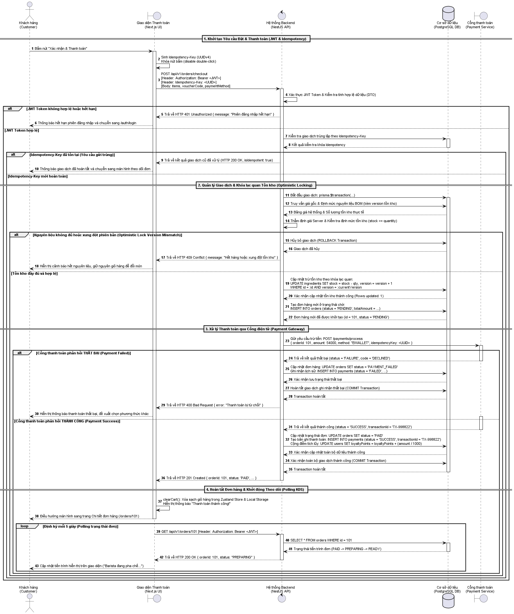

# ĐẶC TẢ SƠ ĐỒ TUẦN TỰ: ĐẶT HÀNG VÀ THANH TOÁN KHÔNG DÙNG TIỀN MẶT
## HỆ THỐNG BREWLITE SPECIALTY COFFEE PLATFORM — TASK 2.2 (CHUẨN HỌC THUẬT)

> **Học phần:** Công nghệ Phần mềm — Giảng viên: **ThS. Từ Lãng Phiêu**  
> **Nhóm thực hiện:** Nhóm BrewLite (6 thành viên) — Phụ trách chính: **Mã Gia Vỹ** (MSSV: **3124410414**)  
> **Tạo phẩm:** [`sequence-checkout.puml`](sequence-checkout.puml) | [`sequence-checkout.svg`](sequence-checkout.svg) | [`sequence-checkout.png`](sequence-checkout.png)  
> **Mã ca sử dụng liên kết:** `UC-CHECKOUT` (Đặt hàng và thanh toán không tiền mặt)  
> **Phong cách thiết kế:** Tinh giản theo chuẩn giáo trình *Software Engineering (Ian Sommerville)* — Khớp chính xác 5 Lifelines được chỉ định trong mục 4.2 Assignment 2.

---

## 📌 1. CẤU TRÚC 5 ĐỐI TƯỢNG (LIFELINES) CHUẨN ĐỀ BÀI ASSIGNMENT 2

Đúng theo yêu cầu bắt buộc tại mục 4.2 của ThS. Từ Lãng Phiêu:
$$\text{Customer} \longrightarrow \text{Next.js UI} \longrightarrow \text{NestJS API} \longrightarrow \text{Database} \longrightarrow \text{Payment Service}$$

1. **`Khách hàng (Customer)` (`User`):** Tác nhân chính (Primary Actor) thực hiện thao tác duyệt giỏ hàng, chọn phương thức thanh toán và kích hoạt đặt hàng.
2. **`Giao diện Thanh toán (Next.js UI)` (`UI`):** Lớp biên (Boundary) thuộc Next.js App Router, quản lý trạng thái giỏ hàng (Zustand Store), sinh `Idempotency-Key` (UUIDv4), khóa nút bấm chống gửi đúp và kích hoạt Polling theo dõi đơn.
3. **`Hệ thống Backend (NestJS API)` (`API`):** Lớp điều khiển & xử lý nghiệp vụ trung tâm (Control Layer), xác thực JWT Token qua `JwtAuthGuard`, điều phối giao dịch (`prisma.$transaction`), kiểm tra khóa lạc quan (Optimistic Locking) và State Machine Guard.
4. **`Cơ sở dữ liệu (PostgreSQL DB)` (`DB`):** Lớp dữ liệu bền vững (Persistence Layer), lưu trữ thông tin đơn hàng, tồn kho nguyên liệu BOM, bản ghi thanh toán với tính toàn vẹn ACID.
5. **`Cổng thanh toán (Payment Service)` (`Gateway`):** Dịch vụ thanh toán trực tuyến thứ ba (ZaloPay Sandbox / Mock Payment Gateway) xử lý giao dịch tài chính không tiền mặt.

---

## 🔄 2. BẢNG TRUY VẾT CHI TIẾT CÁC BƯỚC THỰC HIỆN (33 BƯỚC)

### PHẦN 1: KHỞI TẠO YÊU CẦU ĐẶT & THANH TOÁN (BƯỚC 1 – 11)

| STT | Bước thực hiện | Thành phần gửi $\rightarrow$ nhận | Mô tả chi tiết kỹ thuật |
| :---: | :--- | :--- | :--- |
| **1** | Nhấn "Xác nhận & Thanh toán" | `User` $\rightarrow$ `UI` | Khách hàng hoàn tất chọn món, áp mã ưu đãi và bấm nút thanh toán. |
| **2** | Khóa nút & Sinh Idempotency-Key | `UI` $\rightarrow$ `UI` | Disable nút bấm tránh double-click; sinh chuỗi ngẫu nhiên `Idempotency-Key = UUIDv4()`. |
| **3** | Gửi yêu cầu đặt hàng & thanh toán | `UI` $\rightarrow$ `API` | Gửi `POST /api/v1/orders/checkout` kèm Bearer JWT, `Idempotency-Key` và payload đơn hàng. |
| **4** | Xác thực JWT & Validate DTO | `API` $\rightarrow$ `API` | `JwtAuthGuard` kiểm tra chữ ký & hạn dùng Token; `ValidationPipe` kiểm tra hợp lệ dữ liệu. |
| **5 – 6** | *[Nhánh lỗi]* Token không hợp lệ / Hết hạn | `API` $\rightarrow$ `UI` $\rightarrow$ `User` | Trả mã `401 Unauthorized`; UI thông báo hết hạn phiên đăng nhập và chuyển hướng về `/auth/login`. |
| **7 – 8** | Kiểm tra trùng lặp Idempotency-Key | `API` $\leftrightarrow$ `DB` | Truy vấn `SELECT * FROM payments WHERE idempotencyKey = :idempotencyKey`. |
| **9 – 11** | *[Nhánh Idempotent]* Request gửi lặp đã hoàn tất | `API` $\rightarrow$ `UI` $\rightarrow$ `User` | Nếu key đã tồn tại và giao dịch trước `SUCCESS` $\rightarrow$ Trả kết quả cũ (`200 OK`, `isIdempotent: true`), không trừ tiền lần hai. |

---

### PHẦN 2: QUẢN LÝ GIAO DỊCH & KHÓA LẠC QUAN TỒN KHO (BƯỚC 12 – 20)

| STT | Bước thực hiện | Thành phần gửi $\rightarrow$ nhận | Mô tả chi tiết kỹ thuật |
| :---: | :--- | :--- | :--- |
| **12 – 14** | Mở Transaction & Kiểm tra BOM | `API` $\leftrightarrow$ `DB` | Khởi động `prisma.$transaction`, kiểm tra bảng giá gốc và định mức tồn kho nguyên liệu (`stock`, `version`). |
| **15** | Thẩm định giá & Đối soát tồn kho | `API` $\rightarrow$ `API` | Tính lại tổng tiền phía Server (chống gian lận Client) và kiểm tra `stock >= quantity`. |
| **16 – 18** | *[Nhánh lỗi]* Hết hàng / Xung đột phiên bản | `API` $\rightarrow$ `DB` $\rightarrow$ `UI` $\rightarrow$ `User` | Phiên bản `version` bị tranh chấp hoặc thiếu nguyên liệu $\rightarrow$ **ROLLBACK Transaction**, trả `409 Conflict`; UI cảnh báo hết hàng, giữ nguyên giỏ hàng. |
| **19 – 20** | *[Nhánh thành công]* Trừ kho an toàn & Tạo đơn PENDING | `API` $\leftrightarrow$ `DB` | Cập nhật kho bằng **Optimistic Locking**: `UPDATE ingredients SET stock = stock - qty, version = version + 1 WHERE id = :id AND version = :currentVersion`. Tạo bản ghi `Order` (`status: PENDING`). |

---

### PHẦN 3: XỬ LÝ THANH TOÁN QUA CỔNG ĐIỆN TỬ (BƯỚC 21 – 28)

| STT | Bước thực hiện | Thành phần gửi $\rightarrow$ nhận | Mô tả chi tiết kỹ thuật |
| :---: | :--- | :--- | :--- |
| **21** | Gửi yêu cầu trừ tiền tài chính | `API` $\rightarrow$ `Gateway` | Gọi `POST /payments/process` kèm `orderId`, `amount`, `paymentMethod`, `idempotencyKey`. |
| **22 – 25** | *[Nhánh lỗi]* Thanh toán thất bại | `Gateway` $\rightarrow$ `API` $\rightarrow$ `DB` $\rightarrow$ `UI` $\rightarrow$ `User` | Cổng trả về `FAILURE` (thẻ hết hạn / không đủ số dư). `API` cập nhật đơn sang `PAYMENT_FAILED`, lưu `Payment` (`FAILED`), COMMIT ghi nhận thất bại để khách đổi phương thức (`400 Bad Request`). |
| **26 – 28** | *[Nhánh thành công]* Thanh toán thành công | `Gateway` $\rightarrow$ `API` $\rightarrow$ `DB` $\rightarrow$ `UI` | Cổng trả về `SUCCESS` kèm mã giao dịch `transactionId`. `API` cập nhật đơn `PAID`, lưu `Payment` (`SUCCESS`), cộng điểm Loyalty (**1.000đ = 1 điểm**). **COMMIT Transaction**, trả về `201 Created`. |

---

### PHẦN 4: HOÀN TẤT ĐƠN HÀNG & THEO DÕI TIẾN TRÌNH KDS (BƯỚC 29 – 33)

| STT | Bước thực hiện | Thành phần gửi $\rightarrow$ nhận | Mô tả chi tiết kỹ thuật |
| :---: | :--- | :--- | :--- |
| **29 – 30** | Dọn sạch giỏ hàng & Chuyển trang | `UI` $\rightarrow$ `User` | Kích hoạt `clearCart()` dọn sạch giỏ hàng Zustand, hiển thị "Thanh toán thành công" và điều hướng sang `/orders/101`. |
| **31 – 33** | Polling định kỳ mỗi 5 giây | `UI` $\leftrightarrow$ `API` $\leftrightarrow$ `DB` $\rightarrow$ `User` | Gửi `GET /api/v1/orders/101` định kỳ để truy vấn trạng thái từ quầy pha chế Barista KDS (`PAID` $\rightarrow$ `PREPARING` $\rightarrow$ `READY`) và hiển thị cập nhật cho khách hàng. |

---

## 🖼️ 3. HÌNH ẢNH SƠ ĐỒ KẾT XUẤT

* **Tệp ảnh SVG (Vector sắc nét vô hạn):** [`sequence-checkout.svg`](sequence-checkout.svg)
* **Tệp ảnh PNG (Hiển thị nhanh):** [`sequence-checkout.png`](sequence-checkout.png)

