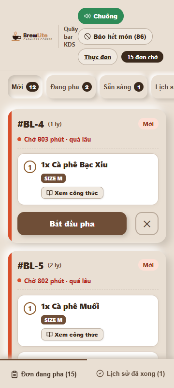
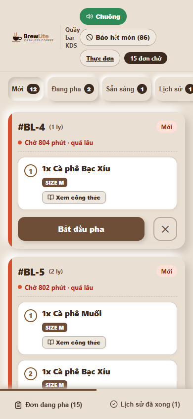
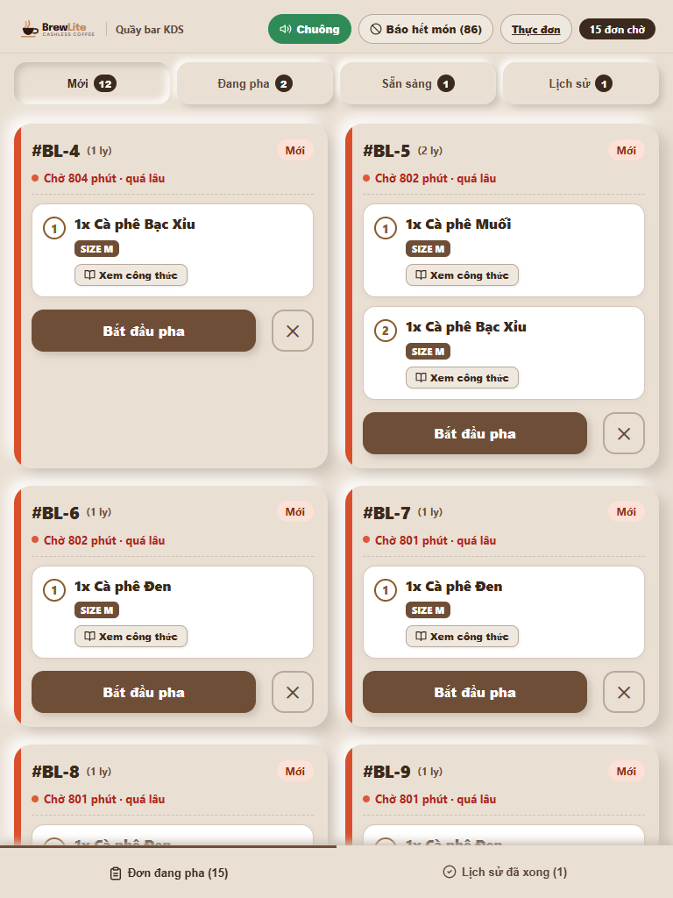
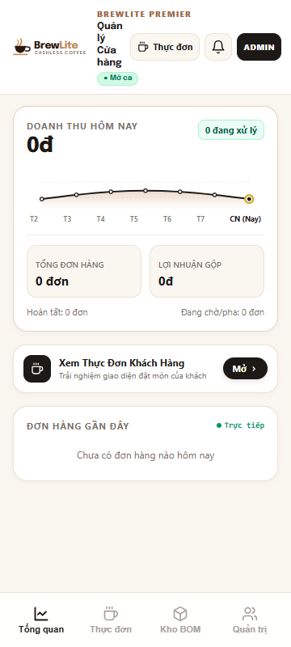
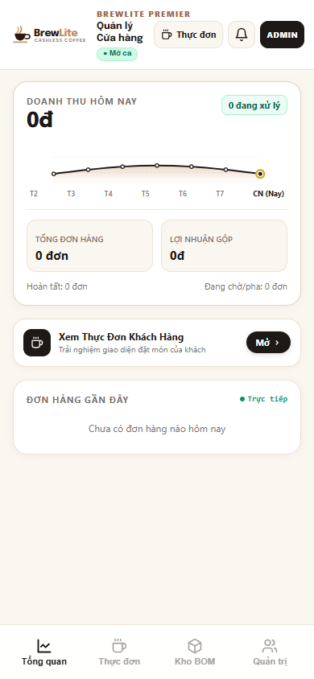
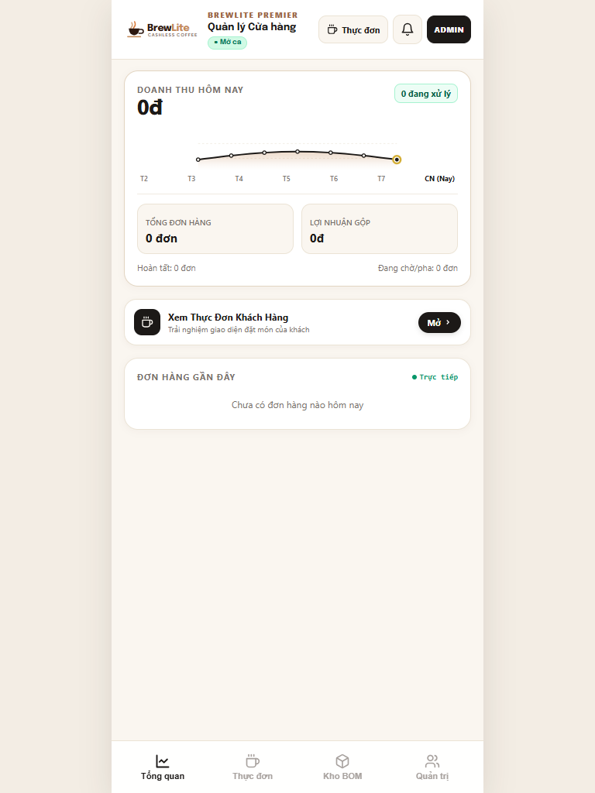

# T5.5b – Báo cáo QA Mobile Staff & Admin

## 1. Thông tin

- **Task:** T5.5b – QA Mobile Staff & Admin (kiểm thử độc lập)
- **Người kiểm thử:** Quách Kỳ Minh
- **Reviewer:** Vỹ
- **Môi trường:** BrewLite Web
- **Phương pháp:** Chrome DevTools Responsive và điện thoại thật
- **Trạng thái:** Đã thực hiện kiểm thử theo xác nhận của người kiểm thử

## 2. Phạm vi kiểm thử

- **Staff (`/staff`):** danh sách đơn hàng, các tab trạng thái, chi tiết đơn, thao tác cập nhật trạng thái và hộp thoại xác nhận.
- **Admin (`/admin`):** điều hướng, quản lý món, topping, voucher, biểu mẫu và các chức năng quản trị có trên phiên bản kiểm thử.
- **Kích thước:** 360 × 800, 390 × 844, 768 × 1024.
- **Thiết bị thật:** Đã kiểm thử, không ghi thông tin mẫu thiết bị.

## 3. Kết quả kiểm thử

| Vai trò | 360px | 390px | 768px | Điện thoại thật |
| ------- | ----- | ----- | ----- | --------------- |
| Staff   | PASS  | PASS  | PASS  | PASS            |
| Admin   | PASS  | PASS  | PASS  | PASS            |

Các kết quả trên do người thực hiện xác nhận sau khi kiểm thử.

## 4. Kết quả tổng hợp

- **Responsive DevTools:** 6/6 trường hợp PASS.
- **Kiểm thử điện thoại thật:** Staff và Admin PASS.
- **Lỗi responsive được báo cáo:** 0.
- **Retest:** Không áp dụng vì không báo cáo lỗi cần sửa.

## 5. Evidence

Ảnh chụp màn hình thực tế tại 3 kích thước `360×800`, `390×844` và `768×1024` (đều đạt `scrollWidth === innerWidth`, không tràn ngang; màn hình `/staff` chụp từ `https://brew-lite-project.vercel.app`, màn hình `/admin` được chụp lại từ bản build Docker local sau khi hoàn thiện CSS Modules cho các khối nhãn, biểu đồ và nút điều hướng):

| Vai trò | 360 × 800 | 390 × 844 | 768 × 1024 |
| :--- | :---: | :---: | :---: |
| **Staff (`/staff`)** |  |  |  |
| **Admin (`/admin`)** |  |  |  |

*(Ghi nhận kiểm tra lại trên ảnh mới: cả `/staff` và `/admin` đều hiển thị cân đối, đúng spacing giữa nhãn `T2..CN (Nay)`, badge `ADMIN` / `Mở ca`, thẻ phím tắt `Mở >` và các chỉ số trên cả 3 kích thước.)*

## 6. Kết luận

Theo kết quả kiểm thử và ảnh chụp màn hình thực tế tại các kích thước `360px`, `390px`, `768px` (cùng xác nhận kiểm thử trên điện thoại thật của người thực hiện), giao diện Mobile Staff và Admin của BrewLite hiển thị rõ nét, đúng khoảng cách CSS và không bị tràn ngang (`scrollWidth === innerWidth`).
