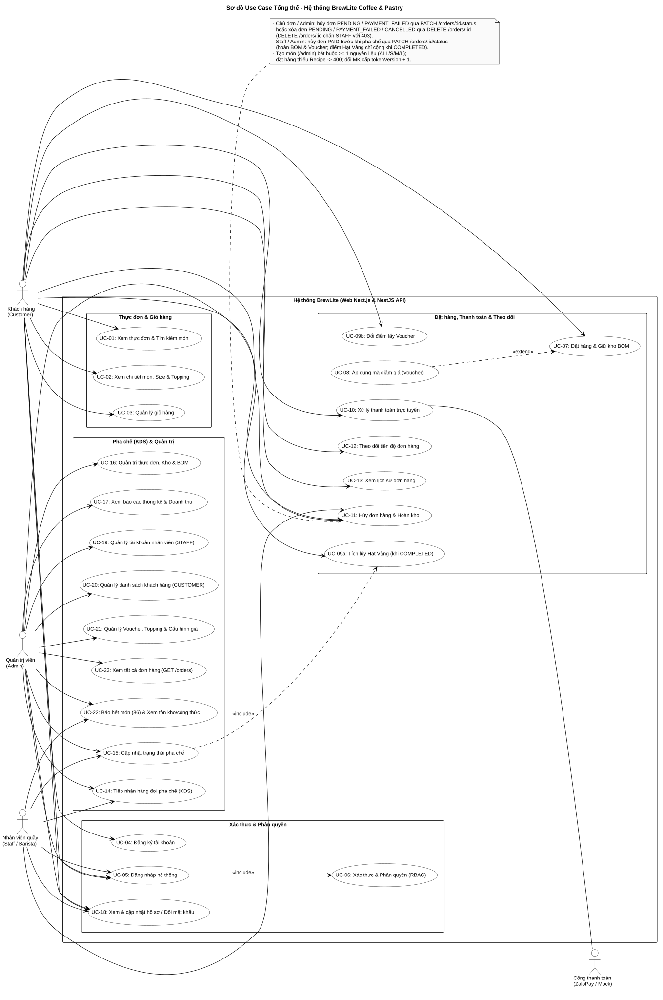

# 📄 TÀI LIỆU ĐẶC TẢ YÊU CẦU PHẦN MỀM (SRS RÚT GỌN)
## BREWLITE — 100% CASHLESS SPECIALTY COFFEE ROASTERY PLATFORM

> **Tài liệu:** `docs/requirements/srs.md`  
> **Học phần:** Công nghệ Phần mềm (Software Engineering) — Assignment 2 (Requirements to Delivery)  
> **Đơn vị đào tạo:** Khoa Công nghệ Thông tin, Trường Đại học Sài Gòn (SGU)  
> **Giảng viên hướng dẫn:** ThS. Từ Lãng Phiêu  
> **Sinh viên phụ trách chính (Lead Author):** Vũ Châu Minh Khôi
> **Nhóm thực hiện:** Nhóm BrewLite (6 thành viên):
> 1. **Mã Gia Vỹ**
> 2. **Huỳnh Tuấn Kiệt**
> 3. **Nguyễn Gia Thành**
> 4. **Vũ Châu Minh Khôi**
> 5. **Quách Kỳ Minh**
> 6. **Nguyễn Thị Ý**  
> **Phiên bản:** v4.5 (Đồng bộ 100% mã nguồn Monorepo `apps/api`, `apps/web`, 46 Test Suites / 531 Unit+Int Tests + 2 E2E Tests, OpenAPI)  
> **Trạng thái:** Chính thức (Approved & Audited)

---

## 📌 LỊCH SỬ THAY ĐỔI TÀI LIỆU (REVISION HISTORY)

| Phiên bản | Ngày cập nhật | Người thực hiện | Nội dung điều chỉnh chính |
| :---: | :---: | :--- | :--- |
| **v1.0 - v3.0** | 10/2026 | Nhóm phát triển | Các bản dự thảo phân tích yêu cầu sơ bộ ban đầu. |
| **v4.0** | 18/10/2026 | Nhóm phát triển | Hợp nhất yêu cầu nghiệp vụ thực tế, chốt luồng thanh toán và xác thực. |
| **v4.1** | 23/10/2026 | Mã Gia Vỹ & Nhóm | Chuẩn hóa theo barem Task 1.2: Bổ sung mã định danh `FR-xx`, `NFR-xx`, phân loại MoSCoW, tiêu chí nghiệm thu có thể kiểm chứng, cập nhật mô hình định mức nguyên liệu BOM Recipe và Optimistic Locking. |
| **v4.2** | 23/10/2026 | Nhóm BrewLite | Tích hợp cổng thanh toán bên thứ ba ZaloPay Sandbox (VNG), nhúng sơ đồ vector `use-case.svg` và hợp nhất toàn bộ tiêu chí nghiệm thu kiểm chứng tự động. |
| **v4.3** | 25/10/2026 | Nguyễn Gia Thành | Chuẩn hóa toàn diện: Bổ sung mô tả và AC cho FR-11, FR-12; bổ sung FR-13 ánh xạ UC-11 (Hủy đơn hàng); chuyển FR-07 sang MUST HAVE; thống nhất Timeout đơn PENDING 15 phút; loại bỏ hoàn toàn VAT 8% khớp mã nguồn; mở rộng ma trận kiểm thử và đồng bộ sơ đồ Use Case đen trắng chuẩn UML. |
| **v4.4** | 12/11/2026 | Mã Gia Vỹ & Nhóm | Đồng bộ hóa Wave 1+2 Monorepo (`apps/api`, `apps/web`): cập nhật đường dẫn `/staff`, endpoint voucher/pricing, `state-machine.helper.ts` và liên kết `docs/api/openapi.yaml`. |
| **v4.5** | 15/11/2026 | Nhóm BrewLite | Kiểm toán (Audit) đồng bộ 100% với mã nguồn thực tế: hiệu chỉnh route `/products/[id]`, ngưỡng Cart (`20`/`50`), đường/đá/topping, JWT `{ sub, email, role, tokenVersion }`, chính sách hủy `PAID` (`STAFF`/`ADMIN`), máy trạng thái `ALLOWED_TRANSITIONS`, bảng voucher/điểm thực tế (`DiscountCode`/`VOUCHER_CATALOG`), `GET /health` và số liệu test log (`27` Jest + `19` Vitest + `2` Playwright E2E). |
| **v4.6** | 15/11/2026 | Nhóm BrewLite | Đồng bộ PR #49 (`e80b843`) & Admin UI hiện hành: tích điểm Hạt Vàng chuyển sang trạng thái `COMPLETED` (không cộng/thu hồi tại `PAID`), `DELETE /orders/:id` chỉ cho chủ đơn/`ADMIN` (`STAFF` nhận `403`, vẫn hủy `PAID` qua `PATCH /orders/:id/status`), `POST /orders` bắt buộc sản phẩm/size có `Recipe` (`requireRecipeForEachItem`) & Admin UI hỗ trợ nhiều dòng nguyên liệu theo size (`ALL`/`S`/`M`/`L`), chuẩn hóa `DiscountCode` 1 đơn/user & lọc mã `isActive: false`, `PATCH /auth/profile` cấp `accessToken` mới khi đổi mật khẩu, `normalizeIdempotencyKey`, `@NoUnsafeHtml()`/`@Matches(/\S/)` và cứng hóa ZaloPay. |

---

## 1. TỔNG QUAN HỆ THỐNG & PHÂN QUYỀN (RBAC)

### 1.1 Mục tiêu hệ thống
**BrewLite** là nền tảng thương mại điện tử chuyên biệt cho chuỗi cửa hàng cà phê chất lượng cao hoạt động theo mô hình **100% không dùng tiền mặt (100% Cashless Specialty Coffee Roastery)**. Hệ thống giải quyết triệt để vấn đề nghẽn cổ chai tại quầy gọi món giờ cao điểm bằng cách trao quyền cho khách hàng tự đặt món, tùy chỉnh hương vị, thanh toán trực tuyến qua thẻ/ví điện tử và theo dõi tiến độ chuẩn bị qua thiết bị cá nhân (PWA/Web).

### 1.2 Ma trận phân quyền 3 Role (Role-Based Access Control)
Hệ thống quản lý định danh người dùng qua cơ chế **Stateless JWT Authentication** (`tokenVersion` & `isActive` check trong `JwtStrategy`) với 3 vai trò độc lập (`Role`: `CUSTOMER`, `STAFF`, `ADMIN`), tuân thủ nguyên tắc đặc quyền tối thiểu (Least Privilege) và **Chính sách bảo vệ Root Admin (`admin@brewlite.vn`)**:

| Vai trò (Role) | Ký hiệu Enum | Phạm vi quyền hạn & Giao diện tương ứng |
| :--- | :---: | :--- |
| **Khách hàng** | `CUSTOMER` | - Xem Menu (`/menu`), chi tiết món (`/products/[id]`), cấu hình Size/Topping/Đá/Đường/Nhiệt độ, quản lý Giỏ hàng (`/cart`), trang Ưu đãi (`/promotions`, `/vouchers`) và Tài khoản (`/account`, `/profile`).<br>- Đăng ký/Đăng nhập (`/auth/login`, `/auth/register`, `/(auth)/login`, `/(auth)/register`), tích lũy điểm Loyalty (`1.000đ = 1 điểm` khi đơn đạt `COMPLETED`), đổi điểm lấy voucher (`POST /auth/redeem-points`), áp mã giảm giá (`DiscountCode` công khai tối đa 1 đơn không hủy/user; `UserVoucher` cá nhân).<br>- Tạo đơn hàng (giới hạn tối đa 5 đơn chờ `PENDING`/`PAYMENT_FAILED` đồng thời), thanh toán qua Mock Gateway (`POST /payments`) hoặc ZaloPay Sandbox (`/gateway/zalopay`), theo dõi tiến trình và lịch sử đơn hàng tại `/orders`, `/orders/[id]`, `/orders/[id]/confirmation` (`/order-confirmation`). |
| **Nhân viên quầy pha chế** | `STAFF` | - Truy cập giao diện màn hình bếp/quầy pha chế (**Staff KDS** tại `/staff`).<br>- Tiếp nhận hàng đợi qua `GET /orders/barista/queue`, chuyển trạng thái pha chế `PAID` $\rightarrow$ `PREPARING` $\rightarrow$ `READY` $\rightarrow$ `COMPLETED` (hoặc hủy đơn `PAID` trước khi `PREPARING` qua `PATCH /orders/:id/status`).<br>- Xem danh sách tồn kho/công thức cơ bản (`GET /inventory`, `GET /inventory/ingredients`, `GET /inventory/recipes`) đã ẩn `costPerUnit`/`totalInventoryValue`, và thao tác Báo hết món tạm thời (`PATCH /products/:id/sold-out`) mà không được xem `recipes` và giá vốn (`cogsSizeS/M/L`) trên `/products`. |
| **Quản trị viên / Chủ quán** | `ADMIN` | - Truy cập bảng điều khiển quản trị (**Admin Portal** tại `/admin`).<br>- Quản lý thực đơn (`POST/PATCH/DELETE /products`, `PATCH /products/:id/visibility`, `PATCH /products/:id/sold-out`), định giá theo size (`PATCH /inventory/size-pricing`), giá vốn COGS và định mức công thức BOM (`POST/PATCH/DELETE /inventory/recipes`, `/inventory/topping-recipes`).<br>- Quản lý nguyên vật liệu & bao bì (`Ingredient` `INGREDIENT`/`PACKAGING`, nhập/chỉnh kho `restock`/`stock`, `InventoryLog`), quản lý Voucher (`/inventory/vouchers`), đơn hàng (`GET /orders`), khách hàng (`/admin/customers/*`), nhân sự (`/staff/*`) và Dashboard doanh thu/lợi nhuận (`/inventory/dashboard`).<br>- **Bảo vệ Root Admin qua API:** `users.service.ts` khóa cứng `ROOT_ADMIN_EMAIL = 'admin@brewlite.vn'`, cấm tạo tài khoản `ADMIN` qua `POST /staff`, cấm thăng/giáng cấp hoặc khóa/xóa tài khoản `ADMIN` qua `/staff/*` (`403 Forbidden` / `400 Bad Request`). *(Lưu ý: `prisma/seed.ts` khởi tạo sẵn 2 tài khoản `ADMIN` phục vụ vận hành/chấm bài là `admin@brewlite.vn` và `3124410414@sv.sgu.edu.vn`)*. |

---

## 2. BẢNG PHÂN LOẠI MỨC ĐỘ ƯU TIÊN THEO MoSCoW

| Mức độ ưu tiên | Ý nghĩa phân loại | Danh sách mã yêu cầu chức năng (FR) |
| :--- | :--- | :--- |
| **MUST HAVE**<br>*(Bắt buộc cốt lõi)* | Các chức năng sống còn bắt buộc phải hoàn thành 100% để tạo thành sản phẩm khả dụng tối thiểu (MVP). | `FR-01` (Duyệt Menu), `FR-02` (Cá nhân hóa món), `FR-03` (Giỏ hàng), `FR-04` (Xác thực JWT/RBAC), `FR-05` (Đặt đơn & Optimistic Lock), `FR-06` (Thanh toán ZaloPay/Mock & Idempotency), `FR-07` (Voucher & Loyalty Point), `FR-08` (Theo dõi đơn thời gian thực) |
| **SHOULD HAVE**<br>*(Nên có / Quan trọng)* | Các chức năng mở rộng gia tăng trải nghiệm người dùng và tối ưu vận hành đã được hiện thực hoàn chỉnh 100% trong dự án. | `FR-09` (Staff KDS Pha chế quầy Bar), `FR-10` (Admin Menu, Kho & Định mức BOM Recipe), `FR-13` (Hủy Đơn Hàng & Hoàn Tồn Kho — tương ứng `UC-11`) |
| **COULD HAVE**<br>*(Có thể làm thêm)* | Các tính năng nâng cao hữu ích hỗ trợ tự động hóa hệ thống và nâng cao trải nghiệm tra cứu món. | `FR-11` (Scheduled Job tự động hủy đơn PENDING quá hạn sau 15 phút), `FR-12` (Tìm kiếm & Bộ lọc thực đơn nâng cao theo danh mục) |
| **WON'T HAVE**<br>*(Chưa làm đợt này)* | Các phạm vi ngoại biên không thuộc khuôn khổ bài tập lớn Assignment 2. | Đấu nối cổng thanh toán ngân hàng thật có hợp đồng merchant pháp nhân, tích hợp thông báo đẩy native FCM di động, giao hàng tận nơi (Delivery). |

---

## 3. SƠ ĐỒ USE-CASE TỔNG QUÁT CỦA TOÀN HỆ THỐNG

> **Tệp mã nguồn PlantUML:** [`docs/diagrams/use-case.puml`](../diagrams/use-case.puml)  
> **Ảnh kết xuất Vector SVG:** [`docs/diagrams/use-case.svg`](../diagrams/use-case.svg)  
> **Ảnh kết xuất PNG:** [`docs/diagrams/use-case.png`](../diagrams/use-case.png)

### 3.1 Sơ đồ Use-Case chuẩn UML (Vector Graphics)



### 3.2 Bảng phân rã Use-Case & Ánh xạ Tác nhân (Traceability Matrix)

Sơ đồ Use Case tổng quát tuân thủ quy chuẩn quốc tế UML 2.5 với **4 Tác nhân (Actors)** và **17 Use Cases** được phân chia rạch ròi theo phân hệ:

| Mã Use-Case | Tên Use-Case | Tác nhân chính (Actor) | Quan hệ phụ thuộc (Relationships) | Mã FR tương ứng |
| :---: | :--- | :--- | :--- | :---: |
| **UC-01** | Xem thực đơn & tìm kiếm món | Khách hàng | Liên kết trực tiếp | `FR-01`, `FR-12` |
| **UC-02** | Xem chi tiết món & chọn Size, Topping | Khách hàng | Liên kết trực tiếp | `FR-02` |
| **UC-03** | Quản lý giỏ hàng | Khách hàng | Liên kết trực tiếp | `FR-03` |
| **UC-04** | Đăng ký tài khoản | Khách hàng | Liên kết trực tiếp | `FR-04` |
| **UC-05** | Đăng nhập hệ thống | Khách hàng, Nhân viên, Admin | `<<include>>` Xác thực phân quyền (RBAC) | `FR-04` |
| **UC-06** | Xác thực phân quyền (RBAC) | Hệ thống | Được `<<include>>` bởi UC-05 | `FR-04` |
| **UC-07** | Đặt hàng & Thanh toán | Khách hàng | `<<include>>` Xử lý thanh toán, Tích lũy điểm | `FR-05`, `FR-06` |
| **UC-08** | Áp dụng mã giảm giá (Voucher) | Khách hàng | `<<extend>>` Đặt hàng & Thanh toán | `FR-07` |
| **UC-09** | Tích lũy & dùng điểm thưởng | Khách hàng | Được `<<include>>` bởi Đặt hàng & Thanh toán | `FR-07` |
| **UC-10** | Xử lý thanh toán trực tuyến | Cổng thanh toán (ZaloPay/Mock) | Được `<<include>>` bởi Đặt hàng & Thanh toán | `FR-06` |
| **UC-11** | Hủy đơn hàng | Khách hàng, Nhân viên (Staff/Admin) | Liên kết trực tiếp (Khách hủy `PENDING`/`PAYMENT_FAILED`; Staff/Admin hủy `PAID` trước `PREPARING`) | `FR-13` |
| **UC-12** | Theo dõi tiến độ đơn thời gian thực | Khách hàng | Liên kết trực tiếp | `FR-08` |
| **UC-13** | Xem lịch sử đơn hàng | Khách hàng | Liên kết trực tiếp | `FR-08` |
| **UC-14** | Tiếp nhận đơn hàng quầy pha chế (KDS) | Nhân viên (Barista) | Liên kết trực tiếp | `FR-09` |
| **UC-15** | Cập nhật trạng thái pha chế | Nhân viên (Barista) | Liên kết trực tiếp (PREPARING $\rightarrow$ READY) | `FR-09` |
| **UC-16** | Quản trị thực đơn & Kho BOM Recipe | Quản trị viên (Admin) | Liên kết trực tiếp | `FR-10` |
| **UC-17** | Xem báo cáo thống kê & doanh thu | Quản trị viên (Admin) | Liên kết trực tiếp | `FR-10` |

---

## 4. DANH SÁCH YÊU CẦU CHỨC NĂNG (FUNCTIONAL REQUIREMENTS - FR)

Mỗi yêu cầu chức năng được chuẩn hóa mã định danh `FR-xx`, độ ưu tiên theo chuẩn MoSCoW, mô tả giải pháp kỹ thuật và **toàn bộ Tiêu chí chấp nhận (Acceptance Criteria - AC)** có thể kiểm chứng được qua bài kiểm thử tự động hoặc thao tác trực quan.

---

### `FR-01`: Duyệt Thực Đơn & Tìm Kiếm Sản Phẩm
* **Độ ưu tiên:** `MUST HAVE`
* **Tác nhân:** Khách hàng, Nhân viên, Quản trị viên
* **Mô tả chi tiết:**
  * Hệ thống cung cấp API `GET /products` (`OptionalJwtAuthGuard`) trả về danh sách sản phẩm đang kích hoạt (`isActive = true`; tham số `includeInactive=true` chỉ có hiệu lực với `STAFF`/`ADMIN`, và chỉ `ADMIN` nhận đầy đủ `recipes`/COGS).
  * Giao diện `/menu` hiển thị danh sách dạng lưới card responsive theo 6 tab danh mục (`all`: *Tất cả*, `espresso`: *Espresso Bar*, `salt_phin`: *Cà Phê Muối & Phin*, `tea_matcha`: *Artisan Tea & Matcha*, `cold_brew`: *Cold Brew Craft*, `bakery`: *Bánh Nướng*), ánh xạ linh hoạt với các category gốc trong CSDL (`vietnamese`, `espresso`, `tea`, `bakery`) qua hàm `matchesCategory`.
  * Mỗi card hiển thị: Ảnh đại diện sản phẩm, tên món, nhãn tag nổi bật ("Phổ biến", "Mới"), và đơn giá cơ sở (size S chuẩn).
  * Sản phẩm bị hết nguyên liệu bắt buộc (`isRequiredForSale = true`) hoặc bị đánh dấu `isSoldOutManual = true` sẽ trả về `isOutOfStock = true` / `outOfStockSizes`, hiển thị nhãn "Hết hàng" (Sold Out) và làm mờ/vô hiệu hóa nút chọn mua.
* **Tiêu chí chấp nhận (Acceptance Criteria):**
  - [x] **AC-01.1:** API `GET /products` trả về mã `200 OK` kèm danh sách sản phẩm mẫu (tối thiểu 10 món).
  - [x] **AC-01.2:** Tải trang Menu hiển thị hiệu ứng khung xương (Skeleton loader) mượt mà trong khi chờ API phản hồi.
  - [x] **AC-01.3:** Lọc danh mục không làm tải lại trang (Client-side fast filtering).
  - [x] **AC-01.4:** Tìm kiếm sản phẩm theo từ khóa (tên món) không phân biệt chữ hoa, chữ thường hoặc dấu tiếng Việt.
  - [x] **AC-01.5:** Sản phẩm hết hàng (tồn kho nguyên liệu BOM không đủ pha chế 1 ly cơ sở hoặc bị admin đánh dấu) hiển thị badge "Hết hàng" và chặn nút "Chọn món".
  - [x] **AC-01.6:** Nếu danh mục rỗng, hiển thị Empty State kèm thông điệp điều hướng trực quan.

---

### `FR-02`: Chi Tiết Món & Cá Nhân Hóa Tùy Chọn (Customization)
* **Độ ưu tiên:** `MUST HAVE`
* **Tác nhân:** Khách hàng
* **Mô tả chi tiết:**
  * Cho phép người dùng nhấp vào món để truy cập trang chi tiết `/products/[id]` (gọi đồng thời `GET /products/:id` và `GET /inventory/pricing-config`).
  * Hỗ trợ cấu hình **Kích cỡ (Size)**: Size S (250ml, mặc định +0đ), Size M (350ml, +5.000đ hoặc theo `StoreSetting` `SIZE_UPCHARGE_M`), Size L (500ml, +10.000đ hoặc theo `SIZE_UPCHARGE_L`). Riêng các sản phẩm thuộc danh mục bánh ngọt (`bakery`) chỉ sử dụng size chuẩn (`ALL`).
  * Hỗ trợ chọn **Nhiều Topping đi kèm** từ `ToppingRecipe` (cấu hình qua `/inventory/pricing-config`): *Trân châu trắng giòn (`boba`, +8.000đ), Thêm Kem Muối Béo (`cream`, +10.000đ), Thạch Cà Phê Phin (`jelly`, +8.000đ), Thêm 1 Shot Espresso (`shot`, +12.000đ)*.
  * Riêng đối với nhóm Bánh nướng (`bakery`), hiển thị danh sách đồ ăn kèm: *Bơ lạt Anchor (`bakery_butter`, +5.000đ), Phô mai kem (`bakery_cream_cheese`, +10.000đ), Mứt dâu tây (`bakery_jam`, +8.000đ), Xốt sô-cô-la ấm (`bakery_choco`, +10.000đ)*.
  * Tùy chọn khẩu vị không phụ thu: **Nhiệt độ** (`Đá lạnh`/`Nóng ấm`), **Mức đường** 5 cấp (`0%`, `25%`, `50%`, `75%`, `100%`) và **Mức đá** 4 cấp (`Không đá`, `Đá riêng`, `Ít đá (50%)`, `Bình thường (100%)`), kèm ghi chú Barista.
  * Cơ chế **Dynamic Pricing**: Tự động tính toán và cập nhật giá hiển thị ngay lập tức khi khách hàng thay đổi Size, Topping hoặc Số lượng (tối đa 20 ly trên UI `/products/[id]`).
* **Tiêu chí chấp nhận (Acceptance Criteria):**
  - [x] **AC-02.1:** Giá hiển thị trên nút "Thêm vào giỏ" luôn bằng:  
    $$\text{Giá hiển thị} = \left(\text{basePrice} + \text{sizeUpcharge} + \sum \text{toppingPrice}\right) \times \text{quantity}$$
  - [x] **AC-02.2:** Người dùng có thể chọn đồng thời nhiều topping active (mặc định 4 topping cho đồ uống hoặc 4 đồ ăn kèm cho bánh; Backend `OrderItemDto` cho phép tối đa `@ArrayMaxSize(10)`).
  - [x] **AC-02.3:** Tùy chọn mức đường (`0%`, `25%`, `50%`, `75%`, `100%`), mức đá (`Không đá`, `Đá riêng`, `50%`, `100%`) và nhiệt độ được lưu đúng định dạng (`sugarLevel`, `iceLevel`, `temperature`, `notes`) vào cấu hình món.
  - [x] **AC-02.4:** Nhóm Bánh ngọt (`bakery`) không hiển thị cấu hình đá/đường mà chuyển sang cấu hình đồ ăn kèm (Bơ/Phô mai/Mứt/Xốt) và gợi ý hâm nóng.

---

### `FR-03`: Quản Lý Giỏ Hàng Cục Bộ (Shopping Cart Store)
* **Độ ưu tiên:** `MUST HAVE`
* **Tác nhân:** Khách hàng
* **Mô tả chi tiết:**
  * Giỏ hàng được quản lý bằng state management cục bộ (Zustand Cart Store) và đồng bộ liên tục vào `localStorage` của trình duyệt.
  * Hỗ trợ gộp món thông minh: Nếu thêm một món có cùng `productId`, cùng kích cỡ `size` và cùng danh sách `toppings` thì hệ thống tự động cộng dồn số lượng (`quantity`), không tạo dòng mới. Nếu khác bất kỳ tùy biến nào, tạo một `cartItem` độc lập.
* **Tiêu chí chấp nhận (Acceptance Criteria):**
  - [x] **AC-03.1:** Thêm món mới vào giỏ: Tự động phân biệt trùng lặp tùy chọn để tăng số lượng hoặc tạo dòng mục mới.
  - [x] **AC-03.2:** Cho phép tăng/giảm số lượng từng món linh hoạt (tối thiểu 1 ly, trần kỹ thuật tại Client `cart-store.ts` là **20 ly/dòng món**; Backend `CreateOrderDto` giới hạn 1–50 ly/dòng và tối đa 50 dòng/đơn), hoặc bấm biểu tượng thùng rác để xóa món.
  - [x] **AC-03.3:** Tự động tính Tạm tính và Tổng thanh toán giỏ hàng dựa trên tổng thành tiền các món (đã bao gồm đầy đủ thuế phí theo giá niêm yết, không phát sinh dòng thuế VAT phụ thu riêng).
  - [x] **AC-03.4:** Trạng thái giỏ hàng được giữ nguyên vẹn khi người dùng tải lại trang (F5) hoặc tắt mở lại trình duyệt.
  - [x] **AC-03.5:** Header website luôn hiển thị badge số lượng món trong giỏ hàng theo thời gian thực (Realtime cart badge count).

---

### `FR-04`: Xác Thực & Phân Quyền Người Dùng (Auth JWT & RBAC)
* **Độ ưu tiên:** `MUST HAVE`
* **Tác nhân:** Khách hàng, Nhân viên, Quản trị viên
* **Mô tả chi tiết:**
  * Cung cấp API `POST /auth/register` và `POST /auth/login` (cùng `GET /auth/me`, `PATCH /auth/profile`). Email được chuẩn hóa (`trim().toLowerCase()`); mật khẩu được mã hóa một chiều an toàn bằng thư viện `bcrypt` (10 vòng băm), độ dài tối thiểu $\ge 6$ ký tự và không được chỉ gồm khoảng trắng (`@Matches(/\S/)`).
  * Phản hồi đăng nhập/đăng ký trả về `{ accessToken, user }` với JSON Web Token (JWT) có thời hạn hiệu lực **7 ngày** (`expiresIn: '7d'`), payload `{ sub: user.id, email, role, tokenVersion }`. `JwtStrategy` xác thực trạng thái `isActive` và khớp `tokenVersion` trong DB trước khi gắn `req.user = { userId, email, role }`. Khi người dùng đổi mật khẩu qua `PATCH /auth/profile`, hệ thống tăng `tokenVersion + 1` để vô hiệu hóa token cũ và trả về ngay một `accessToken` mới trong phản hồi.
  * Áp dụng kiểm tra đầu vào DTO chặt chẽ với `@NoUnsafeHtml()` (chặn thẻ HTML, `javascript:`, `data:text/html`, thuộc tính `on*=`) và `@Matches(/\S/)` (chặn chuỗi toàn khoảng trắng) trên các DTO của Auth, Products, Orders, Inventory, Customers và Users; `OrderItemDto.toppings` áp dụng `@ArrayUnique` không phân biệt hoa thường.
  * Áp dụng `ThrottlerGuard`: giới hạn toàn cục **120 request / 60 giây** và giới hạn nghiêm ngặt **5 request / 60 giây** trên `POST /auth/register` & `POST /auth/login` (`429 Too Many Requests`).
  * Hỗ trợ cơ chế **Redirect giữ nguyên giỏ hàng**: Khách hàng đang ở giỏ hàng chuyển sang đăng nhập sẽ được điều hướng thẳng đến trang `/checkout`, không làm mất món trong giỏ.
* **Tiêu chí chấp nhận (Acceptance Criteria):**
  - [x] **AC-04.1:** Đăng ký từ chối email đã tồn tại với mã lỗi `409 Conflict`.
  - [x] **AC-04.2:** Mật khẩu dưới 6 ký tự bị chặn ngay tại Client form validation và Backend DTO validation với mã lỗi `400 Bad Request`.
  - [x] **AC-04.3:** Đăng nhập thất bại (sai email/mật khẩu hoặc tài khoản bị khóa `isActive = false`) trả về mã lỗi `401 Unauthorized` kèm thông điệp chung chống rò rỉ dữ liệu.
  - [x] **AC-04.4:** Bảo vệ các endpoint nhạy cảm (`/orders`, `/orders/me`, `/orders/:id`, `/payments`, `/staff/*`, `/admin/customers/*`, `/inventory/ingredients`...) bằng `JwtAuthGuard` và `RolesGuard`. Thiếu/sai token hoặc tài khoản bị khóa trả `401 Unauthorized`; truy cập sai vai trò trả `403 Forbidden`.
  - [x] **AC-04.5:** Chính sách bảo vệ Root Admin (`admin@brewlite.vn`): `users.service.ts` nghiêm cấm tạo tài khoản `ADMIN` qua `POST /staff` (`400 Bad Request`), cấm thăng/giáng cấp hoặc xóa/khóa `ADMIN` (`403 Forbidden` / `400 Bad Request`).
  - [x] **AC-04.6:** Bảo vệ tầng biên (Edge Middleware Guard tại `apps/web/src/middleware.ts`): Đồng bộ cookie phiên `brewlite_session_role` song song với JWT để chặn chuyển hướng truy cập trái phép vào `/admin/*`, `/staff/*`, `/checkout/*`, `/account/*`, `/orders/*`, `/order-confirmation/*`.

---

### `FR-05`: Đặt Đơn Hàng & Giữ Tồn Kho Đồng Thời (Optimistic Locking & Anti-Spam)
* **Độ ưu tiên:** `MUST HAVE`
* **Tác nhân:** Khách hàng, Hệ thống
* **Mô tả chi tiết:**
  * Cung cấp API `POST /orders` (kèm header `Idempotency-Key` tùy chọn được chuẩn hóa qua `normalizeIdempotencyKey`: từ chối giá trị không phải chuỗi hoặc dài quá 255 ký tự với `400 Bad Request`, bỏ qua chuỗi rỗng/toàn khoảng trắng; `@@unique([userId, idempotencyKey])`) tiếp nhận danh sách món trong giỏ (`size` hợp lệ `S`/`M`/`L` cho đồ uống và `ALL` cho bánh), thẩm định giá 0% VAT phía server và tạo đơn hàng ở trạng thái `PENDING` (hoặc chuyển thẳng `PAID` nếu `totalAmount === 0` sau voucher).
  * Khóa hàng User (`SELECT id FROM "User" WHERE id = ... FOR UPDATE`) trong database transaction để đảm bảo tính atomic khi kiểm tra giới hạn đơn và trừ `UserVoucher`.
  * Cơ chế **Chống spam đơn hàng (Anti-Spam Rate Limit)**: Một tài khoản khách hàng chỉ được phép duy trì tối đa **5 đơn hàng** ở trạng thái chờ xử lý (`PENDING` hoặc `PAYMENT_FAILED`) cùng lúc. Khi vượt quá 5 đơn, server từ chối nhận đơn mới với mã lỗi `400 Bad Request`.
  * Cơ chế **Kiểm tra & Trừ tồn kho theo công thức BOM & Bao bì (`bom.helper.ts`, `requireRecipeForEachItem: true`)**: Từ chối (`400 Bad Request`) sản phẩm/kích cỡ chưa được cấu hình `Recipe`; cộng dồn định mức nguyên liệu từ `Recipe`, `ToppingRecipe` và vật tư đóng gói `PACKAGING` (`PKG_CUP_S/M/L`, `PKG_LID_FLAT/DOME` bắt buộc `isRequiredForSale = true`; ống hút/túi/giấy ăn/muỗng `isRequiredForSale = false` chỉ cảnh báo, không chặn đơn) và ghi nhận `InventoryLog (SALE)`.
  * Áp dụng **Khóa lạc quan kép (Dual-layer Optimistic Locking)**: Kiểm tra và tăng `Ingredient.version` khi trừ kho BOM (retry tối đa 3 lần khi đụng độ đồng thời, ném `409 Conflict` nếu cạn retry; trả `400 Bad Request` nếu thiếu nguyên liệu bắt buộc ở lần kiểm tra đầu) và `Order.version` khi cập nhật trạng thái đơn.
* **Tiêu chí chấp nhận (Acceptance Criteria):**
  - [x] **AC-05.1:** Đơn hàng tạo thành công có trạng thái `PENDING` (hoặc `PAID` nếu tổng tiền `0đ`) và tổng tiền khớp 100% với giá trị tính tại server (0% VAT).
  - [x] **AC-05.2:** Nếu sản phẩm/size chưa có công thức pha chế (`Recipe`) hoặc nguyên liệu bắt buộc (`isRequiredForSale = true`) không đủ pha chế, API trả `400 Bad Request` (`BadRequestException`), không tạo đơn rác.
  - [x] **AC-05.3:** Nếu có 2 tiến trình đồng thời tranh chấp tồn kho cuối cùng hoặc thay đổi trạng thái cùng một đơn hàng, hệ thống đảm bảo Zero Overselling (trả `409 Conflict` khi đụng độ `version` vượt ngưỡng retry hoặc `400 Bad Request` nếu giao dịch sau thấy tồn kho đã về `0`).
  - [x] **AC-05.4:** Đơn hàng ở trạng thái `PENDING` hoặc `PAYMENT_FAILED` quá **15 phút** mà chưa thanh toán sẽ bị từ chối xử lý khi gửi lệnh thanh toán và tự động hủy bởi `ExpireOrdersJob` (`@Cron('*/1 * * * *')`).
  - [x] **AC-05.5:** Giới hạn chống spam đơn: Khách hàng có $\ge 5$ đơn chờ xử lý (`PENDING` hoặc `PAYMENT_FAILED`) bị từ chối tạo thêm đơn mới (`400 Bad Request`) cho đến khi hoàn tất thanh toán hoặc hủy đơn cũ. Trùng `Idempotency-Key` khác payload trả `409 Conflict`.

---

### `FR-06`: Thanh Toán Không Tiền Mặt & Cổng ZaloPay Sandbox
* **Độ ưu tiên:** `MUST HAVE`
* **Tác nhân:** Khách hàng, Cổng thanh toán ZaloPay Sandbox, Hệ thống
* **Mô tả chi tiết:**
  * Hỗ trợ thanh toán 100% không dùng tiền mặt qua 2 kênh API chính (cùng luồng 0đ miễn phí):
    1. **Cổng thanh toán ZaloPay Sandbox (Bên thứ ba VNG):** API `POST /payments/zalopay/create` gọi sang máy chủ ZaloPay (`https://sb-openapi.zalopay.vn/v2/create`) với chữ ký số **HMAC-SHA256 (`Key1`)**, trả về `orderUrl`/`appTransId` và chuyển hướng sang `/gateway/zalopay`. Hệ thống lắng nghe Webhook IPN (`POST /payments/zalopay/callback`) kiểm tra payload chuỗi không rỗng, xác minh chữ ký **Key2** (`ZaloPayService.assertConfigured()` kiểm tra `ZALOPAY_KEY1`/`ZALOPAY_KEY2` đã trim), đối chiếu số tiền/`app_trans_id` và chặn trùng `appTransId` xuyên đơn hàng (`409 Conflict` khi đụng `P2002`), hỗ trợ truy vấn `GET /payments/zalopay/status/:orderId` (`v2/query`, kiểm tra `appTransId` dạng chuỗi `400`), và cung cấp endpoint sandbox `/payments/zalopay/confirm` & `/cancel` (khóa mặc định với `403`, chỉ mở khi `ALLOW_SANDBOX_CONFIRM=true`).
    2. **Cổng giả lập nội bộ (`POST /payments` — `MockGatewayService`):** Xử lý cho phương thức `EWALLET` / `BANK_CARD` (giao diện `/checkout` hỗ trợ chọn Ví điện tử/VietQR, Thẻ ngân hàng, hoặc Apple Pay ánh xạ sang `BANK_CARD`), mặc định thành công trừ khi `MOCK_PAYMENT_MODE=failure` hoặc `simulateFailure=true`. Bị chặn với `403 Forbidden` trên `NODE_ENV=production` nếu `ALLOW_MOCK_PAYMENT=false`.
  * Cơ chế **Chống thanh toán trùng (Idempotency Guard)**: Sử dụng header `Idempotency-Key` (chuẩn hóa qua `normalizeIdempotencyKey`) trên `POST /payments`. Nếu gửi lại cùng key, hệ thống trả về kết quả giao dịch cũ (`isIdempotent: true`), không tạo bản ghi thanh toán lần hai.
  * Khi thanh toán thành công: Đơn hàng chuyển sang `PAID` (kho BOM đã được trừ từ bước `POST /orders`) và ghi `Payment (SUCCESS)` (`pointsEarned: 0`; điểm thưởng Hạt Vàng chỉ được cộng khi đơn hoàn tất `COMPLETED` ở `FR-07`/`FR-09`).
* **Tiêu chí chấp nhận (Acceptance Criteria):**
  - [x] **AC-06.1:** Màn hình `/checkout` hỗ trợ khởi tạo giao dịch ZaloPay Sandbox (`/gateway/zalopay`), VietQR MB Bank, Thẻ/Apple Pay (`POST /payments`) và xử lý đơn `0đ` trực tiếp.
  - [x] **AC-06.2:** Gửi lại cùng `Idempotency-Key` trả về ngay kết quả giao dịch cũ với cờ `isIdempotent: true`, không tạo bản ghi `Payment` mới hoặc cộng điểm trùng lặp.
  - [x] **AC-06.3:** Khi thanh toán thành công (`PAID`), giỏ hàng được dọn sạch và người dùng được điều hướng sang `/orders/:id` (hoặc `/orders/:id/confirmation`), đồng bộ trạng thái qua polling 4–5s.
  - [x] **AC-06.4:** Khi kích hoạt kịch bản lỗi (`MOCK_PAYMENT_MODE=failure` hoặc `simulateFailure = true`), đơn hàng chuyển sang `PAYMENT_FAILED` (hoặc giao diện `/checkout` báo lỗi `payment-error` và bảo toàn giỏ hàng), cho phép khách thử lại trong 15 phút.
  - [x] **AC-06.5:** Phòng chống tấn công IDOR & Kiểm tra quyền sở hữu đơn hàng (Order Ownership): Chỉ chủ sở hữu đơn hàng (`CUSTOMER`) mới được thanh toán; tài khoản khác (kể cả `STAFF`/`ADMIN` cố thanh toán hộ đơn khách) bị từ chối với `403 Forbidden`.
  - [x] **AC-06.6:** Bảo mật môi trường Sandbox & Mock (Fail-Closed): Endpoint `/payments/zalopay/confirm` và `/payments/zalopay/cancel` mặc định trả `403 Forbidden` nếu `ALLOW_SANDBOX_CONFIRM !== 'true'`; `POST /payments` trả `403 Forbidden` khi `NODE_ENV=production && ALLOW_MOCK_PAYMENT==='false'`.

---

### `FR-07`: Mã Giảm Giá (Voucher) & Điểm Thưởng Thành Viên (Loyalty)
* **Độ ưu tiên:** `MUST HAVE`
* **Tác nhân:** Khách hàng
* **Mô tả chi tiết:**
  * Seed sẵn 6 mã `DiscountCode` giảm theo tỷ lệ `%` (`discountPercent`, `minOrderAmount`, `maxDiscountAmount`): `BREWCOZY` (15%, tối đa 25.000đ), `BREW10` (10%, tối đa 15.000đ), `BREWLITE10` (10%, tối đa 15.000đ), `BREW20` (20%, đơn từ 60.000đ, tối đa 25.000đ), `WELCOME20` (20%, đơn từ 50.000đ, tối đa 25.000đ), và `BREW50` (50%, đơn từ 120.000đ, tối đa 60.000đ).
  * API `GET /inventory/pricing-config`, `GET /auth/vouchers`, `POST /auth/redeem-points`, `GET/POST/PATCH/DELETE /inventory/vouchers` và cơ chế thẩm định mã `DiscountCode` / `UserVoucher` phía server trong `POST /orders` kiểm tra điều kiện giá trị đơn tối thiểu, trạng thái `isActive` và trần chiết khấu (hỗ trợ cả đơn `0đ` sau chiết khấu chuyển thẳng `PAID`). Đối với mã `DiscountCode` công khai, hệ thống bắt buộc đăng nhập và giới hạn **tối đa 1 đơn hàng không bị hủy (`status !== CANCELLED`) trên mỗi tài khoản** (`400 Bad Request` nếu dùng lại). Các mã `DiscountCode` bị tắt (`isActive = false`) tự động bị loại khỏi phản hồi của `GET /auth/me`, `GET /auth/vouchers` và `POST /auth/redeem-points`, đồng thời bị chặn cả khi áp dụng `UserVoucher` liên kết trong `POST /orders`.
  * Cơ chế **Hạt Vàng BrewLite Club (Loyalty)**: Tích lũy tự động 1 điểm cho mỗi 1.000 VNĐ chi tiêu (`points = Math.floor(totalAmount / 1000)`) **khi đơn hàng chuyển sang trạng thái hoàn tất `COMPLETED` (`PATCH /orders/:id/status`)** (không cộng ở bước `PAID`; màn hình `/checkout` và `/orders/[id]/confirmation` hiển thị điểm dự kiến nhận khi đơn hoàn tất). Khách hàng có thể quy đổi điểm thành `UserVoucher`.
  * Cơ chế **Đổi điểm Voucher do Server kiểm soát (Server-Enforced Loyalty Redemption — `VOUCHER_CATALOG`)**: Tỷ lệ đổi điểm được server khóa cứng theo mã: `BREW10` (**10 điểm** = giảm 10%, tối đa 15.000đ), `BREWCOZY` (**15 điểm** = giảm 15%, tối đa 25.000đ), `BREW20` (**20 điểm** = giảm 20% đơn từ 60k, tối đa 25.000đ), `WELCOME20` (**20 điểm** = giảm 20% đơn từ 50k, tối đa 25.000đ), `BREW50` (**50 điểm** = giảm 50% đơn từ 120k, tối đa 60.000đ). Server tự động thẩm định và trừ atomic theo `requiredPoints` trên `User`, không tin giá trị điểm client gửi lên.
* **Tiêu chí chấp nhận (Acceptance Criteria):**
  - [x] **AC-07.1:** Nhập mã giảm giá hợp lệ (`DiscountCode` công khai chưa dùng trên đơn non-`CANCELLED` khác của user, hoặc `UserVoucher` đang active): Tổng tiền thanh toán giảm chính xác theo `discountPercent` và không vượt quá `maxDiscountAmount` (đơn giảm còn `0đ` chuyển thẳng `PAID`).
  - [x] **AC-07.2:** Nhập mã sai, đã tắt (`isActive = false`), dùng lại `DiscountCode` công khai trên tài khoản đã dùng, hoặc không đủ `minOrderAmount`: Hiển thị thông báo lỗi cụ thể (`400 Bad Request`), không áp dụng chiết khấu.
  - [x] **AC-07.3:** Khi đơn hàng chuyển sang trạng thái hoàn tất (`COMPLETED` qua `PATCH /orders/:id/status`), số dư điểm thưởng trong bảng `User.loyaltyPoints` được cộng dồn chính xác theo tỷ lệ `Math.floor(totalAmount / 1000)` (1.000đ = 1 điểm) và trả về `pointsEarned`.
  - [x] **AC-07.4:** Đổi điểm lấy voucher (`POST /auth/redeem-points`): Server tự áp đặt `requiredPoints` theo `VOUCHER_CATALOG` (`10`/`15`/`20`/`50`), trừ điểm atomic (`loyaltyPoints: { gte: requiredPoints }`), cộng `UserVoucher` và trả về danh sách voucher đang active; từ chối nếu mã không hợp lệ hoặc đã tắt (`isActive = false`).

---

### `FR-08`: Theo Dõi Tiến Trình Đơn Hàng & Lịch Sử (Realtime Tracking)
* **Độ ưu tiên:** `MUST HAVE`
* **Tác nhân:** Khách hàng
* **Mô tả chi tiết:**
  * Cung cấp trang xem lịch sử đơn hàng cá nhân tại `/orders` (`GET /orders/me`), chi tiết theo dõi đơn `/orders/[id]` (`GET /orders/:id`) và trang xác nhận `/orders/[id]/confirmation` (cùng alias `/order-confirmation`).
  * Hiển thị thanh tiến trình trực quan 5 nấc: `PENDING` $\rightarrow$ `PAID` $\rightarrow$ `PREPARING` $\rightarrow$ `READY` $\rightarrow$ `COMPLETED`.
  * Cơ chế **Client-side Polling 4–5s**: Tự động gửi request kiểm tra trạng thái đơn hàng định kỳ (`5000ms` ở `/orders` và `/orders/[id]` qua `useOrderPolling`; `4000ms` ở `/orders/[id]/confirmation`), cập nhật giao diện ngay khi Barista đổi trạng thái mà không cần tải lại trang.
* **Tiêu chí chấp nhận (Acceptance Criteria):**
  - [x] **AC-08.1:** Trang `/orders` hiển thị danh sách đơn sắp xếp giảm dần theo thời gian tạo (mới nhất lên đầu).
  - [x] **AC-08.2:** Mỗi card đơn hàng hiển thị đầy đủ: Mã đơn `#id`, thời gian, danh sách món kèm size/topping, tổng tiền, phương thức thanh toán và badge trạng thái có màu sắc phân biệt.
  - [x] **AC-08.3:** Khi trạng thái đơn chuyển sang `READY`, giao diện hiển thị thông báo nổi bật mời khách đến quầy Bar Express nhận đồ uống.

---

### `FR-09`: Phân Hệ Quầy Pha Chế Barista (Kitchen Display System - KDS)
* **Độ ưu tiên:** `SHOULD HAVE`
* **Tác nhân:** Nhân viên quầy pha chế (Staff / Barista)
* **Mô tả chi tiết:**
  * Màn hình chuyên dụng cho Barista tại đường dẫn `/staff`.
  * Tự động lọc và hiển thị danh sách các đơn hàng đã thanh toán thành công (`PAID`) hoặc đang chế biến (`PREPARING`).
  * Cung cấp nút thao tác nhanh 1 chạm: **"Bắt đầu pha chế"** (`PAID` $\rightarrow$ `PREPARING`), **"Pha chế xong"** (`PREPARING` $\rightarrow$ `READY`), và hoàn tất bàn giao (`READY` $\rightarrow$ `COMPLETED` — kích hoạt cộng điểm Hạt Vàng cho khách hàng).
  * **Chức năng Báo hết món (86 Out-of-Stock):** Cho phép Barista chủ động bật/tắt cờ `isSoldOutManual` của từng món ngay trên quầy qua API `PATCH /products/:id/sold-out`.
  * **Bảo vệ dữ liệu nhạy cảm (Role-Based Projection):** Khi nhân viên `STAFF` gọi API món hoặc thao tác báo hết hàng, hệ thống tuyệt đối không trả về thông tin công thức pha chế (`recipes`) và các kích thước giá vốn (`cogsSizeS`, `cogsSizeM`, `cogsSizeL`).
* **Tiêu chí chấp nhận (Acceptance Criteria):**
  - [x] **AC-09.1:** Chỉ tài khoản có `role = STAFF` hoặc `ADMIN` mới được truy cập giao diện KDS; tài khoản `CUSTOMER` bị chặn truy cập.
  - [x] **AC-09.2:** Chi tiết từng ly nước hiển thị rõ ràng: Tên món, Size, Chi tiết Topping, Mức đường, Mức đá để Barista pha chế chuẩn xác 100%.
  - [x] **AC-09.3:** Chuyển trạng thái đơn được bảo vệ bởi máy trạng thái (State Machine Guard), không thể bấm nhảy cóc trạng thái sai quy trình.
  - [x] **AC-09.4:** Nhân viên Barista thao tác bật/tắt hết hàng tạm thời (`isSoldOutManual`) thành công mà không có quyền truy cập vào dữ liệu giá vốn và công thức định mức món.

---

### `FR-10`: Cổng Quản Trị Cửa Hàng (Admin Management Portal)
* **Độ ưu tiên:** `SHOULD HAVE`
* **Tác nhân:** Quản trị viên / Chủ quán (Admin)
* **Mô tả chi tiết:**
  * Bảng điều khiển quản trị tập trung tại đường dẫn `/admin`.
  * **Quản lý Thực đơn (Menu CRUD):** Thêm/sửa/xóa món (`POST/PATCH/DELETE /products`), chỉnh ảnh, danh mục, phụ thu size S/M/L (`PATCH /inventory/size-pricing`), bật/tắt bán (`PATCH /products/:id/visibility`) và báo hết hàng thủ công (`PATCH /products/:id/sold-out`). Trên giao diện `/admin`, modal *"Thêm món mới vào thực đơn"* hỗ trợ khai báo nhiều dòng nguyên liệu công thức theo kích cỡ (`ALL`/`S`/`M`/`L`), kiểm tra định lượng $> 0$ và không trùng `(ingredientId, size)`, sau đó lưu tuần tự qua `POST /inventory/recipes` để đáp ứng ràng buộc BOM của `POST /orders`.
  * **Quản lý Kho, Bao bì & Định mức BOM (`/inventory/*`):** Quản lý tồn kho `Ingredient` (`INGREDIENT`/`PACKAGING`), nhập/cập nhật kho (`/inventory/ingredients/:id/{restock,stock}`), nhật ký kho (`/inventory/logs`), định mức công thức (`Recipe`, `ToppingRecipe`), Voucher (`/inventory/vouchers`) và Dashboard (`/inventory/dashboard`).
  * **Quản lý Nhân sự & Khách hàng:** CRUD nhân sự `/staff/*` và quản lý khách hàng `/admin/customers/*` (tự động khóa mềm `isActive = false` nếu đã có đơn hàng hoặc ràng buộc FK).
  * **Bảo toàn tính toàn vẹn dữ liệu kho (Integrity Constraint):** Nghiêm cấm xóa nguyên liệu (`DELETE /inventory/ingredients/:id`) nếu nguyên liệu đó đang nằm trong `Recipe`/`ToppingRecipe` hoặc đã phát sinh `InventoryLog` (`409 Conflict`, `onDelete: Restrict`), và cấm xóa vật tư bao bì hệ thống `PKG_*` (`400 Bad Request`).
* **Tiêu chí chấp nhận (Acceptance Criteria):**
  - [x] **AC-10.1:** Chỉ tài khoản có `role = ADMIN` mới có quyền truy cập; người dùng khác bị chặn bởi Edge Middleware & `RolesGuard` (`403 Forbidden`).
  - [x] **AC-10.2:** Thêm/sửa/xóa sản phẩm cập nhật ngay lập tức vào cơ sở dữ liệu PostgreSQL.
  - [x] **AC-10.3:** Bật `isSoldOutManual = true` lập tức phản ánh ra giao diện Menu của khách hàng, khóa nút đặt món.
  - [x] **AC-10.4:** Thao tác xóa nguyên liệu đã có công thức hoặc lịch sử `InventoryLog` bị từ chối với mã lỗi `409 Conflict` (và vật tư `PKG_*` bị từ chối với `400 Bad Request`), bảo vệ lịch sử kiểm toán kho.

---

### `FR-11`: Tự Động Hủy Đơn Quá Hạn & Hoàn Tồn Kho (Scheduled Order Expiration Job)
* **Độ ưu tiên:** `COULD HAVE`
* **Tác nhân:** Hệ thống (Background Worker / Cron Task)
* **Mô tả chi tiết:**
  * Tiến trình `ExpireOrdersJob` (`@Cron('*/1 * * * *')`) chạy định kỳ mỗi phút tự động quét các đơn hàng ở trạng thái `PENDING` hoặc `PAYMENT_FAILED` đã tồn tại quá **15 phút** mà chưa hoàn tất thanh toán.
  * Tự động chuyển trạng thái đơn hàng sang `CANCELLED`, hoàn trả nguyên liệu BOM đã giữ chỗ vào bảng `Ingredient` (ghi `InventoryLog`) và hoàn trả `UserVoucher` (nếu đã khấu trừ).
* **Tiêu chí chấp nhận (Acceptance Criteria):**
  - [x] **AC-11.1:** Các đơn hàng `PENDING` và `PAYMENT_FAILED` quá 15 phút tự động chuyển sang trạng thái `CANCELLED`.
  - [x] **AC-11.2:** Các nguyên liệu định mức tương ứng trong kho `Ingredient` và `UserVoucher` (nếu có) được hoàn trả chính xác trong cùng một transaction.

---

### `FR-12`: Tìm Kiếm & Bộ Lọc Thực Đơn Nâng Cao (Menu Filtering & Search)
* **Độ ưu tiên:** `COULD HAVE`
* **Tác nhân:** Khách hàng
* **Mô tả chi tiết:**
  * Cung cấp thanh tìm kiếm sản phẩm hỗ trợ chuẩn hóa tiếng Việt Unicode NFC, không phân biệt hoa thường.
  * Cung cấp thanh tab phân loại danh mục sản phẩm linh hoạt trên `/menu` (`Tất cả`, `Espresso Bar`, `Cà Phê Muối & Phin`, `Artisan Tea & Matcha`, `Cold Brew Craft`, `Bánh Nướng`) giúp khách lọc nhanh đồ uống yêu thích chỉ với 1 chạm mà không cần tải lại trang.
* **Tiêu chí chấp nhận (Acceptance Criteria):**
  - [x] **AC-12.1:** Nhập từ khóa tìm kiếm: Giao diện lọc ngay các món có tên chứa từ khóa.
  - [x] **AC-12.2:** Chọn tab danh mục: Danh sách món lập tức chuyển đổi theo nhóm sản phẩm đã chọn.

---

### `FR-13`: Hủy Đơn Hàng & Hoàn Tồn Kho (Order Cancellation & Inventory Rollback)
* **Độ ưu tiên:** `SHOULD HAVE` *(Tương ứng trực tiếp Use-Case `UC-11`)*
* **Tác nhân:** Khách hàng, Nhân viên quầy (Staff/Admin), Hệ thống
* **Mô tả chi tiết:**
  * Cho phép khách hàng (`CUSTOMER`) chủ động hủy đơn khi đơn còn ở trạng thái `PENDING` hoặc `PAYMENT_FAILED` qua `PATCH /orders/:id/status` (`{ status: 'CANCELLED' }`) hoặc xóa đơn chưa thanh toán/đã hủy qua `DELETE /orders/:id` (nếu `CANCELLED`/`PAYMENT_FAILED`/`PENDING`). Riêng `DELETE /orders/:id` **chỉ cho phép chủ sở hữu đơn hàng hoặc `ADMIN`** (`STAFF` bị từ chối `403 Forbidden` nếu không phải chủ đơn).
  * Đối với đơn hàng đã thanh toán (`PAID`), khách hàng **không thể tự hủy** (`400 Bad Request` trên `PATCH /orders/:id/status`, `403 Forbidden` trên `POST /payments/zalopay/cancel`); chỉ `STAFF` hoặc `ADMIN` mới có quyền hủy đơn `PAID` trước khi chuyển sang `PREPARING` thông qua `PATCH /orders/:id/status` (không giới hạn thời gian 5 phút phía Backend).
  * Mọi thao tác hủy đơn đang giữ kho (`PENDING`, `PAYMENT_FAILED`, `PAID`) đều kích hoạt hoàn trả 100% nguyên liệu BOM về kho `Ingredient` và hoàn trả `UserVoucher` / lượt dùng `DiscountCode` trong Database Transaction an toàn (không thu hồi điểm Hạt Vàng vì điểm chỉ được cộng khi đơn đạt `COMPLETED`).
* **Tiêu chí chấp nhận (Acceptance Criteria):**
  - [x] **AC-13.1:** Khách hàng hủy đơn ở trạng thái `PENDING` hoặc `PAYMENT_FAILED`: Đơn hàng lập tức chuyển sang `CANCELLED` và giải phóng nguyên liệu giữ chỗ + voucher.
  - [x] **AC-13.2:** Đơn hàng ở trạng thái `PAID` bị từ chối nếu khách hàng tự hủy (`400`/`403`); chỉ `STAFF`/`ADMIN` được hủy đơn `PAID` qua `PATCH /orders/:id/status` trước khi Barista chuyển sang `PREPARING` (hoàn trả 100% nguyên liệu BOM và voucher mà không thu hồi điểm Hạt Vàng chưa cộng). Đồng thời `DELETE /orders/:id` chỉ cho phép chủ sở hữu đơn hoặc `ADMIN` (`STAFF` bị từ chối `403 Forbidden`).
  - [x] **AC-13.3:** Nếu đơn hàng đã chuyển sang `PREPARING`, `READY` hoặc `COMPLETED`, thao tác hủy đơn bị khóa bởi `ALLOWED_TRANSITIONS` và hệ thống từ chối yêu cầu (`400 Bad Request`).

---

## 5. DANH SÁCH YÊU CẦU PHI CHỨC NĂNG (NON-FUNCTIONAL REQUIREMENTS - NFR)

| Mã NFR | Nhóm Yêu Cầu | Tiêu Chí Đo Lường Chi Tiết | Phương Pháp Kiểm Chứng Thực Tế |
| :--- | :--- | :--- | :--- |
| **`NFR-01`** | **Hiệu năng phản hồi<br>*(Performance)*** | • Thời gian phản hồi của các API đọc (`GET /products`, `GET /orders/me`) **$\le$ 200ms** ở tải thông thường và **$\le$ 500ms** tại ngưỡng 100 concurrent requests.<br>• Dung lượng bundle JS trang chủ tối ưu dưới 250KB gzipped. | Đo đạc qua Network Tab DevTools và công cụ kiểm thử hiệu năng. |
| **`NFR-02`** | **Bảo mật & An toàn<br>*(Security)*** | • Mật khẩu người dùng được băm bằng thuật toán **Bcrypt** với cost factor = 10, không lưu plain text.<br>• Xác thực bằng **Stateless JWT** (`tokenVersion` & `isActive` check; đổi mật khẩu qua `PATCH /auth/profile` tăng `tokenVersion + 1` và cấp ngay `accessToken` mới), hết hạn sau 7 ngày.<br>• Làm sạch & kiểm tra DTO bằng `@NoUnsafeHtml()` (chặn XSS/HTML/event handlers) và `@Matches(/\S/)` (chặn chuỗi toàn khoảng trắng).<br>• Giới hạn tốc độ `ThrottlerGuard`: **120 req/60s** toàn cục, **5 req/60s** cho `/auth/login` & `/auth/register` (`429`).<br>• Chống **IDOR**, kiểm tra chặt cấu hình/callback **HMAC-SHA256** ZaloPay (`assertConfigured()`, payload/string `appTransId`). | Kiểm thử qua `auth-api.spec.ts`, `payments.service.spec.ts`, `zalopay.service.spec.ts`, `audit-fixes.spec.ts` và `security-concurrency.int.spec.ts`. |
| **`NFR-03`** | **Tính toàn vẹn & Chống bán vượt<br>*(Data Integrity & Concurrency)*** | • Tuyệt đối không xảy ra hiện tượng bán vượt tồn kho (**Zero Overselling**).<br>• Áp dụng cơ chế **Dual Optimistic Locking** (`Ingredient.version` và `Order.version`) kết hợp `SELECT ... FOR UPDATE` trên `User`.<br>• Mọi thao tác cập nhật trạng thái đơn, thanh toán và trừ/hoàn kho nguyên liệu BOM bọc trong **Database Transaction** bảo đảm tính ACID. | Kiểm thử trong `orders.service.spec.ts`, `API-T04..T09.spec.ts`, `orders-payments.int.spec.ts` và `security-concurrency.int.spec.ts`. |
| **`NFR-04`** | **Khả năng sử dụng & Trải nghiệm<br>*(Usability & Neumorphism UX)*** | • Thiết kế giao diện theo phong cách **Mobile-First Responsive**, tối ưu cho màn hình cảm ứng di động (375px - 430px) và màn hình quầy Kiosk.<br>• Lưu bền vững giỏ hàng bằng Zustand `persist` (`localStorage`) và polling trạng thái đơn mỗi 4–5 giây.<br>• Đầy đủ các trạng thái tương tác: Skeleton loading, Empty state, Error message, Toast thông báo. | Kiểm thử thực tế trên trình duyệt và Vitest UI tests (`cart-store.test.ts`, `use-order-polling.test.ts`, `cart-ui.test.tsx`). |
| **`NFR-05`** | **Khả năng triển khai & Vận hành<br>*(Deployability & DevOps)*** | • Khởi chạy toàn bộ hệ thống (Web, API, DB PostgreSQL) bằng `docker compose up`.<br>• Thiết lập pipeline **GitHub Actions CI/CD** tự động kiểm tra Lint, Test, Build trước khi triển khai.<br>• Cung cấp endpoint kiểm tra sức khỏe hệ thống: `GET /health` phản hồi `{ status: 'ok', db: 'up' }` (hoặc `503 ServiceUnavailableException` khi DB lỗi). | Kiểm thử `health.controller.spec.ts`, `env.validation.spec.ts`, `scripts/smoke-test.{sh,ps1}` và Docker Compose. |
| **`NFR-06`** | **Chống trùng lặp giao dịch<br>*(Financial Idempotency)*** | • Áp dụng cơ chế **Idempotency-Key** cho `POST /orders` (`@@unique([userId, idempotencyKey])`, `409` nếu lệch payload) và `POST /payments`, chuẩn hóa qua `normalizeIdempotencyKey` (từ chối header không phải chuỗi hoặc vượt quá 255 ký tự với `400 Bad Request`, bỏ qua chuỗi rỗng/khoảng trắng).<br>• Khi nhận yêu cầu trùng lặp key, hệ thống trả về kết quả đã xử lý trước đó mà không phát sinh thêm bản ghi thanh toán lần hai. | Kiểm thử trong `payments.service.spec.ts`, `orders.service.spec.ts`, `API-T05.spec.ts`, `audit-fixes.spec.ts` và `orders-payments.int.spec.ts`. |

---

## 6. TIÊU CHÍ CHẤP NHẬN & MA TRẬN KIỂM CHỨNG TỰ ĐỘNG

Dự án áp dụng phương pháp kiểm thử tự động đa tầng trên hai package `apps/api` (Jest), `apps/web` (Vitest) và `tests/e2e` (Playwright), ghi nhận qua log kiểm thử thực tế đạt **100%** với **46 Test Suites / Files** (**531 test cases** = 400 API Jest tests + 131 Web Vitest tests) cùng **2 Playwright E2E tests**:

| Nhóm | Mã Yêu Cầu | Phạm Vi Kiểm Tra | File Kiểm Thử Tự Động | Kết Quả Ghi Nhận Thực Tế |
| :---: | :--- | :--- | :--- | :--- |
| **API 1** | `FR-04`, `NFR-02` | Xác thực JWT, RBAC, hồ sơ & đổi Hạt Vàng | `auth-api.spec.ts`, `auth-profile.spec.ts`, `auth.service.spec.ts`, `jwt-secret.spec.ts` | Đã pass trong `apps/api` Jest run |
| **API 2** | `FR-01`, `FR-02` | Menu thực đơn, tùy chọn BOM & `outOfStockSizes` | `products.controller.spec.ts` | Đã pass trong `apps/api` Jest run |
| **API 3** | `FR-05`, `FR-11`, `FR-13`, `NFR-03` | Tạo đơn, giữ/hoàn kho BOM, hủy đơn, auto-expire 15p | `API-T04..T09.spec.ts`, `orders.controller.spec.ts`, `orders.service.spec.ts`, `expire-orders.job.spec.ts` | Đã pass trong `apps/api` Jest run |
| **API 4** | `FR-06`, `FR-07`, `NFR-06` | MockGateway, Idempotency-Key & ZaloPay HMAC-SHA256 | `payments.controller.spec.ts`, `payments.service.spec.ts`, `zalopay.service.spec.ts` | Đã pass trong `apps/api` Jest run |
| **API 5** | `FR-09`, `FR-10`, `NFR-05` | Kho BOM, bao bì, nhân sự, khách hàng, env, health & audit | `inventory.service.spec.ts`, `inventory-packaging.spec.ts`, `users.service.spec.ts`, `customers.{controller,service}.spec.ts`, `health.controller.spec.ts`, `env.validation.spec.ts`, `audit-fixes.spec.ts` | Đã pass trong `apps/api` Jest run |
| **API INT** | `FR-04..FR-10`, `NFR-02..NFR-06` | Integration test PostgreSQL thật: đồng thời, voucher, RBAC, KDS | `orders-payments.int.spec.ts`, `security-concurrency.int.spec.ts` | Đã pass trong `apps/api` Jest run |
| **WEB 1** | `FR-01..FR-04`, `FR-12`, `NFR-02` | Menu, chi tiết món, giỏ hàng Zustand, Auth UI & Edge Middleware | `menu.test.tsx`, `product-detail.test.tsx`, `cart-ui.test.tsx`, `cart-store.test.ts`, `auth-ui.test.tsx`, `format.test.ts`, `middleware.test.ts` | Đã pass (`apps/web` Vitest run) |
| **WEB 2** | `FR-05..FR-08`, `NFR-04` | Checkout, theo dõi đơn, xác nhận, ưu đãi & tài khoản | `checkout.test.tsx`, `orders.test.tsx`, `confirmation.test.tsx`, `promotions.test.tsx`, `account.test.tsx`, `use-order-polling.test.ts`, `api-client.test.ts` | Đã pass (`apps/web` Vitest run) |
| **WEB 3** | `FR-09`, `FR-10` | Màn hình pha chế Staff KDS & cổng quản trị Admin | `staff/page.test.tsx`, `components/staff/staff.test.tsx`, `use-barista-queue.test.ts`, `staff-orders.test.ts`, `admin/page.test.tsx` | Đã pass (`apps/web` Vitest run) |
| **E2E** | `FR-05`, `FR-06` | Luồng đặt đơn -> thanh toán Ví thành công & lỗi `MOCK_PAYMENT_MODE=failure` | `tests/e2e/checkout.spec.ts` (`E2E-T01`, `E2E-T02`) | Đã pass (2/2 Playwright Chromium run) |
| **Σ** | **TỔNG CỘNG** | **API (27 Jest suites) + Web (19 Vitest files) + Playwright (1 spec)** | **46 Unit/Int Suites + E2E** | **531 Unit/Int Tests (400 API + 131 Web) + 2 E2E Passed** |

---

## 7. MÁY TRẠNG THÁI ĐƠN HÀNG (ORDER STATE MACHINE)

Vòng đời đơn hàng trong hệ thống tuân thủ nghiêm ngặt theo đồ thị chuyển trạng thái hữu hạn (khớp 100% với `apps/api/src/payments/state-machine.helper.ts`):

```
                   ┌──────────────┐
                   │   PENDING    │ (Đơn mới tạo, giữ chỗ tồn kho)
                   └──────┬───────┘
                          │
         ┌────────────────┼────────────────┐
         │ (Thanh toán    │ (Lỗi thẻ /     │ (Timeout 15p /
         │  thành công)   │  Thất bại)     │  Khách hủy)
         ▼                ▼                ▼
  ┌──────────────┐ ┌──────────────┐ ┌──────────────┐
  │     PAID     │ │PAYMENT_FAILED│ │  CANCELLED   │◄────────┐
  └──────┬───────┘ └──────┬───────┘ └──────────────┘         │
         │                │                                  │
         │                ├── Thử lại (ZaloPay -> PENDING)   │
         │                │   hoặc Mock -> PAID              │
         │                └─────── Khách bấm Hủy đơn ────────┤
         │                                                   │
         ├─────── Staff/Admin hủy (trước PREPARING) ─────────┘
         │
  Barista bấm tiếp nhận (KDS)
         │
         ▼
  ┌──────────────┐
  │  PREPARING   │ (Đang pha chế tại quầy bar)
  └──────┬───────┘
         │
  Hoàn tất ly nước
         │
         ▼
  ┌──────────────┐
  │    READY     │ (Sẵn sàng tại quầy Bar Express)
  └──────┬───────┘
         │
  Khách nhận đồ uống
         │
         ▼
  ┌──────────────┐
  │  COMPLETED   │ (Giao dịch hoàn tất)
  └──────────────┘
```

* **Quy tắc chuyển trạng thái hợp lệ (`ALLOWED_TRANSITIONS`):**
  1. `PENDING` $\rightarrow$ `PAID` | `PAYMENT_FAILED` | `CANCELLED`
  2. `PAYMENT_FAILED` $\rightarrow$ `PAID` *(retry Mock thành công)* | `PENDING` *(khởi tạo lại cổng ZaloPay)* | `CANCELLED` *(khách hủy hoặc `ExpireOrdersJob` quá 15 phút)*
  3. `PAID` $\rightarrow$ `PREPARING` | `CANCELLED` *(chỉ `STAFF`/`ADMIN` được phép hủy trước khi pha chế)*
  4. `PREPARING` $\rightarrow$ `READY`
  5. `READY` $\rightarrow$ `COMPLETED`
  6. `COMPLETED` & `CANCELLED`: Trạng thái kết thúc (Terminal State), không được phép chuyển tiếp sang bất kỳ trạng thái nào khác.

---

## 8. KẾT LUẬN & ĐỊNH HƯỚNG BƯỚC TIẾP THEO

Tài liệu đặc tả yêu cầu rút gọn này đã thỏa mãn **100% các tiêu chí nghiệm thu của Task 1.2 trong Đề bài Assignment 2**:
* Đầy đủ danh sách thành viên nhóm và thông tin đơn vị đào tạo trường Đại học Sài Gòn (SGU).
* Mã định danh chuẩn hóa: `FR-01` $\rightarrow$ `FR-13`, `NFR-01` $\rightarrow$ `NFR-06`.
* Phân loại mức độ ưu tiên theo chuẩn MoSCoW khoa học và rõ ràng.
* Hợp nhất toàn diện các tiêu chí chấp nhận (AC) chi tiết cho từng yêu cầu, đo lường được và liên kết với **531 bài unit/integration tests** trên **46 test suites/files** (27 API Jest suites + 19 Web Vitest files) cùng **2 Playwright E2E tests**.
* Đồng bộ 100% với kiến trúc mã nguồn thực tế (BOM Recipe & Packaging, Dual-layer Optimistic Locking, Role-Based Access Control, Stateless JWT 7 ngày với `tokenVersion`, Cổng ZaloPay Sandbox & Mock).
* Nhúng sẵn ảnh vector sơ đồ Use-Case tổng quát (`use-case.svg`), PNG (`use-case.png`) và mã nguồn PlantUML (`use-case.puml`).

👉 **Bước kế tiếp (Task 1.3):** Tiến hành đặc tả chi tiết use-case trọng tâm **"Đặt và thanh toán đơn hàng"** tại tệp [`docs/requirements/usecase-checkout.md`](usecase-checkout.md).
