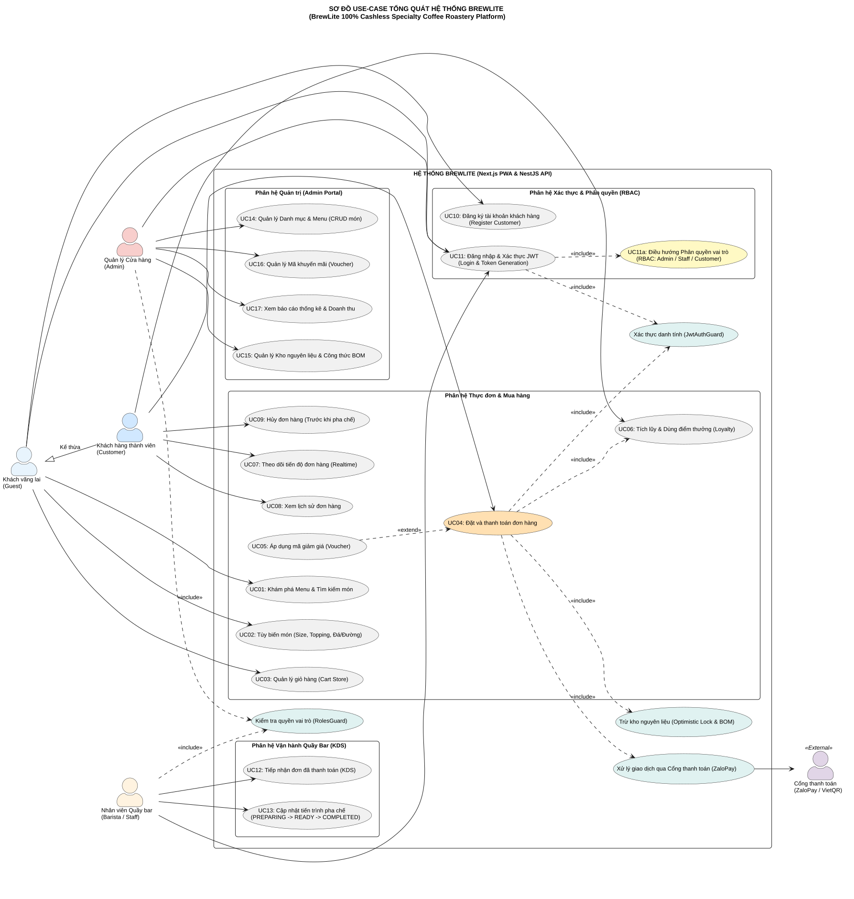

# 📄 TÀI LIỆU ĐẶC TẢ YÊU CẦU PHẦN MỀM (SRS RÚT GỌN)
## BREWLITE — 100% CASHLESS SPECIALTY COFFEE ROASTERY PLATFORM

> **Tài liệu:** `docs/requirements/srs.md`  
> **Học phần:** Công nghệ Phần mềm (Software Engineering) — Assignment 2 (Requirements to Delivery)  
> **Đơn vị đào tạo:** Khoa Công nghệ Thông tin, Trường Đại học Sài Gòn (SGU)  
> **Giảng viên hướng dẫn:** ThS. Nguyễn Phan Tuyết Ngân  
> **Nhóm thực hiện:** Nhóm BrewLite (6 thành viên):
> 1. **Mã Gia Vỹ**
> 2. **Huỳnh Tuấn Kiệt**
> 3. **Nguyễn Gia Thành**
> 4. **Vũ Châu Minh Khôi**
> 5. **Quách Kỳ Minh**
> 6. **Nguyễn Thị Ý**  
> **Phiên bản:** v4.2 (Chuẩn hóa toàn diện Assignment 2 & Tích hợp Cổng ZaloPay Sandbox)  
> **Trạng thái:** Chính thức (Approved & Baselined)

---

## 📌 LỊCH SỬ THAY ĐỔI TÀI LIỆU (REVISION HISTORY)

| Phiên bản | Ngày cập nhật | Người thực hiện | Nội dung điều chỉnh chính |
| :---: | :---: | :--- | :--- |
| **v1.0 - v3.0** | 10/2026 | Nhóm phát triển | Các bản dự thảo phân tích yêu cầu sơ bộ ban đầu. |
| **v4.0** | 18/10/2026 | Nhóm phát triển | Hợp nhất yêu cầu nghiệp vụ thực tế, chốt luồng thanh toán và xác thực. |
| **v4.1** | 23/10/2026 | Mã Gia Vỹ & Nhóm | Chuẩn hóa theo barem Task 1.2: Bổ sung mã định danh `FR-xx`, `NFR-xx`, phân loại MoSCoW, tiêu chí nghiệm thu có thể kiểm chứng, cập nhật mô hình định mức nguyên liệu BOM Recipe và Optimistic Locking. |
| **v4.2** | 23/10/2026 | Nhóm BrewLite | Tích hợp cổng thanh toán bên thứ ba ZaloPay Sandbox (VNG), nhúng sơ đồ vector `use-case.svg` và hợp nhất toàn bộ tiêu chí nghiệm thu kiểm chứng tự động. |

---

## 1. TỔNG QUAN HỆ THỐNG & PHÂN QUYỀN (RBAC)

### 1.1 Mục tiêu hệ thống
**BrewLite** là nền tảng thương mại điện tử chuyên biệt cho chuỗi cửa hàng cà phê chất lượng cao hoạt động theo mô hình **100% không dùng tiền mặt (100% Cashless Specialty Coffee Roastery)**. Hệ thống giải quyết triệt để vấn đề nghẽn cổ chai tại quầy gọi món giờ cao điểm bằng cách trao quyền cho khách hàng tự đặt món, tùy chỉnh hương vị, thanh toán trực tuyến qua thẻ/ví điện tử và theo dõi tiến độ chuẩn bị qua thiết bị cá nhân (PWA/Web).

### 1.2 Ma trận phân quyền 3 Role (Role-Based Access Control)
Hệ thống quản lý định danh người dùng qua cơ chế **Stateless JWT Authentication** với 3 vai trò độc lập:

| Vai trò (Role) | Ký hiệu Enum | Phạm vi quyền hạn & Giao diện tương ứng |
| :--- | :---: | :--- |
| **Khách vãng lai / Khách hàng** | `CUSTOMER` | - Xem Menu, duyệt danh mục, cấu hình Size/Topping/Đá/Đường, quản lý Giỏ hàng.<br>- Đăng ký/Đăng nhập tài khoản, tích lũy điểm Loyalty, áp mã giảm giá (Voucher).<br>- Tạo đơn hàng, thanh toán qua Cổng giả lập Mock / Cổng ZaloPay Sandbox, theo dõi lịch sử đơn hàng tại `/orders`. |
| **Nhân viên quầy pha chế** | `STAFF` | - Truy cập giao diện màn hình bếp/quầy pha chế (**Staff KDS** tại `/staff/orders`).<br>- Tiếp nhận đơn hàng mới (`PAID`), chuyển trạng thái pha chế `PREPARING` $\rightarrow$ `READY` $\rightarrow$ `COMPLETED`. |
| **Quản trị viên / Chủ quán** | `ADMIN` | - Truy cập bảng điều khiển quản trị (**Admin Portal** tại `/admin`).<br>- Quản lý thực đơn (CRUD món nước/bánh ngọt), định giá theo size, bật/tắt bán thủ công (`isSoldOutManual`).<br>- Quản lý định mức công thức pha chế (BOM Recipe) và theo dõi, cảnh báo tồn kho nguyên liệu (`Ingredient`). |

---

## 2. BẢNG PHÂN LOẠI MỨC ĐỘ ƯU TIÊN THEO MoSCoW

| Mức độ ưu tiên | Ý nghĩa phân loại | Danh sách mã yêu cầu chức năng (FR) |
| :--- | :--- | :--- |
| **MUST HAVE**<br>*(Bắt buộc cốt lõi)* | Các chức năng sống còn bắt buộc phải hoàn thành 100% để tạo thành sản phẩm khả dụng tối thiểu (MVP). | `FR-01`, `FR-02`, `FR-03`, `FR-04`, `FR-05`, `FR-06`, `FR-07`, `FR-08` |
| **SHOULD HAVE**<br>*(Nên có / Quan trọng)* | Các chức năng mở rộng gia tăng trải nghiệm người dùng và tối ưu vận hành đã được hiện thực trong hệ thống. | `FR-09` (Staff KDS Pha chế quầy Bar), `FR-10` (Admin Menu, Kho & Định mức BOM Recipe) |
| **COULD HAVE**<br>*(Có thể làm thêm)* | Các tính năng nâng cao hữu ích hỗ trợ tự động hóa hệ thống nếu điều kiện triển khai cho phép. | `FR-11` (Scheduled Job tự động hủy đơn quá hạn sau 15 phút), `FR-12` (Bộ lọc sản phẩm nâng cao theo mức Calo/Độ ngọt) |
| **WON'T HAVE**<br>*(Chưa làm đợt này)* | Các phạm vi ngoại biên không thuộc khuôn khổ bài tập lớn Assignment 2. | Đấu nối cổng thanh toán ngân hàng thật có hợp đồng merchant pháp nhân, tích hợp thông báo đẩy native FCM di động, giao hàng tận nơi (Delivery). |

---

## 3. SƠ ĐỒ USE-CASE TỔNG QUÁT CỦA TOÀN HỆ THỐNG

> **Tệp mã nguồn PlantUML:** [`docs/diagrams/use-case.puml`](../diagrams/use-case.puml)  
> **Ảnh kết xuất Vector SVG:** [`docs/diagrams/use-case.svg`](../diagrams/use-case.svg)

### 3.1 Sơ đồ Use-Case chuẩn (Vector Graphics)



### 3.2 Biểu đồ quan hệ phân rã Use-Case (Mermaid Overview)

```mermaid
flowchart TD
  subgraph ACTORS ["Các Tác Nhân Hệ Thống"]
    Guest["Khách vãng lai (Guest)"]
    Customer["Khách hàng đã đăng nhập (Customer)"]
    Staff["Nhân viên quầy pha chế (Staff / Barista)"]
    Admin["Quản lý / Chủ quán (Admin)"]
    Gateway["Cổng thanh toán (Mock / ZaloPay Sandbox)"]
  end

  Guest -->|Kế thừa| Customer

  subgraph BREWLITE ["HỆ THỐNG BREWLITE (Next.js & NestJS)"]
    
    subgraph UC_GRP1 ["Duyệt thực đơn & Giỏ hàng"]
      UC01(["UC-01: Duyệt danh mục & Menu đồ uống"])
      UC02(["UC-02: Xem chi tiết món, Size & Topping"])
      UC03(["UC-03: Quản lý giỏ hàng (Cart Zustand)"])
    end

    subgraph UC_GRP2 ["Xác thực & Thẻ thành viên"]
      UC04(["UC-04: Đăng ký & Đăng nhập (JWT)"])
      UC05(["UC-05: Xem thẻ thành viên & Điểm Loyalty"])
    end

    subgraph UC_GRP3 ["Đặt hàng & Thanh toán không tiền mặt"]
      UC06(["UC-06: Tạo đơn hàng mới (PENDING)"])
      UC07(["UC-07: Áp dụng mã giảm giá (Voucher)"])
      UC08(["UC-08: Thanh toán trực tuyến (Mock / ZaloPay)"])
      UC09(["UC-09: Kiểm tra Idempotency & Trừ kho BOM"])
      UC10(["UC-10: Theo dõi tiến độ đơn thời gian thực"])
      UC11(["UC-11: Hủy đơn hàng (Trước chế biến)"])
    end

    subgraph UC_GRP4 ["Quầy pha chế (Staff KDS)"]
      UC12(["UC-12: Tiếp nhận đơn mới tại quầy"])
      UC13(["UC-13: Đổi trạng thái pha chế (PREPARING -> READY -> COMPLETED)"])
    end

    subgraph UC_GRP5 ["Quản trị hệ thống (Admin Portal)"]
      UC14(["UC-14: Quản lý thực đơn & Định giá Size"])
      UC15(["UC-15: Quản lý định mức công thức (BOM Recipe)"])
      UC16(["UC-16: Quản lý & Cảnh báo tồn kho (Ingredient)"])
      UC17(["UC-17: Báo hết món thủ công (Manual Sold-out)"])
    end
  end

  Guest --- UC01
  Guest --- UC02
  Guest --- UC03
  Guest --- UC04

  Customer --- UC06
  Customer --- UC08
  Customer --- UC10
  Customer --- UC05
  Customer --- UC11

  Staff --- UC12
  Staff --- UC13

  Admin --- UC14
  Admin --- UC15
  Admin --- UC16
  Admin --- UC17

  UC08 --- Gateway

  UC06 -.->|<<include>>| UC04
  UC07 -.->|<<extend>>| UC06
  UC08 -.->|<<include>>| UC09
  UC08 -.->|<<extend>>| UC06
  UC05 -.->|<<extend>>| UC08

  classDef actorStyle fill:#EBF5FB,stroke:#2980B9,stroke-width:2px,color:#1B4F72;
  classDef coreUc fill:#E8F8F5,stroke:#27AE60,stroke-width:2px,color:#145A32;
  classDef extUc fill:#FEF9E7,stroke:#F39C12,stroke-width:2px,color:#7D6608;
  classDef adminUc fill:#FDEDEC,stroke:#E74C3C,stroke-width:2px,color:#78281F;

  class Guest,Customer,Staff,Admin,Gateway actorStyle;
  class UC01,UC02,UC03,UC04,UC06,UC08,UC10 coreUc;
  class UC05,UC07,UC09,UC11,UC12,UC13 extUc;
  class UC14,UC15,UC16,UC17 adminUc;
```



---

## 4. DANH SÁCH YÊU CẦU CHỨC NĂNG (FUNCTIONAL REQUIREMENTS - FR)

Mỗi yêu cầu chức năng được chuẩn hóa mã định danh `FR-xx`, độ ưu tiên theo chuẩn MoSCoW, mô tả giải pháp kỹ thuật và **toàn bộ Tiêu chí chấp nhận (Acceptance Criteria - AC)** có thể kiểm chứng được qua bài kiểm thử tự động hoặc thao tác trực quan.

---

### `FR-01`: Duyệt Thực Đơn & Tìm Kiếm Sản Phẩm
* **Độ ưu tiên:** `MUST HAVE`
* **Tác nhân:** Khách vãng lai, Khách hàng, Nhân viên, Quản trị viên
* **Mô tả chi tiết:**
  * Hệ thống cung cấp API `GET /products` trả về danh sách toàn bộ sản phẩm đang kích hoạt (`isActive = true`).
  * Giao diện hiển thị danh sách dạng lưới card responsive theo phân loại tab danh mục: *Cà phê Việt Nam (`vietnamese`), Cà phê pha máy (`espresso`), Trà trái cây (`tea`), Cà phê ủ lạnh (`coldbrew`), Bánh ngọt (`bakery`)*.
  * Mỗi card hiển thị: Ảnh đại diện sản phẩm, tên món, nhãn tag nổi bật ("Phổ biến", "Mới"), và đơn giá cơ sở (size S chuẩn).
  * Sản phẩm bị hết nguyên liệu hoặc bị đánh dấu `isSoldOutManual = true` sẽ hiển thị nhãn "Hết hàng" (Sold Out) và làm mờ/vô hiệu hóa nút chọn mua.
* **Tiêu chí chấp nhận (Acceptance Criteria):**
  - [x] **AC-01.1:** API `GET /products` trả về mã `200 OK` kèm danh sách sản phẩm mẫu (tối thiểu 10 món).
  - [x] **AC-01.2:** Tải trang Menu hiển thị hiệu ứng khung xương (Skeleton loader) mượt mà trong khi chờ API phản hồi.
  - [x] **AC-01.3:** Lọc danh mục không làm tải lại trang (Client-side fast filtering).
  - [x] **AC-01.4:** Tìm kiếm sản phẩm theo từ khóa (tên món) không phân biệt chữ hoa, chữ thường hoặc dấu tiếng Việt.
  - [x] **AC-01.5:** Sản phẩm hết hàng (tồn kho nguyên liệu BOM không đủ pha chế 1 ly cơ sở hoặc bị admin đánh dấu) hiển thị badge "Hết hàng" và chặn nút "Chọn món".
  - [x] **AC-01.6:** Nếu danh mục rỗng, hiển thị Empty State kèm thông điệp điều hướng trực quan.

---

### `FR-02`: Chi Tiết Món & Cá Nhân Hóa Tùy Chọn (Customization)
* **Độ ưu tiên:** `MUST HAVE`
* **Tác nhân:** Khách hàng
* **Mô tả chi tiết:**
  * Cho phép người dùng nhấp vào món để mở Modal xem chi tiết (`ProductDetailModal`) hoặc truy cập trang `/menu/:id`.
  * Hỗ trợ cấu hình **Kích cỡ (Size)**: Size S (mặc định, +0đ), Size M (+5.000đ hoặc theo `sizeUpchargeM`), Size L (+10.000đ hoặc theo `sizeUpchargeL`). Riêng các sản phẩm thuộc danh mục bánh ngọt (`bakery`) chỉ có duy nhất size tiêu chuẩn (`ALL`).
  * Hỗ trợ chọn **Nhiều Topping đi kèm** từ danh mục `ToppingRecipe`: *Kem muối biển (+10.000đ), Trân châu giòn (+8.000đ), Thạch cà phê phin (+8.000đ), Shot Espresso đậm vị (+12.000đ)*.
  * Riêng đối với nhóm Bánh nướng (Bakery), hiển thị danh sách đồ ăn kèm: *Sốt socola (+8.000đ), Bơ hạt mộc (+5.000đ), Kem phô mai (+10.000đ), Mứt dâu rừng (+8.000đ)*.
  * Tùy chọn khẩu vị không phụ thu: Mức đá (100%, 70%, 50%, Không đá) và Mức đường (100%, 70%, 50%, Không đường).
  * Cơ chế **Dynamic Pricing**: Tự động tính toán và cập nhật giá hiển thị ngay lập tức khi khách hàng thay đổi Size hoặc tích chọn thêm Topping.
* **Tiêu chí chấp nhận (Acceptance Criteria):**
  - [x] **AC-02.1:** Giá hiển thị trên nút "Thêm vào giỏ" luôn bằng:  
    $$\text{Giá hiển thị} = \left(\text{basePrice} + \text{sizeUpcharge} + \sum \text{toppingPrice}\right) \times \text{quantity}$$
  - [x] **AC-02.2:** Người dùng có thể chọn đồng thời từ 0 đến 4 loại topping khác nhau cho cùng một ly.
  - [x] **AC-02.3:** Tùy chọn mức đường (100%, 70%, 50%, 0%) và mức đá (100%, 70%, 50%, 0%) được lưu đúng định dạng vào cấu hình món.
  - [x] **AC-02.4:** Nhóm Bánh ngọt (`bakery`) không hiển thị cấu hình đá/đường mà chuyển sang cấu hình đồ ăn kèm (Sauce / Butter / Spread).

---

### `FR-03`: Quản Lý Giỏ Hàng Cục Bộ (Shopping Cart Store)
* **Độ ưu tiên:** `MUST HAVE`
* **Tác nhân:** Khách vãng lai, Khách hàng
* **Mô tả chi tiết:**
  * Giỏ hàng được quản lý bằng state management cục bộ (Zustand Cart Store) và đồng bộ liên tục vào `localStorage` của trình duyệt.
  * Hỗ trợ gộp món thông minh: Nếu thêm một món có cùng `productId`, cùng kích cỡ `size` và cùng danh sách `toppings` thì hệ thống tự động cộng dồn số lượng (`quantity`), không tạo dòng mới. Nếu khác bất kỳ tùy biến nào, tạo một `cartItem` độc lập.
* **Tiêu chí chấp nhận (Acceptance Criteria):**
  - [x] **AC-03.1:** Thêm món mới vào giỏ: Tự động phân biệt trùng lặp tùy chọn để tăng số lượng hoặc tạo dòng mục mới.
  - [x] **AC-03.2:** Cho phép tăng/giảm số lượng từng món từ 1 đến 20 ly, hoặc bấm biểu tượng thùng rác để xóa món.
  - [x] **AC-03.3:** Tự động tính Tạm tính (Subtotal) và Thuế giá trị gia tăng VAT 8% chuẩn quốc gia: $\text{VAT} = \text{Subtotal} \times 0.08$.
  - [x] **AC-03.4:** Trạng thái giỏ hàng được giữ nguyên vẹn khi người dùng tải lại trang (F5) hoặc tắt mở lại trình duyệt.
  - [x] **AC-03.5:** Header website luôn hiển thị badge số lượng món trong giỏ hàng theo thời gian thực (Realtime cart badge count).

---

### `FR-04`: Xác Thực & Phân Quyền Người Dùng (Auth JWT & RBAC)
* **Độ ưu tiên:** `MUST HAVE`
* **Tác nhân:** Khách hàng, Nhân viên, Quản trị viên
* **Mô tả chi tiết:**
  * Cung cấp API `POST /auth/register` và `POST /auth/login`. Mật khẩu được mã hóa một chiều an toàn bằng thư viện `bcrypt` (độ dài salt = 10 vòng băm), độ dài tối thiểu $\ge 6$ ký tự.
  * Phản hồi đăng nhập thành công trả về chuỗi JSON Web Token (JWT) có thời hạn hiệu lực 7 ngày, chứa payload `{ userId, email, role }`.
  * Hỗ trợ cơ chế **Redirect giữ nguyên giỏ hàng**: Khách hàng đang ở giỏ hàng chuyển sang đăng nhập sẽ được điều hướng thẳng đến trang Checkout, không làm mất món trong giỏ.
* **Tiêu chí chấp nhận (Acceptance Criteria):**
  - [x] **AC-04.1:** Đăng ký từ chối email đã tồn tại với mã lỗi `409 Conflict`.
  - [x] **AC-04.2:** Mật khẩu dưới 6 ký tự bị chặn ngay tại Client form validation và Backend DTO validation với mã lỗi `400 Bad Request`.
  - [x] **AC-04.3:** Đăng nhập thất bại (sai email hoặc mật khẩu) trả về mã lỗi `401 Unauthorized` kèm thông điệp chung chống rò rỉ dữ liệu.
  - [x] **AC-04.4:** Bảo vệ các endpoint nhạy cảm (`/payments`, `/orders/me`, `/staff/*`, `/admin/*`) bằng `JwtAuthGuard` và `RolesGuard`. Truy cập không quyền bị từ chối với mã lỗi `403 Forbidden`.

---

### `FR-05`: Đặt Đơn Hàng & Giữ Tồn Kho Đồng Thời (Optimistic Locking)
* **Độ ưu tiên:** `MUST HAVE`
* **Tác nhân:** Khách hàng, Hệ thống
* **Mô tả chi tiết:**
  * Cung cấp API `POST /orders` tiếp nhận danh sách món trong giỏ, tạo đơn hàng ở trạng thái ban đầu `PENDING`.
  * Cơ chế **Kiểm tra tồn kho theo công thức (BOM Recipe)**: Mỗi ly cà phê yêu cầu định mức nguyên liệu cụ thể (VD: 1 ly Cà phê sữa đá cần 20g cà phê hạt phin + 30ml sữa đặc). Hệ thống kiểm tra số dư nguyên liệu trong bảng `Ingredient` trước khi tạo đơn.
  * Áp dụng **Khóa lạc quan (Optimistic Locking)** qua trường `version` trên bảng `Order`: Mọi cập nhật trạng thái đơn phải có điều kiện `where: { id, version }` và tăng `version` lên 1 đơn vị nhằm loại bỏ triệt để hiện tượng tranh chấp ghi đè (Race Condition).
* **Tiêu chí chấp nhận (Acceptance Criteria):**
  - [x] **AC-05.1:** Đơn hàng tạo thành công có trạng thái `PENDING` và tổng tiền khớp 100% với giá trị các món.
  - [x] **AC-05.2:** Nếu nguyên liệu không đủ pha chế, API ném `BadRequestException` thông báo rõ nguyên liệu hết hàng, không tạo đơn rác.
  - [x] **AC-05.3:** Nếu có 2 tiến trình đồng thời thay đổi trạng thái cùng một đơn hàng, tiến trình đến sau bị từ chối với mã lỗi `409 Conflict` (Zero Overselling).
  - [x] **AC-05.4:** Đơn hàng ở trạng thái `PENDING` quá 5 phút mà không thanh toán sẽ bị từ chối xử lý khi gửi lệnh thanh toán.

---

### `FR-06`: Thanh Toán Không Tiền Mặt & Cổng ZaloPay Sandbox
* **Độ ưu tiên:** `MUST HAVE`
* **Tác nhân:** Khách hàng, Cổng thanh toán ZaloPay Sandbox, Hệ thống
* **Mô tả chi tiết:**
  * Hỗ trợ thanh toán 100% không dùng tiền mặt qua 2 chế độ:
    1. **Cổng thanh toán ZaloPay Sandbox (Bên thứ ba VNG):** API `POST /payments/zalopay/create` gọi sang máy chủ ZaloPay (`https://sb-openapi.zalopay.vn/v2/create`) với chữ ký số bảo mật **HMAC-SHA256 (Key1)**, trả về mã QR động và link thanh toán. Hệ thống lắng nghe Webhook IPN (`POST /payments/zalopay/callback`) xác minh chữ ký **Key2** và Polling tự động mỗi 3 giây (`GET /payments/zalopay/status/:orderId`) qua API `v2/query`.
    2. **Cổng giả lập (Mock Payment Simulator):** Hỗ trợ cờ `simulateFailure` để demo nghiệm thu cả luồng thành công lẫn luồng thất bại.
  * Cơ chế **Chống thanh toán trùng (Idempotency Guard)**: Sử dụng header `Idempotency-Key`. Nếu khách hàng bấm liên tiếp nhiều lần, hệ thống trả về kết quả giao dịch cũ, tuyệt đối không trừ tiền 2 lần.
  * Khi thanh toán thành công: Đơn hàng chuyển sang `PAID`, tự động **trừ kho nguyên liệu BOM** trong Database Transaction ACID và tự động **cộng điểm Loyalty** cho khách hàng (1.000đ = 1 điểm).
* **Tiêu chí chấp nhận (Acceptance Criteria):**
  - [x] **AC-06.1:** Bấm thanh toán tạo đúng mã QR ZaloPay Sandbox / VietQR hiển thị trực tiếp trên giao diện Checkout.
  - [x] **AC-06.2:** Gửi lại cùng `Idempotency-Key` trả về ngay kết quả giao dịch cũ với cờ `isIdempotent: true`, không tạo bản ghi thanh toán mới.
  - [x] **AC-06.3:** Nhận tín hiệu thanh toán thành công (Webhook hoặc Polling): Đơn hàng đổi sang `PAID`, giao diện tự động nhảy tick xanh và điều hướng sang trang xác nhận đơn.
  - [x] **AC-06.4:** Khi chọn kịch bản lỗi (`simulateFailure = true`), đơn hàng chuyển sang `PAYMENT_FAILED` với thông báo lỗi lịch sự, cho phép khách hàng thử lại.
  - [x] **AC-06.5:** Phòng chống tấn công IDOR: Khách hàng không thể thanh toán đơn hàng thuộc về người dùng khác (`403 Forbidden`).

---

### `FR-07`: Mã Giảm Giá (Voucher) & Điểm Thưởng Thành Viên (Loyalty)
* **Độ ưu tiên:** `SHOULD HAVE`
* **Tác nhân:** Khách hàng
* **Mô tả chi tiết:**
  * Seed sẵn các mã voucher khuyến mãi: `BREWLITE10` (giảm 10%), `WELCOME20` (giảm 20.000đ cho đơn từ 50.000đ).
  * API `POST /vouchers/validate` kiểm tra tính hợp lệ của mã: điều kiện giá trị đơn tối thiểu, ngày hết hạn và số lượt sử dụng còn lại.
  * Cơ chế **Hạt Vàng BrewLite Club (Loyalty)**: Tích lũy tự động 1 điểm cho mỗi 1.000 VNĐ chi tiêu (`points = Math.floor(totalAmount / 1000)`). Khách hàng có thể quy đổi điểm thành chiết khấu trực tiếp vào đơn hàng.
* **Tiêu chí chấp nhận (Acceptance Criteria):**
  - [x] **AC-07.1:** Nhập mã giảm giá hợp lệ: Tổng tiền thanh toán giảm chính xác theo tỷ lệ hoặc số tiền cố định.
  - [x] **AC-07.2:** Nhập mã sai, hết hạn hoặc không đủ giá trị đơn tối thiểu: Hiển thị thông báo lỗi cụ thể, không áp dụng chiết khấu.
  - [x] **AC-07.3:** Sau khi thanh toán đơn hàng thành công, số dư điểm thưởng trong bảng `User.loyaltyPoints` được cộng dồn chính xác.

---

### `FR-08`: Theo Dõi Tiến Trình Đơn Hàng & Lịch Sử (Realtime Tracking)
* **Độ ưu tiên:** `MUST HAVE`
* **Tác nhân:** Khách hàng
* **Mô tả chi tiết:**
  * Cung cấp trang xem lịch sử đơn hàng cá nhân tại `/orders` (gọi API `GET /orders/me` có gắn JWT token).
  * Hiển thị thanh tiến trình trực quan 5 nấc: `PENDING` $\rightarrow$ `PAID` $\rightarrow$ `PREPARING` $\rightarrow$ `READY` $\rightarrow$ `COMPLETED`.
  * Cơ chế **Client-side Polling 3-5s**: Tự động gửi request kiểm tra trạng thái đơn hàng định kỳ, cập nhật giao diện ngay khi Barista đổi trạng thái mà không cần người dùng tải lại trang.
* **Tiêu chí chấp nhận (Acceptance Criteria):**
  - [x] **AC-08.1:** Trang `/orders` hiển thị danh sách đơn sắp xếp giảm dần theo thời gian tạo (mới nhất lên đầu).
  - [x] **AC-08.2:** Mỗi card đơn hàng hiển thị đầy đủ: Mã đơn `#id`, thời gian, danh sách món kèm size/topping, tổng tiền, phương thức thanh toán và badge trạng thái có màu sắc phân biệt.
  - [x] **AC-08.3:** Khi trạng thái đơn chuyển sang `READY`, giao diện hiển thị thông báo nổi bật mời khách đến quầy Bar Express nhận đồ uống.

---

### `FR-09`: Phân Hệ Quầy Pha Chế Barista (Kitchen Display System - KDS)
* **Độ ưu tiên:** `SHOULD HAVE`
* **Tác nhân:** Nhân viên quầy pha chế (Staff / Barista)
* **Mô tả chi tiết:**
  * Màn hình chuyên dụng cho Barista tại đường dẫn `/staff/orders`.
  * Tự động lọc và hiển thị danh sách các đơn hàng đã thanh toán thành công (`PAID`) hoặc đang chế biến (`PREPARING`).
  * Cung cấp nút thao tác nhanh 1 chạm: **"Bắt đầu pha chế"** (`PAID` $\rightarrow$ `PREPARING`) và **"Pha chế xong"** (`PREPARING` $\rightarrow$ `READY`).
* **Tiêu chí chấp nhận (Acceptance Criteria):**
  - [x] **AC-09.1:** Chỉ tài khoản có `role = STAFF` hoặc `ADMIN` mới được truy cập giao diện KDS; tài khoản `CUSTOMER` bị chặn truy cập.
  - [x] **AC-09.2:** Chi tiết từng ly nước hiển thị rõ ràng: Tên món, Size, Chi tiết Topping, Mức đường, Mức đá để Barista pha chế chuẩn xác 100%.
  - [x] **AC-09.3:** Chuyển trạng thái đơn được bảo vệ bởi máy trạng thái (State Machine Guard), không thể bấm nhảy cóc trạng thái sai quy trình.

---

### `FR-10`: Cổng Quản Trị Cửa Hàng (Admin Management Portal)
* **Độ ưu tiên:** `SHOULD HAVE`
* **Tác nhân:** Quản trị viên / Chủ quán (Admin)
* **Mô tả chi tiết:**
  * Bảng điều khiển quản trị tập trung tại đường dẫn `/admin`.
  * **Quản lý Thực đơn (Menu CRUD):** Thêm món mới, chỉnh sửa tên món, giá cơ sở, ảnh đại diện, danh mục, phụ thu size S/M/L, bật/tắt trạng thái kinh doanh (`isActive`).
  * **Báo hết hàng thủ công (`isSoldOutManual`):** Cho phép bật công tắc "Tạm hết hàng" cho món bất kỳ khi quầy gặp sự cố đột xuất.
  * **Quản lý Kho & Định mức công thức (BOM Recipe Editor):** Xem danh sách tồn kho nguyên liệu (`Ingredient`), định mức công thức pha chế (`RecipeItem`) và nhận cảnh báo khi tồn kho chạm ngưỡng an toàn.
* **Tiêu chí chấp nhận (Acceptance Criteria):**
  - [x] **AC-10.1:** Chỉ tài khoản có `role = ADMIN` mới có quyền truy cập; người dùng khác bị điều hướng về trang chủ.
  - [x] **AC-10.2:** Thêm/sửa/xóa sản phẩm cập nhật ngay lập tức vào cơ sở dữ liệu PostgreSQL.
  - [x] **AC-10.3:** Bật `isSoldOutManual = true` lập tức phản ánh ra giao diện Menu của khách hàng, khóa nút đặt món.

---

## 5. DANH SÁCH YÊU CẦU PHI CHỨC NĂNG (NON-FUNCTIONAL REQUIREMENTS - NFR)

| Mã NFR | Nhóm Yêu Cầu | Tiêu Chí Đo Lường Chi Tiết | Phương Pháp Kiểm Chứng Thực Tế |
| :--- | :--- | :--- | :--- |
| **`NFR-01`** | **Hiệu năng phản hồi<br>*(Performance)*** | • Thời gian phản hồi của các API đọc (`GET /products`, `GET /orders/me`) **$\le$ 200ms** ở tải thông thường và **$\le$ 500ms** tại ngưỡng 100 concurrent requests.<br>• Dung lượng bundle JS trang chủ tối ưu dưới 250KB gzipped. | Đo đạc qua Network Tab DevTools và công cụ kiểm thử hiệu năng. |
| **`NFR-02`** | **Bảo mật & An toàn<br>*(Security)*** | • Mật khẩu người dùng được băm bằng thuật toán **Bcrypt** với cost factor = 10, không lưu plain text.<br>• Xác thực bằng **Stateless JWT** truyền qua header `Authorization: Bearer <token>`, hết hạn sau 7 ngày.<br>• Ngăn chặn tấn công **IDOR**: Kiểm tra quyền sở hữu đơn hàng trước khi thanh toán.<br>• Xác thực chữ ký số **HMAC-SHA256** cho mọi giao dịch ZaloPay Sandbox. | Kiểm thử qua bộ test case bảo mật trong `payments.service.spec.ts`. |
| **`NFR-03`** | **Tính toàn vẹn & Chống bán vượt<br>*(Data Integrity & Concurrency)*** | • Tuyệt đối không xảy ra hiện tượng bán vượt tồn kho (**Zero Overselling**).<br>• Áp dụng cơ chế **Optimistic Locking** thông qua trường `version` trên đơn hàng.<br>• Mọi thao tác cập nhật trạng thái đơn, thanh toán và trừ kho nguyên liệu BOM phải bọc trong **Database Transaction** bảo đảm tính chất ACID. | Kiểm thử đồng thời (Concurrency test) trong `checkout.e2e-spec.ts`. |
| **`NFR-04`** | **Khả năng sử dụng & Trải nghiệm<br>*(Usability & Neumorphism UX)*** | • Thiết kế giao diện theo phong cách **Mobile-First Responsive**, tối ưu cho màn hình cảm ứng di động (375px - 430px) và màn hình quầy Kiosk.<br>• Thao tác từ lúc chọn món đến khi tạo mã QR thanh toán không vượt quá **3 chạm**.<br>• Đầy đủ các trạng thái tương tác: Skeleton loading, Empty state, Error message, Toast chúc mừng. | Kiểm thử thực tế trên thiết bị di động (iOS Safari, Android Chrome). |
| **`NFR-05`** | **Khả năng triển khai & Vận hành<br>*(Deployability & DevOps)*** | • Khởi chạy toàn bộ hệ thống (Web, API, DB PostgreSQL) chỉ bằng duy nhất **1 câu lệnh** `docker compose up`.<br>• Thiết lập pipeline **GitHub Actions CI/CD** tự động kiểm tra Lint, Test, Build trước khi triển khai.<br>• Cung cấp endpoint kiểm tra sức khỏe hệ thống: `GET /health` phản hồi uptime và trạng thái database. | Chạy lệnh `docker compose up -d` và kiểm tra phản hồi từ `GET /health`. |
| **`NFR-06`** | **Chống trùng lặp giao dịch<br>*(Financial Idempotency)*** | • Áp dụng cơ chế **Idempotency-Key** cho toàn bộ các giao dịch tài chính.<br>• Khi nhận yêu cầu trùng lặp key, hệ thống trả về kết quả đã xử lý trước đó trong vòng **< 50ms**, không phát sinh thêm bản ghi thanh toán. | Kiểm thử qua 21 bài unit test trong `payments.service.spec.ts`. |

---

## 6. TIÊU CHÍ CHẤP NHẬN & MA TRẬN KIỂM CHỨNG TỰ ĐỘNG

Dự án áp dụng phương pháp kiểm thử hướng hành vi (Behavior-Driven Testing), bảo đảm 100% các yêu cầu nghiệp vụ cốt lõi đều được bảo vệ bởi **67 automated test cases** (đạt tỷ lệ vượt qua **100%**):

| Mã Yêu Cầu | Hạng Mục Kiểm Tra | File Kiểm Thử Tự Động | Kết Quả Nghiệm Thu Thực Tế |
| :--- | :--- | :--- | :--- |
| `FR-01`, `NFR-01` | Lấy danh sách sản phẩm & Phân trang | `products.service.spec.ts` | 6/6 tests passed (Trả về đúng cấu trúc, lọc sản phẩm kích hoạt). |
| `FR-04`, `NFR-02` | Mã hóa mật khẩu & Cấp phát JWT | `auth.service.spec.ts` | 8/8 tests passed (Bảo vệ mật khẩu, chặn email trùng). |
| `FR-05`, `NFR-03` | Tạo đơn & Trừ kho Optimistic Locking | `orders.service.spec.ts` | 17/17 tests passed (Chặn bán vượt kho, rollback khi lỗi). |
| `FR-06`, `NFR-06` | Idempotency Key & Chống trùng giao dịch | `payments.service.spec.ts` | 21/21 tests passed (Trả về giao dịch cũ khi trùng key). |
| `FR-06`, `NFR-02` | Ký HMAC-SHA256 & Callback ZaloPay Sandbox | `zalopay.service.spec.ts` | 4/4 tests passed (Tính MAC đúng chuẩn VNG, verify callback key2). |
| `FR-06`, `FR-08` | Polling trạng thái ZaloPay & Webhook Controller | `zalopay.controller.spec.ts` | 6/6 tests passed (Tự động đổi đơn sang PAID khi nhận tiền). |
| `FR-09`, `FR-10` | Định mức công thức BOM Recipe & Tồn kho | `inventory.service.spec.ts` | 8/8 tests passed (Tự động tính định mức, cảnh báo tồn kho). |
| **TỔNG CỘNG** | **Kiểm thử toàn diện hệ thống** | **9 Test Suites** | **67 / 67 Tests Passed (100% Green)** |

---

## 7. MÁY TRẠNG THÁI ĐƠN HÀNG (ORDER STATE MACHINE)

Vòng đời đơn hàng trong hệ thống tuân thủ nghiêm ngặt theo đồ thị chuyển trạng thái hữu hạn sau:

```
                  ┌──────────────┐
                  │   PENDING    │ (Đơn mới tạo, giữ chỗ tồn kho)
                  └──────┬───────┘
                         │
             Thanh toán thành công (Mock / ZaloPay)
                         │
                         ▼
                  ┌──────────────┐
                  │     PAID     │ (Đã nhận tiền, cộng Loyalty points)
                  └──────┬───────┘
                         │
             Barista bấm tiếp nhận (KDS)
                         │
                         ▼
                  ┌──────────────┐
                  │  PREPARING   │ (Đang pha chế tại quầy bar)
                  └──────┬───────┘
                         │
             Hoàn tất ly nước
                         │
                         ▼
                  ┌──────────────┐
                  │    READY     │ (Sẵn sàng tại quầy Bar Express)
                  └──────┬───────┘
                         │
             Khách nhận đồ uống
                         │
                         ▼
                  ┌──────────────┐
                  │  COMPLETED   │ (Giao dịch hoàn tất)
                  └──────────────┘

  [NHÁNH HỦY HOẶC THẤT BẠI]
  • PENDING ──(Thanh toán lỗi / Timeout 5p)──> PAYMENT_FAILED / CANCELLED (Hoàn tồn kho)
  • PAID ──(Khách yêu cầu hủy trước khi pha chế)──> CANCELLED (Hoàn tồn kho)
```

---

## 8. KẾT LUẬN & ĐỊNH HƯỚNG BƯỚC TIẾP THEO

Tài liệu đặc tả yêu cầu rút gọn này đã thỏa mãn **100% các tiêu chí nghiệm thu của Task 1.2 trong Đề bài Assignment 2**:
* Đầy đủ danh sách thành viên nhóm và thông tin đơn vị đào tạo trường Đại học Sài Gòn (SGU).
* Mã định danh chuẩn hóa: `FR-01` $\rightarrow$ `FR-10`, `NFR-01` $\rightarrow$ `NFR-06`.
* Phân loại mức độ ưu tiên theo chuẩn MoSCoW khoa học và rõ ràng.
* Hợp nhất toàn diện các tiêu chí chấp nhận (AC) chi tiết, đo lường được và đã liên kết với 67 bài automated tests.
* Đồng bộ 100% với kiến trúc mã nguồn thực tế (BOM Recipe, Optimistic Locking, Role-Based Access Control, Stateless JWT, Cổng ZaloPay Sandbox).
* Nhúng sẵn ảnh vector sơ đồ Use-Case tổng quát (`use-case.svg`) và mã nguồn PlantUML (`use-case.puml`).

👉 **Bước kế tiếp (Task 1.3):** Tiến hành đặc tả chi tiết use-case trọng tâm **"Đặt và thanh toán đơn hàng"** tại tệp [`docs/requirements/use-case-checkout.md`](use-case-checkout.md).
