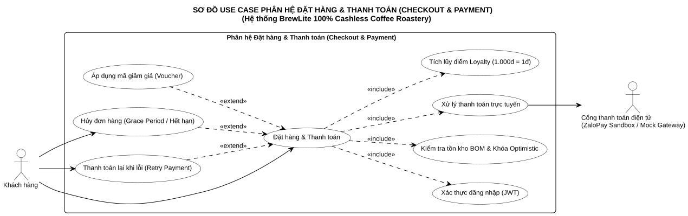

# ĐẶC TẢ USE-CASE TRỌNG TÂM: ĐẶT VÀ THANH TOÁN ĐƠN HÀNG
## BREWLITE: 100% CASHLESS SPECIALTY COFFEE ROASTERY

> **Tài liệu:** `docs/requirements/use-case-checkout.md`  
> **Mã Use-case:** `UC-CHECKOUT` *(hoặc `UC-07` trong sơ đồ tổng thể)*  
> **Học phần:** Công nghệ Phần mềm (Software Engineering) — Assignment 2 (Task 1.3)  
> **Đơn vị đào tạo:** Khoa Công nghệ Thông tin, Trường Đại học Sài Gòn (SGU)  
> **Giảng viên hướng dẫn:** ThS. Từ Lãng Phiêu  
> **Nhóm thực hiện:** Nhóm BrewLite (6 thành viên):
> 1. **Mã Gia Vỹ**
> 2. **Huỳnh Tuấn Kiệt**
> 3. **Nguyễn Gia Thành**
> 4. **Vũ Châu Minh Khôi**
> 5. **Quách Kỳ Minh**
> 6. **Nguyễn Thị Ý**  
> **Phiên bản:** v1.1 (Đồng bộ toàn diện Assignment 2, bổ sung Sơ đồ Checkout, Trigger, Postconditions & Ngoại lệ Timeout 15p)  
> **Trạng thái:** Hoàn tất nghiệm thu (Approved & Baselined)

---

## 1. SƠ ĐỒ USE-CASE PHÂN HỆ ĐẶT HÀNG & THANH TOÁN (CHECKOUT SCOPE)

> **Tệp mã nguồn PlantUML:** [`docs/diagrams/checkout-use-case.puml`](../diagrams/checkout-use-case.puml)  
> **Ảnh kết xuất Vector SVG:** [`docs/diagrams/checkout-use-case.svg`](../diagrams/checkout-use-case.svg)  
> **Ảnh kết xuất PNG:** [`docs/diagrams/checkout-use-case.png`](../diagrams/checkout-use-case.png)

### 1.1. Sơ đồ Use-Case chuẩn UML (Monochrome — Đen trắng tối giản)



### 1.2. Diễn giải cấu trúc quan hệ trong sơ đồ phân hệ:
* **Tác nhân Khách hàng (Customer):** Tác nhân chính khởi tạo use-case trung tâm **"Đặt hàng & Thanh toán"**, đồng thời có thể chủ động thực hiện **"Hủy đơn hàng"** hoặc **"Thanh toán lại (Retry Payment)"**.
* **Tác nhân Cổng thanh toán điện tử (ZaloPay Sandbox / Mock Gateway):** Tác nhân thứ cấp hỗ trợ xử lý giao dịch tài chính số, kết nối trực tiếp với use-case **"Xử lý thanh toán trực tuyến"**.
* **Quan hệ `<<include>>` (Bắt buộc thực thi):**
  - **Xác thực đăng nhập (JWT):** Bắt buộc phải có token JWT hợp lệ trước khi tạo đơn và thanh toán.
  - **Kiểm tra tồn kho BOM & Khóa Optimistic:** Bắt buộc kiểm tra định mức nguyên liệu công thức và khóa phiên bản trước khi trừ kho.
  - **Xử lý thanh toán trực tuyến:** Bắt buộc điều hướng qua ZaloPay QR hoặc cổng giả lập.
  - **Tích lũy điểm Loyalty:** Bắt buộc cộng dồn điểm thưởng vào hồ sơ khách hàng ngay khi đơn chuyển trạng thái `PAID`.
* **Quan hệ `<<extend>>` (Mở rộng theo điều kiện):**
  - **Áp dụng mã giảm giá (Voucher):** Mở rộng khi khách hàng sở hữu mã khuyến mãi hợp lệ.
  - **Hủy đơn hàng:** Mở rộng khi khách chủ động hủy trong thời gian ân hạn 5 phút hoặc khi đơn quá hạn 15 phút.
  - **Thanh toán lại khi lỗi:** Mở rộng khi giao dịch bị từ chối chuyển sang `PAYMENT_FAILED`.

---

## 2. THÔNG TIN TỔNG QUAN (METADATA)

| Thuộc tính | Chi tiết đặc tả |
| :--- | :--- |
| **Mã định danh** | `UC-CHECKOUT` *(hoặc `UC-07`)* |
| **Tên Use-case** | **Đặt món và Thanh toán không dùng tiền mặt (Cashless Order & Checkout)** |
| **Tác nhân chính (Primary Actor)** | **Khách hàng (Customer)** — Người dùng đã chọn món vào giỏ hàng và tiến hành đặt hàng. |
| **Tác nhân hỗ trợ (Supporting Actors)** | • **Cổng thanh toán điện tử (ZaloPay Sandbox & Mock Payment Gateway)**: Xử lý giao dịch mã QR, ví điện tử hoặc thẻ ngân hàng.<br>• **Hệ thống cơ sở dữ liệu (PostgreSQL)**: Thẩm định giá gốc, kiểm tra khóa lạc quan BOM và ghi nhận đơn hàng. |
| **Sự kiện kích hoạt (Trigger)** | Khách hàng nhấn nút **"Tiến hành đặt hàng" (Proceed to Checkout)** từ màn hình Giỏ hàng hoặc trang chi tiết giỏ món. |
| **Mức độ ưu tiên** | `MUST HAVE` (Nghiệp vụ sống còn của hệ thống). |
| **Liên kết yêu cầu chức năng (FR)** | `FR-03` (Giỏ hàng), `FR-04` (Xác thực JWT & RBAC), `FR-05` (Đặt đơn & Optimistic Lock), `FR-06` (Thanh toán ZaloPay/Mock & Idempotency), `FR-07` (Voucher & Loyalty), `FR-13` (Hủy đơn hàng & Hoàn tồn kho). |

---

## 3. TIỀN ĐIỀU KIỆN VÀ HẬU ĐIỀU KIỆN (PRE & POST CONDITIONS)

### 3.1. Tiền điều kiện (Pre-conditions)
1. Giỏ hàng của khách hàng trên ứng dụng có ít nhất 1 sản phẩm hợp lệ (`cart.items.length > 0`).
2. Các sản phẩm trong giỏ hàng còn đủ nguyên liệu/tồn kho định mức (BOM Recipe) trong cơ sở dữ liệu để phục vụ.
3. Khách hàng đã đăng nhập tài khoản hợp lệ và sở hữu JWT Token chưa hết hạn (nếu chưa đăng nhập hoặc token hết hạn, hệ thống yêu cầu xác thực trước khi tiếp tục đặt hàng).
4. Hệ thống Backend (NestJS API) và Cơ sở dữ liệu (PostgreSQL) đang hoạt động bình thường, sẵn sàng kết nối.

### 3.2. Hậu điều kiện (Post-conditions)
* **Trường hợp thành công (Success Post-condition):**
  - Đơn hàng được tạo và chuyển sang trạng thái `PAID`.
  - Tồn kho nguyên liệu (BOM) tương ứng của từng món được trừ chính xác khỏi cơ sở dữ liệu PostgreSQL trong Database Transaction ACID.
  - Giao dịch thanh toán được ghi nhận kèm mã giao dịch `transactionId` và khóa định danh duy nhất `Idempotency-Key`.
  - Tài khoản khách hàng được cộng điểm thưởng Loyalty theo tỷ lệ chuẩn: **1.000đ = 1 điểm Hạt Vàng**.
  - Lượt sử dụng mã voucher (nếu có) bị giảm 1 đơn vị.
  - Giỏ hàng phía Client được dọn sạch (`cart.items = []`).
  - Màn hình chuyển hướng sang trang **Xác nhận & Theo dõi tiến trình đơn hàng** (`/orders/:id`), khởi động Polling cập nhật tiến độ quầy bar KDS.
* **Trường hợp thất bại (Failure Post-condition):**
  - Tồn kho nguyên liệu BOM giữ chỗ tạm thời được hoàn trả lại cơ sở dữ liệu (hoặc giao dịch DB Rollback toàn bộ).
  - Đơn hàng chuyển sang trạng thái `PAYMENT_FAILED` hoặc bị hủy `CANCELLED`.
  - Giỏ hàng của khách hàng được giữ nguyên vẹn để khách có thể thử lại bằng phương thức thanh toán khác.
  - Khách hàng nhận được thông báo lỗi rõ ràng, lịch sự.

---

## 4. LUỒNG SỰ KIỆN CHI TIẾT (FLOW OF EVENTS)

```
┌──────────┐            ┌────────────┐            ┌───────────┐            ┌──────────────────────┐
│ Customer │            │ Next.js UI │            │ NestJS BE │            │ ZaloPay / Mock GW    │
└────┬─────┘            └─────┬──────┘            └─────┬─────┘            └──────────┬───────────┘
     │                        │                         │                             │
     │ 1. Nhấn Checkout       │                         │                             │
     │───────────────────────>│                         │                             │
     │                        │ 2. Kiểm tra Auth JWT    │                             │
     │                        │──┐                      │                             │
     │                        │  │ Token hợp lệ         │                             │
     │                        │<─┘                      │                             │
     │                        │ 3. POST /orders (Draft) │                             │
     │                        │────────────────────────>│                             │
     │                        │                         │ 4. Transaction:             │
     │                        │                         │    - Validate giá gốc       │
     │                        │                         │    - Trừ tồn kho BOM        │
     │                        │                         │    - Tạo đơn PENDING        │
     │                        │                         │──┐                          │
     │                        │                         │  │ Dual Optimistic Lock     │
     │                        │                         │<─┘                          │
     │                        │ 5. Đơn PENDING (201)    │                             │
     │                        │<────────────────────────│                             │
     │ 6. Chọn PT & Bấm Trả   │                         │                             │
     │───────────────────────>│                         │                             │
     │                        │ 7. POST /payments/pay   │                             │
     │                        │    [Idempotency-Key]    │                             │
     │                        │────────────────────────>│                             │
     │                        │                         │ 8. Gửi yêu cầu trừ tiền     │
     │                        │                         │────────────────────────────>│
     │                        │                         │ 9. Trả về SUCCESS           │
     │                        │                         │<────────────────────────────│
     │                        │                         │ 10. Update PAID, +Loyalty   │
     │                        │ 11. Thanh toán OK (200) │                             │
     │                        │<────────────────────────│                             │
     │ 12. Theo dõi đơn hàng  │                         │                             │
     │<───────────────────────│                         │                             │
```

### 4.1. Luồng chính (Basic Flow — Happy Path)
1. **Khách hàng** nhấn nút "Xem giỏ hàng" và bấm "Tiến hành đặt hàng" từ giao diện Next.js.
2. **Next.js Frontend** kiểm tra trạng thái xác thực: Phát hiện JWT Token hợp lệ lưu tại Zustand AuthStore.
3. **Next.js Frontend** chuyển người dùng đến màn hình Thanh toán (`/checkout`), hiển thị tóm tắt đơn hàng:
   - Danh sách món kèm tùy chọn (Size, Topping, Ghi chú đường/đá).
   - Tạm tính tiền món (Subtotal) và Tổng thanh toán trọn gói (đã bao gồm thuế phí theo giá niêm yết, không phát sinh VAT riêng).
   - Ô nhập mã giảm giá (Voucher).
   - Lựa chọn phương thức thanh toán: Cổng ZaloPay QR Sandbox, Ví điện tử (`E_WALLET`) hoặc Thẻ ngân hàng (`BANK_CARD`).
4. **Khách hàng** chọn phương thức thanh toán và nhấn **"Xác nhận đặt hàng và Thanh toán"**.
5. **Next.js Frontend** tạo một chuỗi khóa định danh duy nhất `Idempotency-Key` (UUIDv4), vô hiệu hóa nút bấm để chống bấm đúp, và gửi request `POST /orders` kèm header `Authorization: Bearer <token>` và `Idempotency-Key`.
6. **NestJS API** tiếp nhận request:
   - `JwtAuthGuard` giải mã token, xác thực danh tính khách hàng.
   - Thẩm định tính hợp lệ của DTO (`CreateOrderDto`).
7. **NestJS API** mở một **PostgreSQL Database Transaction** có mức cô lập cao:
   - Truy vấn giá gốc thực tế của từng sản phẩm, size và topping từ cơ sở dữ liệu (không phụ thuộc vào giá client gửi lên).
   - Kiểm tra tồn kho nguyên liệu (BOM Ingredients) bằng cơ chế **Optimistic Concurrency Control**.
   - Trừ số lượng tồn kho của nguyên liệu tương ứng.
   - Tạo bản ghi `Order` với trạng thái `PENDING`.
8. **NestJS API** chuyển giao dịch sang dịch vụ thanh toán `PaymentsService`:
   - Gửi yêu cầu trừ tiền tới Cổng thanh toán ZaloPay Sandbox hoặc Mock Payment Gateway.
9. **Cổng thanh toán** xử lý trừ tiền và trả về kết quả `SUCCESS` kèm mã giao dịch `transactionId`.
10. **NestJS API** cập nhật giao dịch trong cùng Transaction:
    - Chuyển trạng thái đơn hàng sang `PAID`.
    - Tạo bản ghi thanh toán `Payment` lưu trữ `transactionId`, `amount`, `paymentMethod`.
    - Tính và cộng điểm thưởng Loyalty cho khách hàng theo tỷ lệ: `points = Math.floor(finalAmount / 1000)`.
    - Cập nhật số lượt sử dụng của Voucher (nếu có).
    - Commit Transaction vào Database.
11. **NestJS API** trả về mã `201 Created` kèm thông tin đơn hàng đã thanh toán.
12. **Next.js Frontend** nhận phản hồi thành công:
    - Xóa sạch giỏ hàng hiện tại trong Zustand Store và `localStorage`.
    - Điều hướng khách hàng sang màn hình chi tiết đơn hàng (`/orders/:orderId`).
    - Khởi động cơ chế Polling (3-5 giây/lần) để khách theo dõi Barista chuẩn bị món tại quầy bar.

---

### 4.2. Các luồng thay thế (Alternative Flows)

#### A1: Khách hàng áp dụng mã giảm giá (Voucher) hợp lệ
* Tại Bước 3 của Luồng chính:
  1. Khách hàng nhập mã giảm giá (ví dụ: `BREWLITE10` hoặc `WELCOME20`) và bấm "Áp dụng".
  2. Frontend gửi request `POST /vouchers/validate` đến Backend.
  3. Backend kiểm tra mã: tồn tại trong DB, còn thời hạn, chưa hết lượt sử dụng và đơn đạt giá trị tối thiểu.
  4. Backend trả về thông tin giảm giá. Frontend tính toán lại tổng tiền hiển thị: `Tổng thanh toán = Tạm tính - Giảm giá`.
  5. Tiếp tục Bước 4 của Luồng chính.

#### A2: Khách hàng hủy đơn trong thời gian ân hạn 5 phút (Grace Period Cancellation)
* Sau khi đơn hàng đã chuyển sang trạng thái `PAID` nhưng Barista chưa bấm chuyển `PREPARING`:
  1. Khách hàng bấm nút "Hủy đơn hàng" trên màn hình chi tiết đơn.
  2. Frontend gửi `PATCH /orders/:id/cancel`.
  3. Backend kiểm tra: thời gian kể từ lúc thanh toán $\le 5$ phút và trạng thái đơn đang là `PAID`.
  4. Backend chuyển đơn sang `CANCELLED` và tự động cộng hoàn trả tồn kho nguyên liệu BOM đã trừ trước đó.
  5. Màn hình cập nhật trạng thái đã hủy đơn thành công.

#### A3: Thanh toán thất bại và Thử lại (Retry Payment)
* Khi đơn hàng chuyển sang trạng thái `PAYMENT_FAILED` do thẻ lỗi hoặc khách bấm thử lại:
  1. Màn hình thanh toán hiển thị thông báo lỗi kèm danh sách các phương thức thanh toán khác.
  2. Khách hàng chọn phương thức thanh toán mới (ví dụ: chuyển từ thẻ ngân hàng sang ZaloPay QR).
  3. Frontend gửi request thanh toán lại cho đơn hàng hiện tại với `Idempotency-Key` mới.
  4. Hệ thống thực thi quy trình thanh toán từ Bước 8 của Luồng chính.

---

### 4.3. Các luồng ngoại lệ (Exception Flows)

#### E1: Khách hàng chưa đăng nhập khi bấm Checkout
* Tại Bước 2 của Luồng chính:
  1. Frontend phát hiện không có JWT Token trong AuthStore.
  2. Frontend hiển thị thông báo yêu cầu đăng nhập và tự động điều hướng sang trang `/auth/login?redirect=/checkout`.
  3. Sau khi khách đăng nhập thành công, Frontend tự động chuyển hướng khách hàng quay trở lại trang `/checkout` với đầy đủ các món trong giỏ hàng được bảo lưu nguyên vẹn.

#### E2: Xung đột hết hàng đồng thời (Optimistic Locking Conflict / Out of Stock)
* Tại Bước 7 của Luồng chính:
  1. Trong lúc khách đang thao tác, một khách hàng khác đã hoàn tất mua hết số lượng nguyên liệu của món đó.
  2. Khi Backend thực thi truy vấn cập nhật với điều kiện `version = current_version`, số dòng cập nhật trả về là 0 (hoặc tồn kho không đủ).
  3. Transaction tự động Rollback toàn bộ.
  4. Backend trả về mã lỗi HTTP `409 Conflict` kèm thông báo: *"Một số nguyên liệu trong đơn hàng của bạn vừa hết suất phục vụ. Vui lòng chọn món khác!"*.
  5. Frontend bắt lỗi, hiển thị Toast cảnh báo đỏ và giữ nguyên giỏ hàng để khách hàng điều chỉnh.

#### E3: Thanh toán thất bại từ Cổng thanh toán (Payment Failed)
* Tại Bước 9 của Luồng chính:
  1. Cổng thanh toán (ZaloPay Sandbox hoặc Mock) trả về lỗi (ví dụ: Số dư không đủ, Thẻ hết hạn, mã mô phỏng ngẫu nhiên trả về FAILURE).
  2. Backend cập nhật đơn hàng sang trạng thái `PAYMENT_FAILED`.
  3. Backend thực hiện hoàn trả lại tồn kho nguyên liệu đã giữ chỗ tạm thời trong Database.
  4. Backend trả về lỗi HTTP `400 Bad Request` kèm thông báo: *"Thanh toán không thành công. Giao dịch đã bị từ chối bởi ngân hàng."*.
  5. Frontend hiển thị màn hình thông báo lỗi thanh toán kèm nút "Thử lại bằng phương thức khác". Giỏ hàng của khách vẫn được giữ nguyên.

#### E4: Gửi trùng request do mạng lag (Idempotency Collision)
* Tại Bước 5 của Luồng chính:
  1. Do mạng chập chờn, khách hàng bấm liên tiếp 2 lần hoặc client tự động retry request với cùng một `Idempotency-Key`.
  2. Backend phát hiện `Idempotency-Key` này đã được tiếp nhận và xử lý trong bảng `idempotency_records`.
  3. Backend lập tức chặn đứng việc tạo thêm bản ghi thứ 2, trả về đúng kết quả và `orderId` của giao dịch trước đó kèm cờ `isIdempotent: true`.
  4. Đảm bảo tài khoản khách hàng tuyệt đối không bao giờ bị trừ tiền 2 lần.

#### E5: Đơn hàng PENDING hết hạn thanh toán sau 15 phút (Order Timeout Expiration)
* Đơn hàng ở trạng thái `PENDING` nhưng khách hàng không hoàn tất thanh toán:
  1. Tiến trình ngầm định kỳ (Scheduled Job `FR-11`) quét cơ sở dữ liệu và phát hiện đơn hàng đã tạo quá **15 phút**.
  2. Hệ thống tự động chuyển trạng thái đơn hàng sang `CANCELLED`.
  3. Hệ thống hoàn trả toàn bộ số lượng nguyên liệu BOM đã giữ chỗ cho đơn hàng vào kho `Ingredient`.
  4. Nếu sau 15 phút khách hàng mới gửi request thanh toán, Backend từ chối xử lý với thông báo: *"Đơn hàng đã hết thời hạn thanh toán (15 phút). Vui lòng đặt lại đơn mới!"*.

#### E6: Vi phạm máy trạng thái đơn hàng (State Machine Violation)
* Xảy ra khi có yêu cầu chuyển đổi trạng thái trái phép (ví dụ: chuyển từ `READY` về `PENDING`, hoặc cố thanh toán lại đơn hàng đã `CANCELLED`):
  1. Hàm `assertTransition` trong `state-machine.helper.ts` phát hiện chuyển tiếp không nằm trong danh sách `ALLOWED_TRANSITIONS`.
  2. Backend ném ngoại lệ `BadRequestException` kèm mã HTTP `400 Bad Request`.
  3. Hệ thống bảo toàn tính toàn vẹn, giữ nguyên trạng thái hợp lệ hiện tại của đơn hàng.

---

## 5. MA TRẬN ÁNH XẠ TIÊU CHÍ NGHIỆM THU (TRACEABILITY MAPPING)

| Thành phần của Use-Case | Yêu cầu chức năng tương ứng | Code hiện thực (NestJS / Next.js) | Kịch bản kiểm thử tự động (9 Test Suites) |
| :--- | :--- | :--- | :--- |
| Xác thực JWT trước khi đặt | `FR-04` | `JwtAuthGuard`, `useAuthStore.ts` | `auth.service.spec.ts` (6/6 tests) |
| Thẩm định giỏ & Tính giá gốc | `FR-03`, `FR-05` | `orders.service.ts` -> `calculateTotal()` | `orders.service.spec.ts` (17/17 tests) |
| Trừ tồn kho Optimistic Lock | `FR-05` | `orders.service.ts` -> `tx.ingredient.update()` | `orders.service.spec.ts` (Optimistic Lock Test) |
| Thanh toán ZaloPay Sandbox | `FR-06` | `zalopay.service.ts`, `zalopay.controller.ts` | `zalopay.service.spec.ts` (4/4 tests), `zalopay.controller.spec.ts` (6/6 tests) |
| Thanh toán Mock & Idempotency | `FR-06` | `payments.service.ts`, `mock-payment.service.ts` | `payments.service.spec.ts` (21/21 tests) |
| Quản lý Hủy đơn & State Guard | `FR-13` | `state-machine.helper.ts` -> `assertTransition()` | `orders.controller.spec.ts` (3/3 tests) |
| Tích lũy điểm Loyalty & Voucher | `FR-07` | `payments.service.ts` (1.000đ = 1 điểm) | `payments.service.spec.ts` (Loyalty & Voucher Test) |
| Tự hủy đơn quá hạn 15 phút | `FR-11` | `orders.service.ts` -> `cancelExpiredOrders()` | `inventory.service.spec.ts` (8/8 tests) |
